# Guía de uso para coordinación, administración y monitoreo

Esta guía explica cómo usar la plataforma para gestionar el programa Niñas con Oportunidades a
nivel nacional: revisar indicadores, mantener los padrones de estudiantes, docentes, colegios y
gestores, y configurar la malla curricular. Las imágenes usan datos de ejemplo.

Los tres perfiles comparten casi todo:

- **Coordinación** y **Administración** ven los siete módulos del menú: Panel Analítico,
  Estudiantes, Egresados, Docentes, Territorio, Gestores y Malla Curricular.
- **Monitoreo** ve los mismos módulos excepto **Gestores**, y no tiene las acciones de importar el
  padrón docente, editar docentes, actualizar el padrón ESCALE ni configurar los parámetros de
  egresadas.

## Ingresar y moverte por la plataforma
pagina: 1
claves: ingresar, iniciar sesión, menú, módulos, coordinación, administración, monitoreo, cerrar sesión

1. Abre la dirección de la plataforma en el navegador e ingresa con tu correo institucional o
   DNI y tu contraseña. Si es tu primer ingreso, la plataforma te pide cambiar la contraseña
   temporal. El paso a paso, y cómo recuperar la contraseña, están en
   [Ingresar a la plataforma](docente.md#ingresar-a-la-plataforma) de la guía docente: la
   pantalla de ingreso es la misma para todos.
2. La plataforma abre el **Panel Analítico**.
3. Usa el menú de la izquierda para cambiar de módulo. En el celular, ábrelo con el botón de las
   tres rayas.
4. Para salir, toca **Cerrar sesión** al final del menú.

## Revisar el panel analítico
pagina: 2
claves: panel analítico, indicadores, cobertura, mapa, avance docente, avance estudiantes, pre test, post test, región, tablero

El **Panel Analítico** resume el avance del programa. Arriba están los filtros (año, región, UGEL,
provincia, distrito, colegio, grado y salón) y debajo cuatro indicadores:

- **I.E. activas**: colegios, salones y gestores en el filtro.
- **Avance docentes**: avance promedio del plan formativo y cuántas docentes están aptas.
- **Avance estudiantes**: sesiones ejecutadas y asistencia.
- **Logro pre → post test**: puntaje promedio de salida y diferencia con el de entrada.

La pestaña **Resumen Multinivel y Mapa** muestra la cobertura por región con un semáforo. Haz clic
en una fila de la tabla para bajar al siguiente nivel (región → UGEL → colegio).

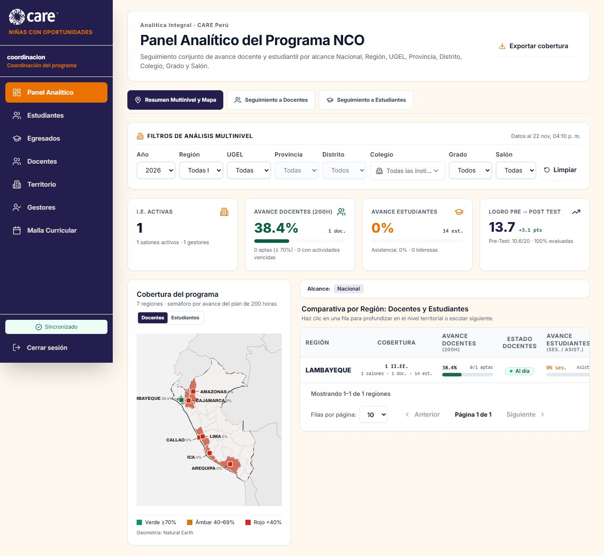

Las pestañas **Seguimiento a Docentes** y **Seguimiento a Estudiantes** muestran el mismo filtro
con el detalle por región y por grado:

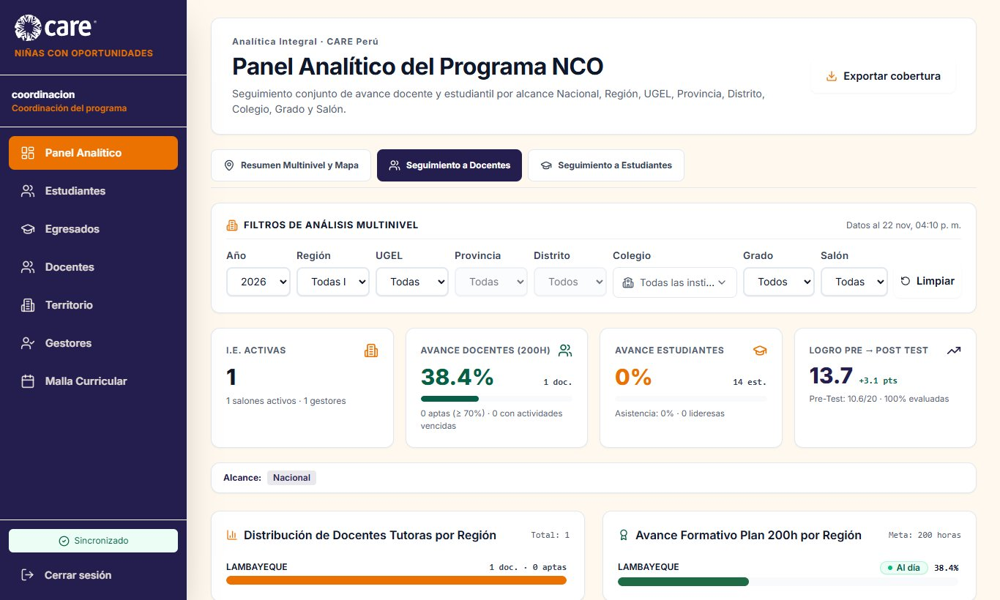

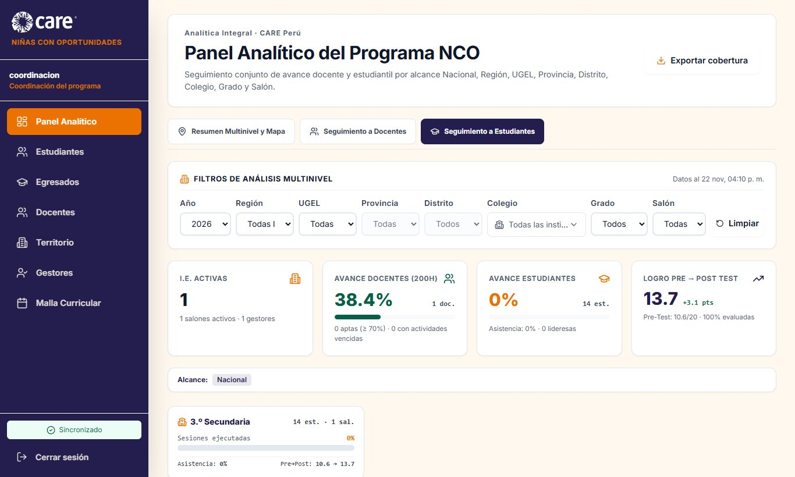

## Exportar la cobertura
pagina: 3
claves: exportar, excel, descargar, reporte, cobertura

Para llevarte los datos del panel a una hoja de cálculo, aplica los filtros que necesites y toca
**Exportar cobertura**.

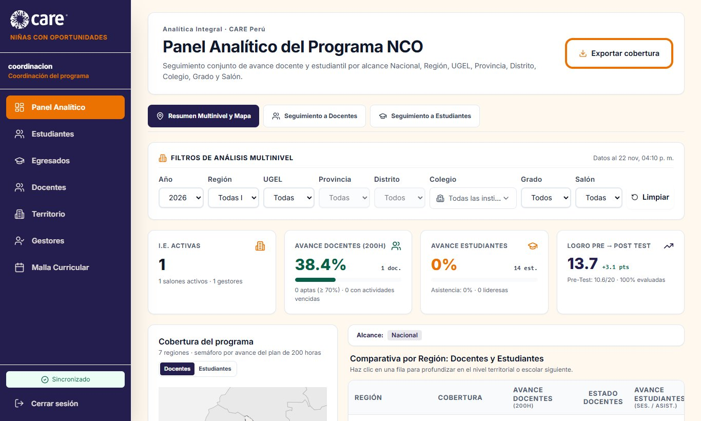

## Consultar el padrón de estudiantes
pagina: 4
claves: padrón de estudiantes, maestro nacional, buscar estudiante, consentimiento, seudonimizado, studentkey, matriz de actividades

En **Estudiantes** está el padrón nacional. Cada estudiante tiene un **StudentKey**: su código
único en el programa (por ejemplo, GUIA-0001), que no cambia aunque cambie de sección o de año.
Puedes buscar por StudentKey, iniciales, DNI o nombres, y filtrar por región, grado, sección, sexo,
año, estado, consentimiento y lideresa.

Por protección de datos personales (Ley N.° 29733), las estudiantes sin consentimiento firmado de
sus padres aparecen **seudonimizadas**: solo con su StudentKey e iniciales, sin nombre ni DNI.

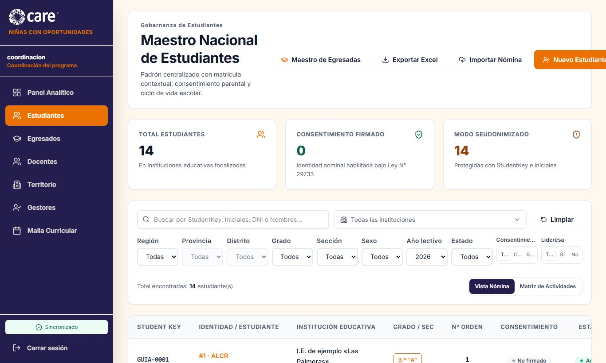

La pestaña **Matriz de Actividades** muestra la asistencia y las notas por sesión. **Exportar
Excel** descarga el listado filtrado.

## Registrar o importar estudiantes
pagina: 5
claves: nuevo estudiante, registrar estudiante, importar nómina, carga masiva, plantilla, dry-run, simulación de validación, matrícula

Para registrar a una estudiante:

1. Toca **Nuevo Estudiante**.
2. Elige la institución educativa, el grado, la sección, el año lectivo y el número de orden.
3. Marca si cuenta con consentimiento informado firmado. Sin consentimiento, la estudiante se
   registra seudonimizada. Con consentimiento, indica también la fecha en que se firmó.
4. Completa sus datos (los campos con asterisco son obligatorios) y toca **Registrar Estudiante**,
   al final de la ventana.

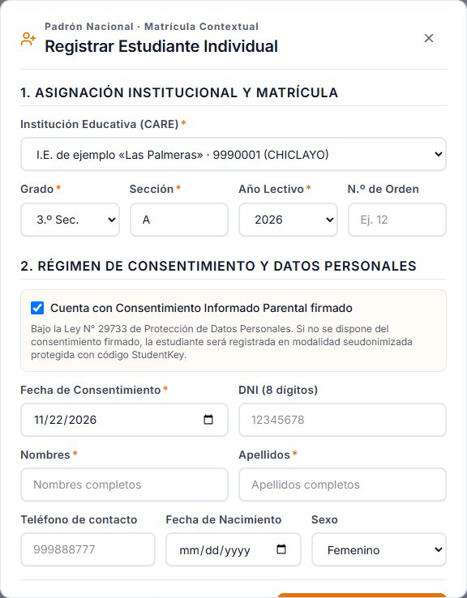

Para cargar una nómina completa:

1. Toca **Importar Nómina**. En la ventana, toca **Descargar Plantilla (.xlsx)**: es el formato
   oficial, con las columnas que la plataforma espera.
2. Llena la plantilla y arrástrala al recuadro punteado de la derecha (o haz clic en él para
   elegirla). Acepta .xlsx o .csv de hasta 10 MB.
3. Toca **Simular Validación (Dry-Run)**. La simulación revisa el archivo **sin grabar nada** y te
   muestra las filas con problemas. Es obligatoria: corrige el archivo y vuelve a simular si hace
   falta.
4. Cuando la simulación no muestre errores, toca **Confirmar e Importar**.

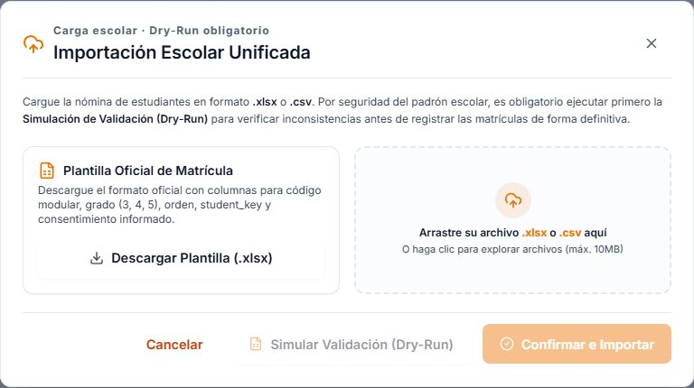

## Hacer seguimiento a las egresadas
pagina: 6
claves: egresadas, egresados, seguimiento post-egreso, hitos, contacto, situación educativa, situación laboral, encuestas

En **Egresados** se hace el seguimiento de las estudiantes después de terminar el colegio. Los
indicadores muestran cuántas fueron contactadas, cuántas siguen estudiando y cuántas trabajan.

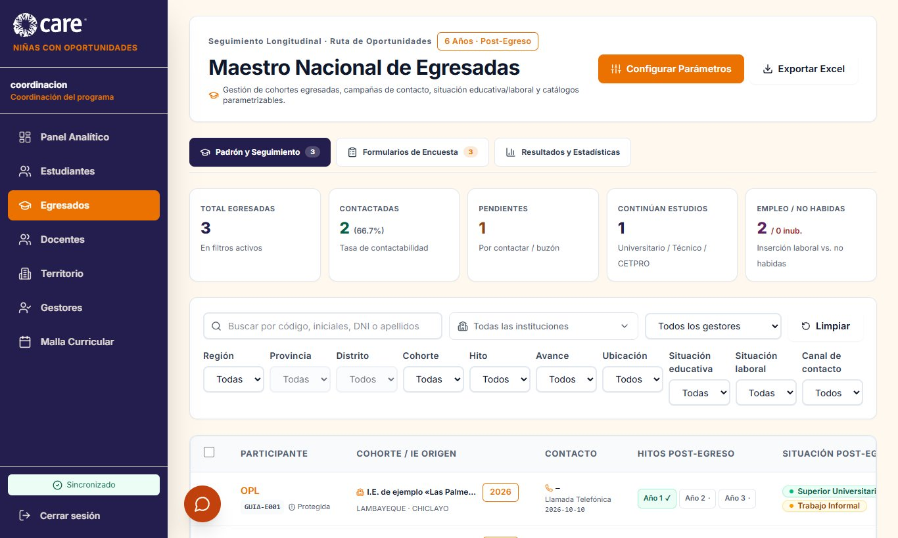

Para registrar un contacto:

1. En la fila de la egresada, toca **Seguimiento** (al final de la fila; desplaza la tabla hacia
   la derecha si no lo ves).
2. Elige el hito (cuántos años pasaron desde que egresó), la fecha, el canal de contacto y si
   fue ubicada.
3. Registra su situación educativa y laboral, y la carrera, institución u ocupación.
4. Completa los campos adicionales y, si aplicaste una encuesta, abre **Encuestas de seguimiento
   aplicadas** y registra sus respuestas.
5. Toca **Registrar Seguimiento**, al final de la ventana.

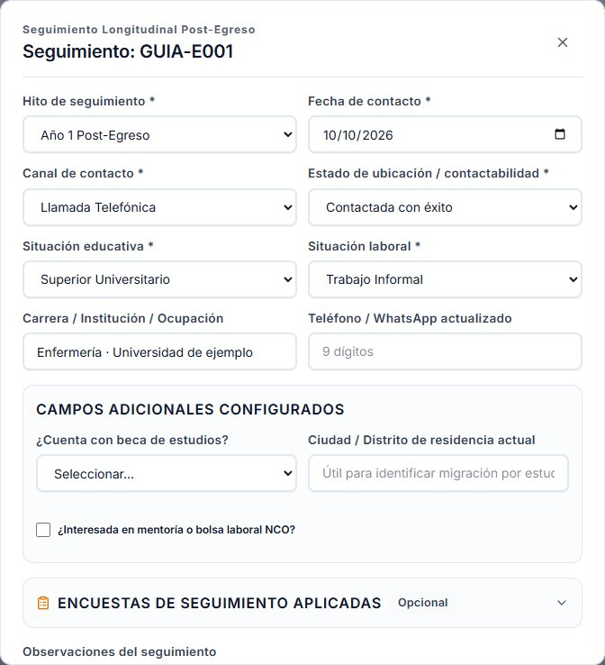

**Configurar Parámetros** (solo coordinación y administración) define los catálogos y campos del
seguimiento.

## Diseñar encuestas y ver resultados de egresadas
pagina: 7
claves: encuestas, formularios de encuesta, crear formulario, resultados, estadísticas, exportar csv

En la pestaña **Formularios de Encuesta** están los cuestionarios de seguimiento. Para crear uno,
toca **Crear Nuevo Formulario**. En cada tarjeta, **Editar** cambia sus preguntas, **Vista Previa**
lo muestra como lo verá quien responde, y los íconos de abajo a la derecha lo clonan o lo pausan.
Los formularios **En Campo** aparecen automáticamente en la ventana de **Seguimiento** de cada
egresada.

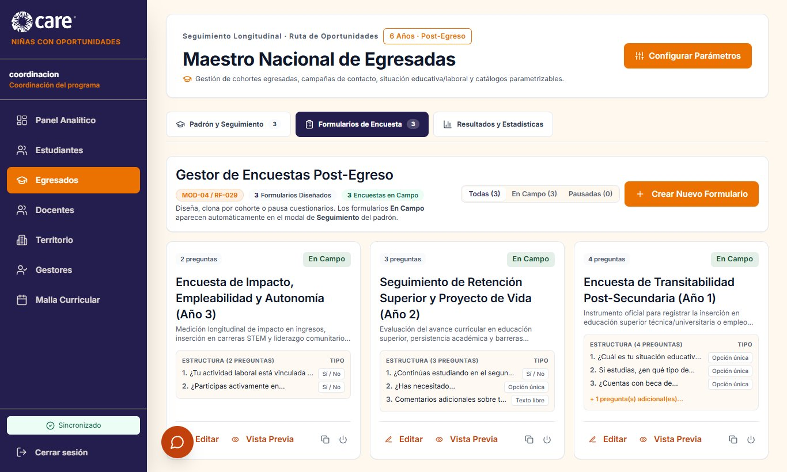

En **Resultados y Estadísticas** eliges una encuesta en **Encuesta a analizar** y ves las
respuestas por pregunta, la cobertura del padrón y la fecha de la última respuesta. **Exportar
CSV** descarga las respuestas. Si la encuesta todavía no tiene respuestas, los indicadores
aparecen en cero y dicen «Sin registros», como en la imagen.

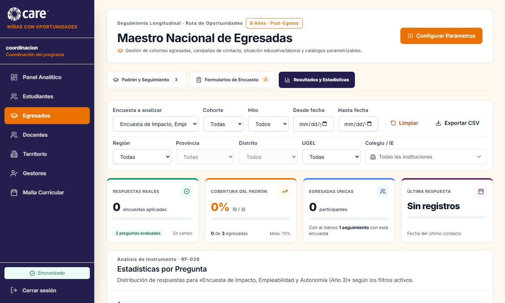

## Gestionar el padrón docente
pagina: 8
claves: padrón docente, nuevo docente, registrar docente, importar padrón, editar docente, tipo de tutoría, cuenta de la docente

En **Docentes** está el padrón de docentes tutoras, con su colegio, ubicación, tipo de tutoría y
estado.

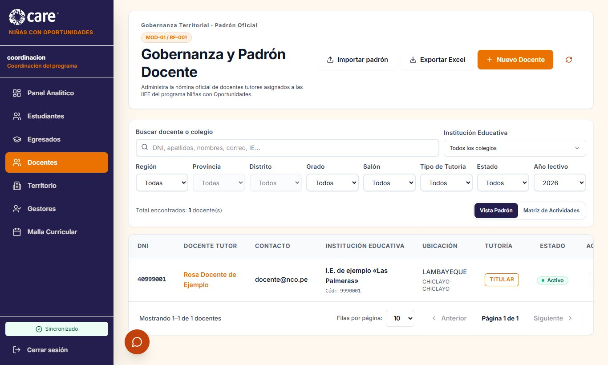

Para registrar a una docente:

1. Toca **Nuevo Docente**.
2. Escribe su DNI, nombres, apellidos, correo y teléfono, y elige el tipo de tutoría y su colegio.
3. Toca **Registrar Docente**. La plataforma crea su cuenta: el usuario y la clave temporal son su
   DNI. En su primer ingreso, la plataforma le pedirá cambiar esa clave por una propia.
4. Envíale a la docente la dirección de la plataforma, su usuario (su DNI) y el enlace a la
   [guía docente](docente.md).

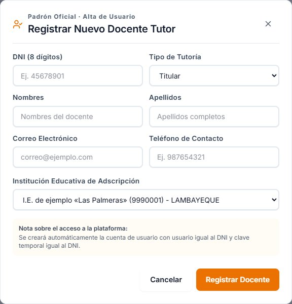

**Importar padrón** carga varias docentes desde un archivo, y el lápiz al final de cada fila edita
sus datos (desplaza la tabla hacia la derecha si no lo ves). Ambas acciones son de coordinación y
administración. La pestaña **Matriz de Actividades**
muestra el avance de cada docente en las actividades del plan formativo:

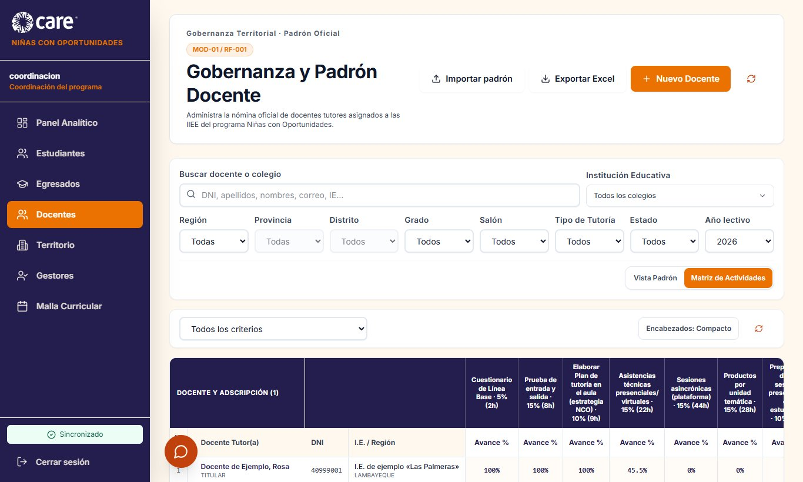

## Ver la ficha de una docente
pagina: 9
claves: ficha docente, detalle docente, avance 200 horas, salones, acompañamiento, historial, perfil

Toca el nombre de una docente para abrir su ficha. Ahí ves su avance en el plan formativo, sus
salones y asistencia, sus calificaciones registradas y sus evidencias, organizados en pestañas:
**Resumen**, **Salones y Pulso del Aula**, **Avance Formativo**, **Acompañamiento y Evidencias**,
**Historial en el Programa** y **Perfil y Datos Personales**.

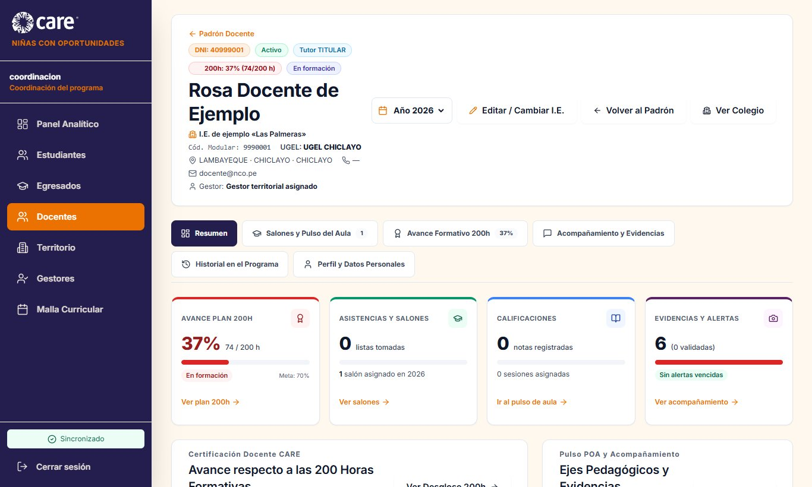

Desde la ficha puedes cambiar el año, editar sus datos o su colegio, y abrir la ficha del colegio.

## Administrar colegios y regiones
pagina: 10
claves: territorio, instituciones educativas, IIEE, regiones, UGEL, ESCALE, padrón territorial, código modular

En **Territorio** está el padrón de instituciones educativas focalizadas, con su código modular,
región, provincia, distrito, UGEL y modalidad. Toca el nombre de un colegio para ver su ficha.

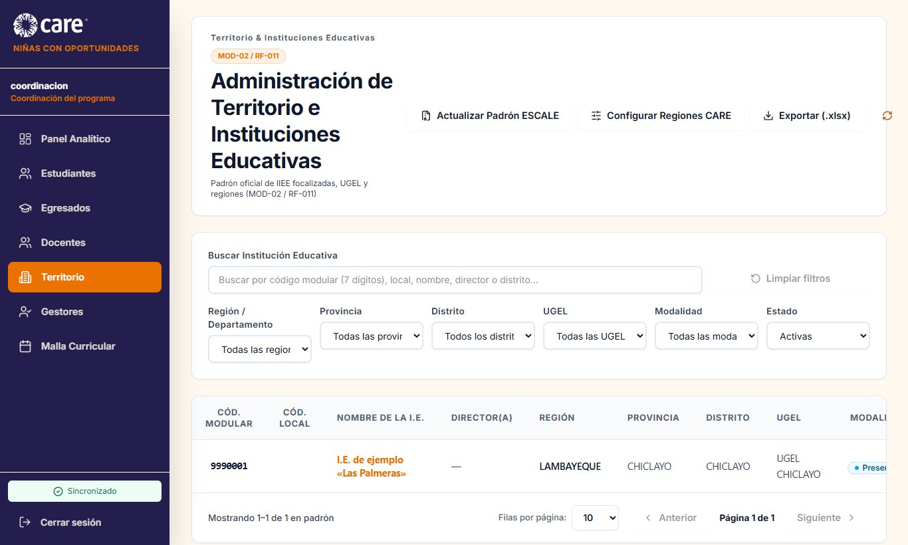

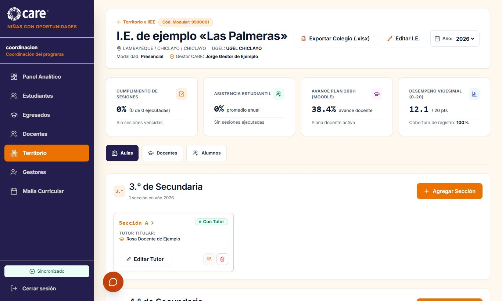

En la ficha del colegio ves el cumplimiento de sesiones, la asistencia, el avance de sus docentes
y su desempeño, con sus aulas, docentes y alumnos en pestañas. Desde la pestaña **Aulas** puedes:

- Crear una sección con **Agregar Sección** (hay un botón por grado).
- Asignar o cambiar la docente tutora de una sección con **Editar Tutor**.

Arriba, **Exportar Colegio (.xlsx)** descarga los datos del colegio y **Editar I.E.** corrige sus
datos.

En **Territorio**, el botón **Configurar Regiones CARE** abre la lista de regiones de
intervención del programa: actívalas o desactívalas con el interruptor de cada una y toca
**Cerrar**. Los colegios de las regiones activas entran en los filtros de toda la plataforma.

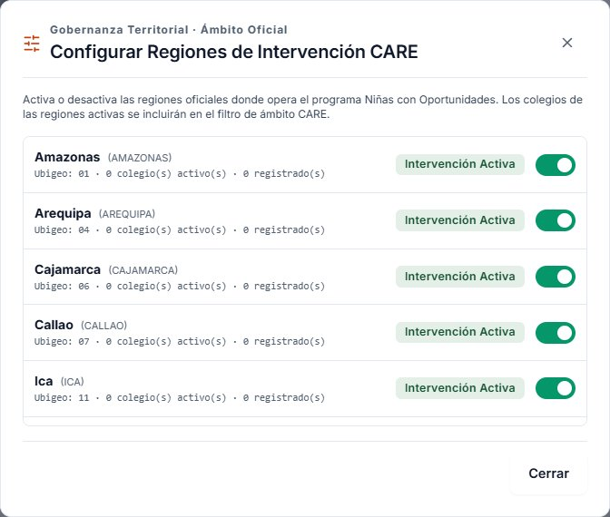

**Actualizar Padrón ESCALE** (coordinación y administración) trae los datos oficiales de colegios
del Ministerio de Educación.

## Gestionar a los gestores territoriales
pagina: 11
claves: gestores, gestor territorial, nuevo gestor, asignar colegios, cartera, asignar territorio

**Gestores** (solo coordinación y administración) lista a los gestores territoriales con los
colegios y docentes a su cargo, y las alertas de atraso.

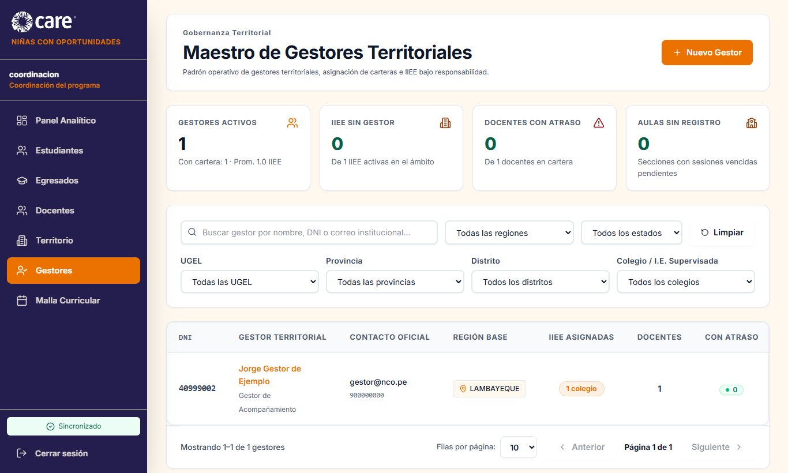

Para registrar a un gestor, toca **Nuevo Gestor**, completa su DNI, teléfono, nombres y correo
institucional, y toca **Registrar Gestor**. Su cuenta se crea con usuario y clave temporal igual a
su DNI; en su primer ingreso la plataforma le pide cambiarla.

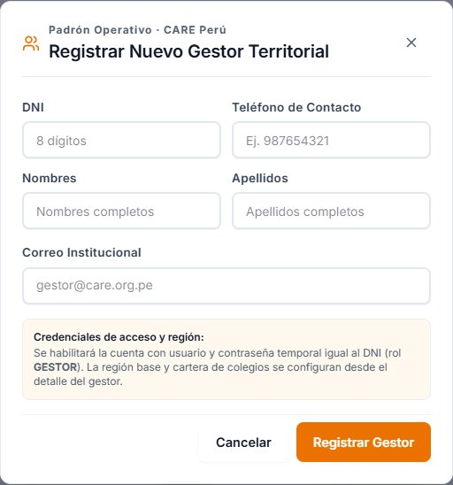

Para asignarle colegios, abre su ficha tocando su nombre y usa **Asignar Territorio / IIEE**.
**Configurar Región / Editar** cambia su región base.

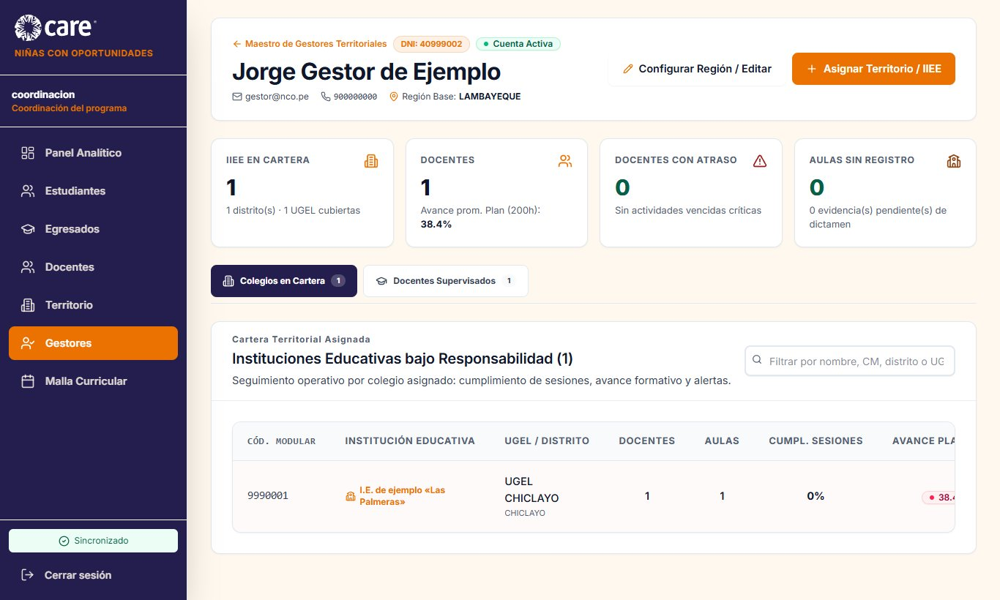

## Configurar las sesiones de la malla curricular
pagina: 12
claves: malla curricular, configurar sesiones, ejes temáticos, plazo máximo, campos, evaluación, clonar malla, grado

En **Malla Curricular**, el selector de arriba a la derecha tiene dos opciones: **Malla Curricular
Estudiantes** (las sesiones de aula) y **Malla Formativa Docente** (el plan de formación, que se
explica en el tema siguiente). En **Malla Curricular Estudiantes** defines las sesiones oficiales
de cada grado para el año: su título, eje temático, plazo máximo y los campos que la docente debe
registrar.

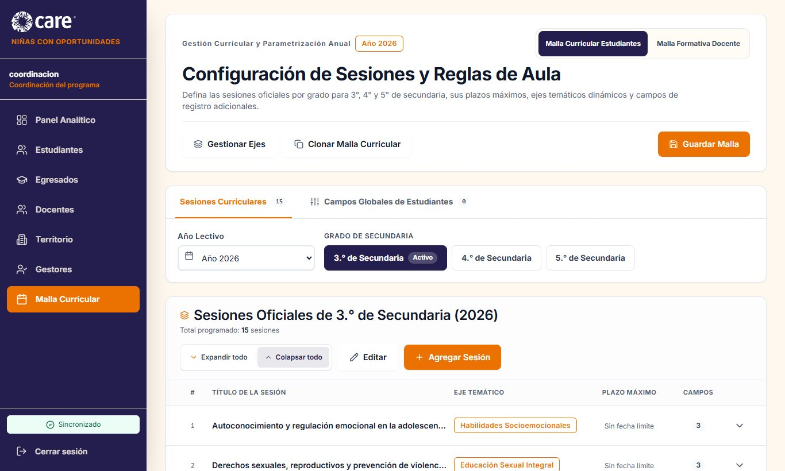

1. Elige el año lectivo y el grado.
2. Toca la flecha de una sesión para ver su configuración (evaluación, evidencias y campos).
3. Para cambiar algo, toca **Editar**; para crear una sesión, **Agregar Sesión**.
4. Toca **Guardar Malla**. Los cambios se aplican a todas las secciones activas de ese grado y año.

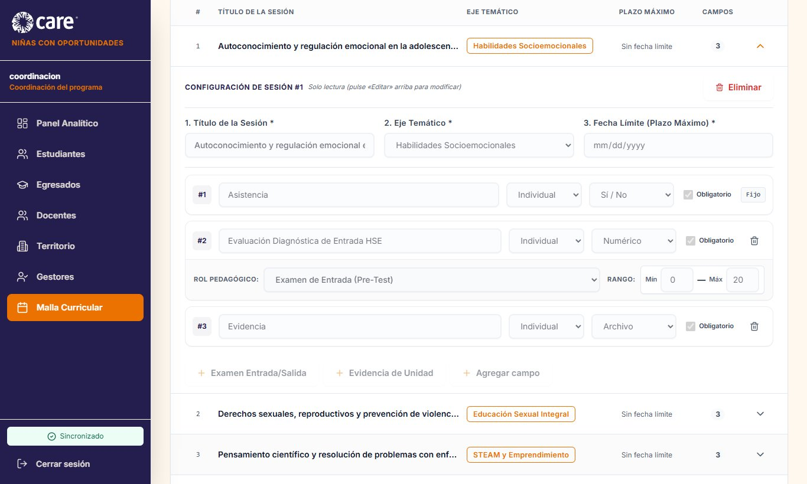

Cada sesión tiene sus campos de registro: el nombre, si es individual o general, el tipo de dato y si
es obligatorio. En una evaluación también defines su **rol pedagógico** (por ejemplo, examen de
entrada o de salida) y su rango de notas: así la plataforma sabe qué notas usar en la evaluación de
impacto. **Examen Entrada/Salida**, **Evidencia de Unidad** y **Agregar campo** añaden campos.

**Gestionar Ejes** crea o renombra los ejes temáticos; los cambios se reflejan en las sesiones
asociadas. **Clonar Malla Curricular** copia la malla de un grado a otro, o de un año lectivo a otro.

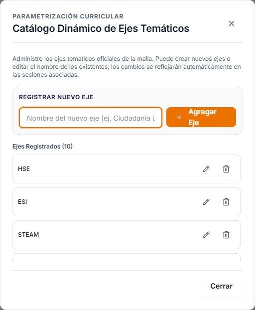

## Configurar el plan formativo docente
pagina: 13
claves: malla formativa docente, criterios de aprobación, umbral, horas de certificación, ponderación, moodle, actividades formativas, sincronizar moodle

En **Malla Curricular** → **Malla Formativa Docente** defines cómo se aprueba el plan formativo de
las docentes de cada cohorte:

- El **umbral de aprobación** y las **horas totales de certificación** (toca **Guardar Umbral y
  Horas**).
- Los **criterios de aprobación**, con su peso porcentual (deben sumar 100 %) y sus actividades.
  **Nuevo Criterio** y **Nueva Actividad** los crean. **Distribuir equitativamente** reparte los
  pesos por igual. Después de cambiar los pesos, toca **Guardar Pesos de Criterios**: si no, los
  cambios se pierden.
- **Importar catálogo de Moodle** y **Sincronizar avances Moodle** traen las actividades y el
  avance de las docentes desde el aula virtual.

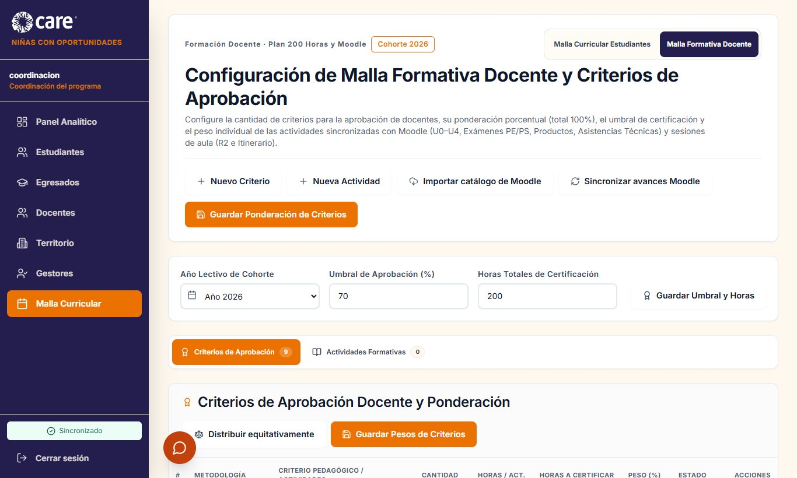

Lo que configures aquí es lo que ven las docentes en **Mi Formación**.

## Revisar la bitácora del asistente
pagina: 14
claves: bitácora, asistente, consultas IA, preguntas de docentes, registro de consultas

La **Bitácora de Consultas IA** registra las preguntas que las docentes hacen al asistente
curricular: la fecha, el usuario, la pregunta y el eje de la guía que respondió. Sirve para ver
qué temas consultan más. Puedes buscar por pregunta, sesión o usuario. Coordinación y monitoreo la
pueden abrir. Cada usuario aparece con su código interno (por ejemplo, UID-6), no con su nombre.

Esta pantalla todavía no tiene botón en el menú. Para abrirla, en la barra de direcciones del
navegador cambia lo que va después del nombre de la plataforma por **/asistente/bitacora** y presiona Enter.
Por ejemplo, `plataforma.ejemplo.pe/analitica/cobertura` pasa a ser `plataforma.ejemplo.pe/asistente/bitacora`. Guárdala
en tus favoritos para volver con un clic.

Por ahora las columnas de modelo y latencia aparecen como «Pendiente BE», y arriba hay un recuadro
con una nota técnica para el equipo de desarrollo: puedes ignorarlo. Esos datos se guardan, pero
la pantalla todavía no los muestra.

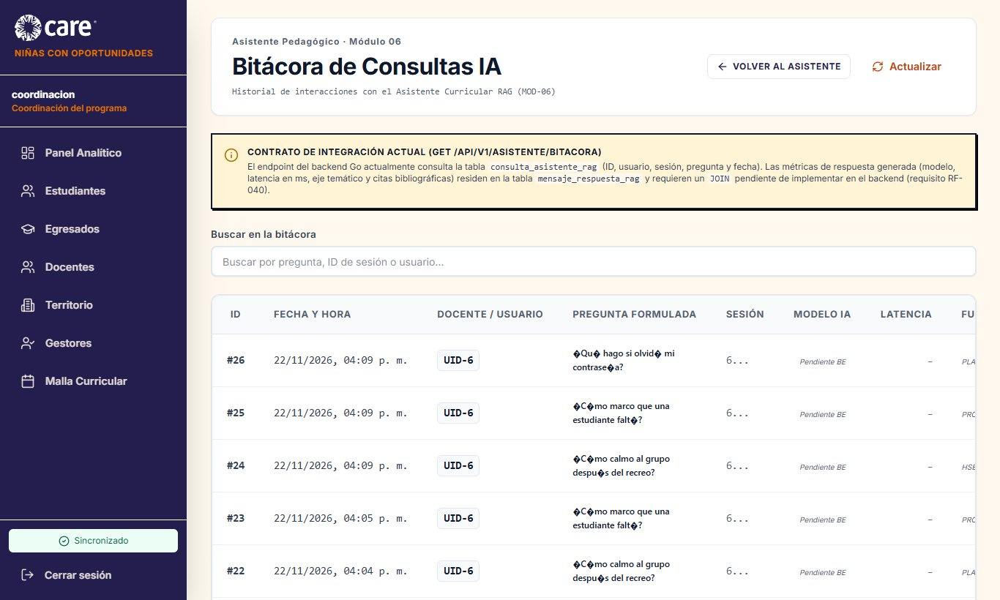
