# Guía de uso de la plataforma para docentes

Esta guía explica, paso a paso, cómo usar la plataforma del programa Niñas con Oportunidades
en tu trabajo como docente tutora: registrar tus sesiones en el aula, hacer seguimiento a tus
estudiantes y revisar tu avance de formación. Las imágenes usan un colegio y estudiantes de
ejemplo; en tu cuenta verás tu colegio y tu sección.

Si eres **cotutora o cotutor**, esta guía también es para ti: tienes el mismo menú y las mismas
pantallas que la docente titular.

**¿Dudas mientras usas la plataforma?** Toca el botón naranja de la esquina inferior izquierda
para preguntarle al asistente curricular: conoce esta guía, te responde con el paso a paso y te
lleva al tema. Más detalles en [Consultar al asistente curricular](#consultar-al-asistente-curricular).

## Ingresar a la plataforma
pagina: 1
claves: ingresar, iniciar sesión, login, entrar, usuario, contraseña, correo, DNI, acceso

Para entrar a la plataforma necesitas tres datos que te entrega tu gestor territorial o la
coordinación del programa: la **dirección de la plataforma** (empieza con `https://`), tu
**usuario** (tu correo institucional o tu DNI) y tu **contraseña**. Si te acaban de crear la
cuenta, tu contraseña inicial es tu número de DNI.

1. Abre el navegador de tu celular o computadora (por ejemplo, Chrome), escribe la dirección de
   la plataforma en la barra de arriba y presiona Enter.
2. En **Correo o DNI**, escribe tu correo institucional o tu número de DNI.
3. En **Contraseña**, escribe tu clave. Puedes tocar el ícono del ojo para ver lo que escribiste.
4. Toca **Ingresar**. La plataforma te lleva a tu **Panel de inicio**.

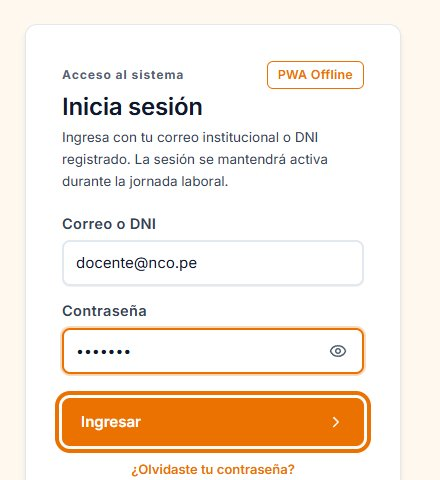

**La primera vez** que ingresas con la contraseña inicial, la plataforma te pide cambiarla: aparece
el aviso «Cambia la contraseña temporal para continuar». Escribe una contraseña nueva de al menos
8 caracteres en los dos campos y toca **Cambiar contraseña e ingresar**. Desde ese momento usa la
contraseña nueva.

Tu sesión se mantiene abierta durante la jornada. Si escribes mal la contraseña, verás el
mensaje «Credenciales incorrectas»: revisa que no tengas activadas las mayúsculas.

En el celular, puedes guardar la plataforma como una aplicación: en el menú del navegador (los
tres puntos de Chrome) toca **Agregar a la pantalla principal**. Así la abres con un toque, como
cualquier otra aplicación.

## Recuperar tu contraseña
pagina: 2
claves: olvidé mi contraseña, recuperar contraseña, restablecer clave, cambiar contraseña, token, no puedo entrar

Si olvidaste tu contraseña, puedes crear una nueva sin pedir ayuda. Necesitas acceso a tu correo
institucional.

1. En la pantalla de ingreso, toca **¿Olvidaste tu contraseña?** (debajo del botón Ingresar).
2. En la ventana **Recuperar contraseña**, escribe tu correo institucional o tu DNI y toca
   **Enviar instrucciones**.
3. Abre tu correo. Te llegará un mensaje de la plataforma con el botón **Restablecer
   contraseña**. Tócalo: se abre la plataforma.
4. Escribe tu nueva contraseña dos veces y confírmala. Luego ingresa con ella.

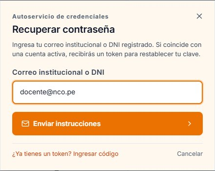

El enlace del correo **vence a los 15 minutos**. Si venció, vuelve a pedirlo desde el paso 1.
Si no te llega el correo en unos minutos, revisa la carpeta de correo no deseado o comunícate
con tu gestor territorial.

Si en lugar del botón recibiste un código (token), vuelve a abrir **¿Olvidaste tu contraseña?**,
toca **¿Ya tienes un token? Ingresar código**, pega el código y escribe tu nueva contraseña.

## Conocer tu panel de inicio
pagina: 3
claves: inicio, panel de inicio, pantalla principal, resumen, sesión del día, sesión prioritaria, plan formativo, estudiantes del salón

El **Panel de inicio** es lo primero que ves al ingresar. Reúne lo más importante del día:

- **Encabezado**: tu nombre, tu colegio, el código modular y tu sección (por ejemplo, 3.° A).
- **Sesión prioritaria del día**: la sesión que te toca dictar, con su eje temático y el tipo
  de evaluación. Desde aquí entras al registro con **Registrar Asistencia y Aula**.
- **Plan Formativo**: cuántas horas de formación llevas acreditadas y tu semáforo de avance.
- **Estudiantes del Salón**: cuántas estudiantes tienes matriculadas y la asistencia de la última sesión.

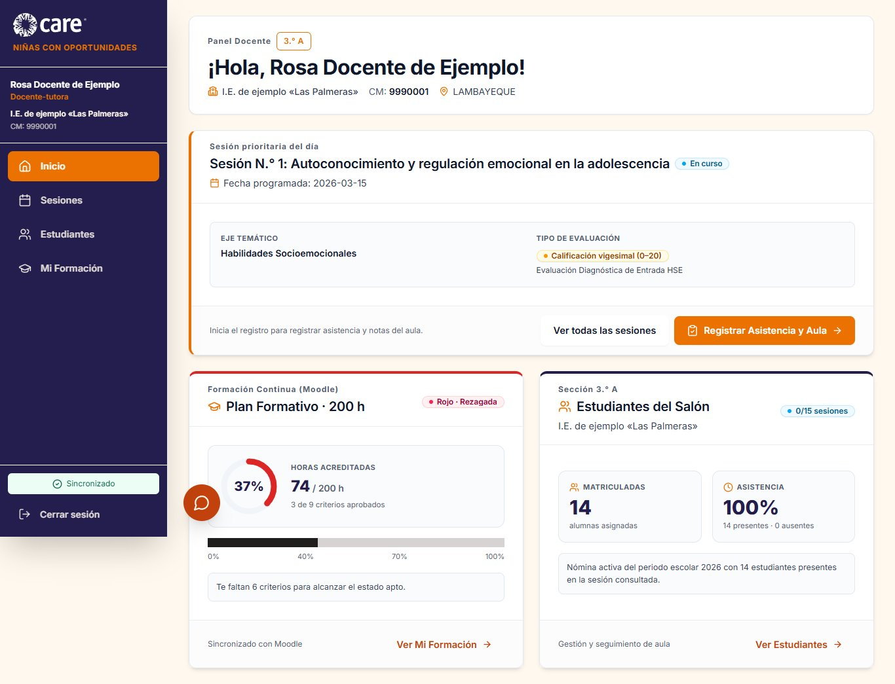

El estado de sincronización aparece al final del menú en la computadora, y arriba a la derecha en
el celular. **Sincronizado** significa que todo lo que registraste ya está guardado en el servidor.

Las palabras **Rojo · Rezagada** y «Te faltan N criterios» se refieren a tu plan de formación: se
explican en [Revisar tu avance en Mi Formación](#revisar-tu-avance-en-mi-formacion).

## Moverte por el menú desde el celular
pagina: 4
claves: menú, navegación, celular, móvil, secciones, opciones, hamburguesa, cerrar sesión, salir

En la computadora, el menú está siempre a la izquierda. En el celular está oculto para dejar
más espacio:

1. Toca el botón de las tres rayas, arriba a la izquierda.
2. Elige **Inicio**, **Sesiones**, **Estudiantes** o **Mi Formación**.
3. Para salir de la plataforma, toca **Cerrar sesión** al final del menú.

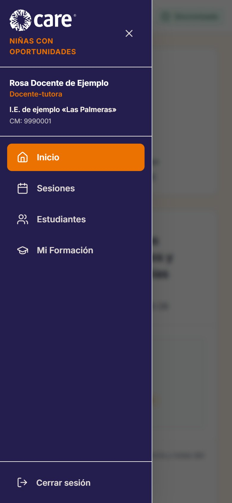

Si compartes el celular o la computadora, cierra sesión al terminar.

## Consultar la malla de sesiones
pagina: 5
claves: malla curricular, malla de sesiones, sesiones pendientes, sesiones ejecutadas, sesión activa, calendario, eje temático, tabla

En **Sesiones** ves todas las sesiones de tutoría del año para tu sección, en orden.

- Arriba tienes el resumen: estudiantes en aula, sesiones ejecutadas, asistencia promedio y
  evidencias del salón.
- Las pestañas **Todas**, **Sesión Activa**, **Pendientes** y **Ejecutadas** filtran la lista.
  También puedes filtrar por eje temático.
- La **sesión activa** es la que corresponde dictar ahora. Las demás aparecen «En espera
  secuencial»: se habilitan en orden, cuando cierras la anterior.
- Para empezar a registrar la sesión activa, toca **Registrar Sesión y Aula**.

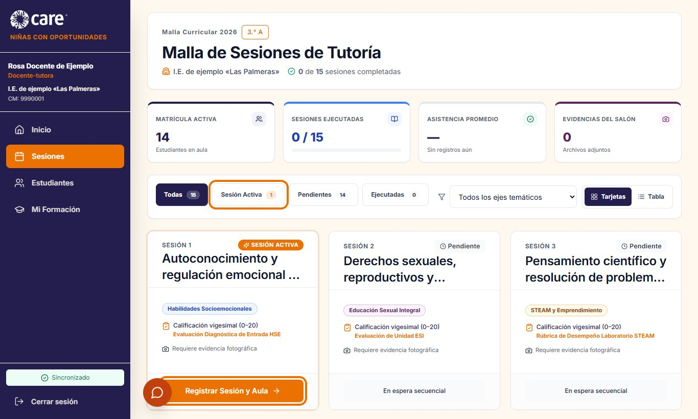

Si prefieres una lista compacta, toca **Tabla** (junto a **Tarjetas**):

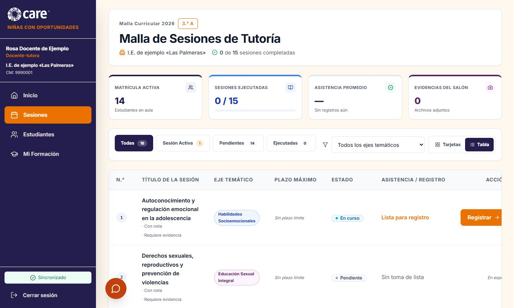

## Registrar una sesión en el aula desde el celular
pagina: 6
claves: registrar sesión, registro de aula, empezar sesión, registrar asistencia y aula, celular, pasos del registro

El registro de una sesión tiene tres pasos: **1. Asistencia**, **2. Notas** y **3. Cierre**.
Puedes hacerlo desde el celular mientras dictas la clase.

1. En el **Panel de inicio**, toca **Registrar Asistencia y Aula**.

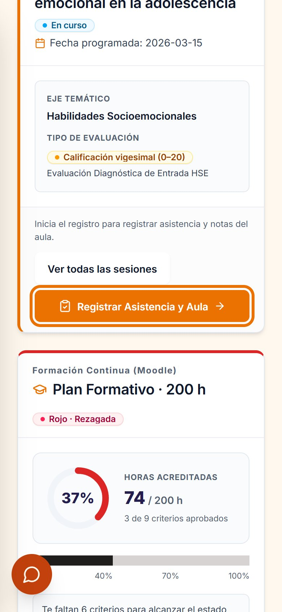

2. Se abre el **Registro de aula** de tu sección, con la sesión del día. Arriba verás los tres
   pasos (**1. Asistencia**, **2. Notas** y **3. Cierre**); empiezas en **1. Asistencia**.

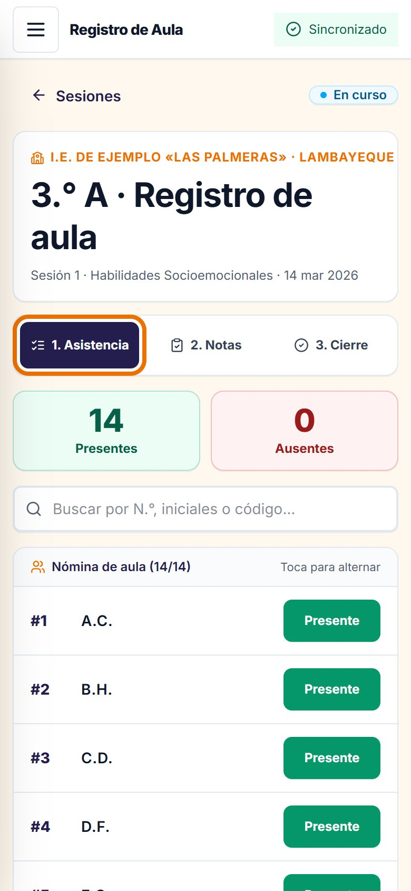

Por protección de datos personales (Ley N.° 29733), las estudiantes aparecen con su número de
nómina y sus iniciales, no con su nombre completo. El número es el mismo de tu registro escolar.

Sigue con [Marcar la asistencia](#marcar-la-asistencia).

## Marcar la asistencia
pagina: 7
claves: marcar asistencia, ausente, presente, faltó, inasistencia, tomar lista

Al abrir el registro, todas las estudiantes aparecen como **Presente**.

1. Toca el botón de cada estudiante que faltó: cambia a **Ausente**. Si te equivocas, tócalo
   otra vez y vuelve a **Presente**.
2. Revisa los contadores de **Presentes** y **Ausentes** en la parte superior.
3. Si necesitas encontrar a una estudiante, usa el buscador por número, iniciales o código.
4. Cuando termines, toca **Continuar a calificación**.

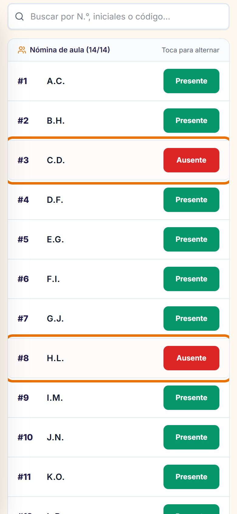

## Registrar las notas
pagina: 8
claves: calificación, calificar, evaluación, nota vigesimal, teclado numérico, registrar notas, evaluación diagnóstica

En el paso **2. Notas** registras la evaluación que corresponde a la sesión. El nombre de la
evaluación y su escala aparecen arriba (por ejemplo, «Evaluación Diagnóstica de Entrada HSE»,
escala de 0 a 20). Solo se califica a las estudiantes presentes; las ausentes aparecen con «—».

1. Toca la fila de la estudiante. Abajo aparece un teclado con números.
2. Toca los dígitos de la nota, uno por uno. Por ejemplo, para un 12 toca **1** y luego **2**.
   El botón **20** escribe la nota máxima de un solo toque.
3. Toca **✓** para confirmar. La plataforma pasa sola a la siguiente estudiante.
4. Si quieres, escribe un comentario opcional para esa estudiante en el cuadro que aparece
   debajo de su fila.
5. Cuando termines, toca **Continuar al cierre de sesión**, al final de la lista.

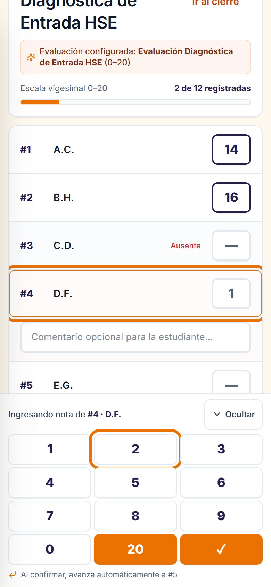

La barra de avance (por ejemplo, «2 de 12 registradas») te indica cuántas notas llevas. Para cerrar
la sesión, todas las estudiantes presentes deben tener nota. **Ocultar** esconde el teclado si
necesitas ver la lista completa; vuelve a tocar una fila para mostrarlo.

## Adjuntar evidencias y comentar la sesión
pagina: 9
claves: foto, fotografía, adjuntar, subir foto, archivo, papelógrafo, comentario de la sesión, observaciones

En el paso **3. Cierre** ves el resumen de la sesión (promedio, porcentaje de aprobación y
ausencias) y puedes dejar constancia de lo que hiciste.

1. En **Comentario de la sesión (opcional)**, escribe observaciones generales sobre cómo se
   desarrolló la clase.
2. Para subir fotos del aula (por ejemplo, un papelógrafo), toca **+ Adjuntar general**. En
   el celular puedes tomar la foto en ese momento o elegirla de tu galería. Puedes elegir
   varias a la vez.
3. Si la evidencia es de una estudiante en particular, toca **Adjuntar** en su fila. Las
   estudiantes ausentes no pueden tener evidencia: su botón aparece apagado.

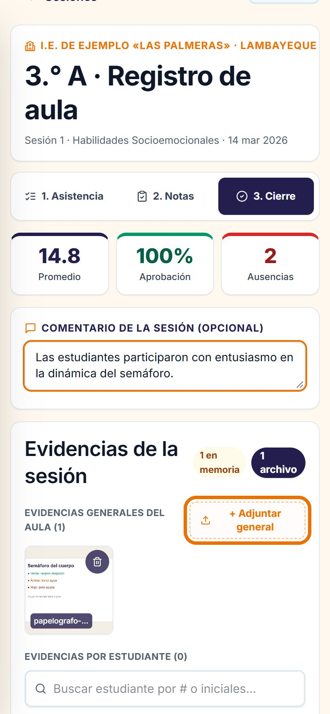

Las fotos se comprimen automáticamente para que pesen poco y se suban rápido aunque tengas
poca señal. También puedes adjuntar documentos en PDF o Word. Si te equivocaste de archivo,
toca el ícono del tacho sobre la miniatura para quitarlo.

Si la sesión dice **Requiere evidencia fotográfica**, sube al menos una foto antes de cerrar. La
plataforma te deja cerrar sin fotos, pero la evidencia es parte de tu registro de la sesión.

Al final del paso aparece **Guardar cambios**: guarda lo que llevas sin cerrar la sesión, por si
necesitas terminar más tarde. No es necesario tocarlo antes de cerrar.

## Cerrar y sincronizar la sesión
pagina: 10
claves: cerrar sesión del día, cerrar y sincronizar, terminar sesión, finalizar registro, sesión ejecutada, no puedo cerrar la sesión

Al final del paso **3. Cierre**, toca **Cerrar y sincronizar sesión**.

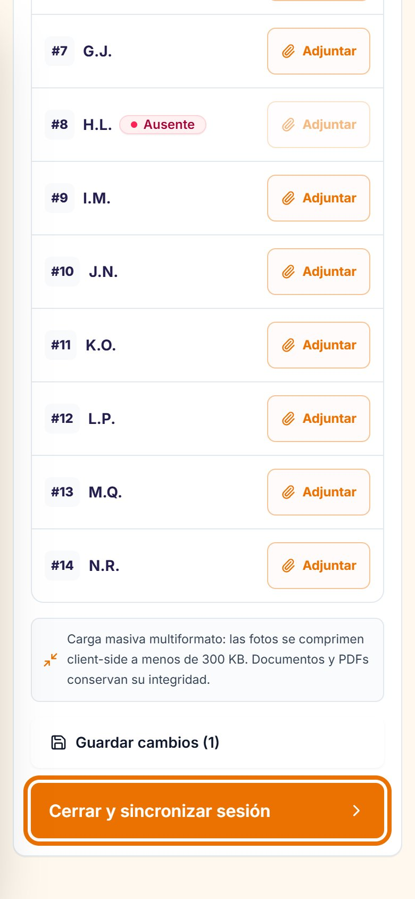

**Cuidado con los nombres parecidos:** **Cerrar y sincronizar sesión** termina la sesión de clase
que registraste. **Cerrar sesión**, al final del menú, te saca de la plataforma y no guarda el
registro como terminado.

Si el botón está desactivado, lee el aviso **Pendiente para cerrar** que aparece encima: te
dice qué falta, por ejemplo «Faltan notas obligatorias por registrar en 2 estudiante(s)
presente(s)». Vuelve al paso **2. Notas**, complétalas y regresa al cierre.

Al cerrar, la plataforma guarda la sesión, la marca como ejecutada y te lleva a
**Mi Formación**, donde ves tu avance en el plan formativo.

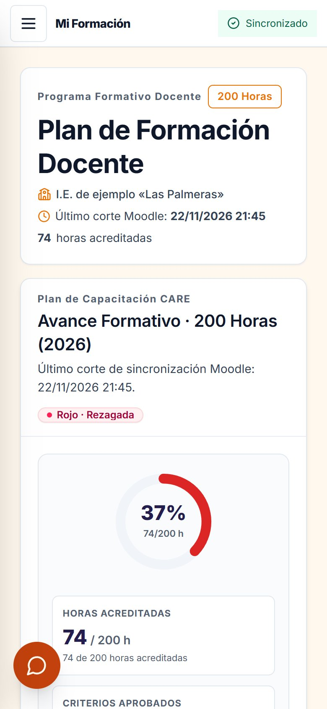

En **Sesiones**, la pestaña **Ejecutadas** muestra la sesión cerrada, y la siguiente sesión
pasa a estar activa.

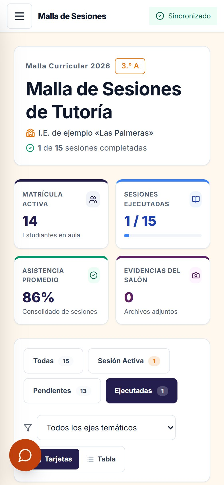

## Registrar la sesión desde la computadora
pagina: 11
claves: computadora, laptop, escritorio, registro en computadora, tabla de aula, guardar avance, cerrar sesión del día

En la computadora, el registro de aula muestra todo en una sola tabla: asistencia, nota,
evidencia y comentario de cada estudiante, con el resumen y las evidencias a la derecha.

1. Entra a **Sesiones** y toca **Registrar Sesión y Aula** en la sesión activa (en la vista
   **Tabla**, el botón se llama **Registrar**).
2. En cada fila, toca **Presente** para cambiarlo a **Ausente** si la estudiante faltó, escribe
   la nota en su casilla y, si corresponde, toca **Adjuntar** para subir su evidencia.
3. Toca **Guardar avance** (arriba a la derecha) para guardar sin cerrar; puedes terminar más tarde.
4. Cuando todo esté completo, toca **Cerrar sesión del día**. Mientras falte algo, el botón está
   apagado y el aviso **Pendiente para cerrar sesión** dice qué falta.

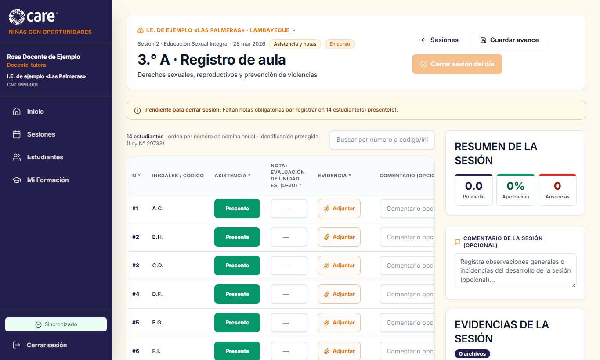

La tabla muestra diez estudiantes por página: usa **Siguiente** y **Anterior** para ver el resto.
Igual que en el celular, **Cerrar sesión del día** termina la sesión de clase, y **Cerrar sesión**
del menú te saca de la plataforma.

## Trabajar sin conexión a internet
pagina: 12
claves: sin conexión, sin internet, offline, sin señal, sincronizar, pendientes de sincronizar, guardado local, se perdió la señal

Puedes registrar la asistencia, las notas y las evidencias aunque te quedes sin internet en el
aula. La plataforma guarda todo en tu dispositivo y lo envía al servidor cuando vuelve la señal.

- Cuando no hay conexión, arriba aparece **Sin conexión** y el aviso **Guardado local**, con
  la cantidad de registros **pendientes de sincronizar**.
- Sigue trabajando normalmente. Al recuperar la conexión, la plataforma sincroniza sola y el
  estado vuelve a **Sincronizado**.
- Antes de cerrar sesión o borrar los datos del navegador, espera a que el estado vuelva a
  **Sincronizado**, para asegurarte de que nada quede solo en tu dispositivo.

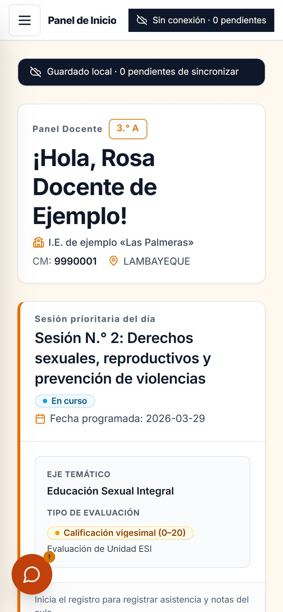

Para entrar a la plataforma por primera vez en un dispositivo sí necesitas conexión. El
asistente curricular también necesita internet para responder.

## Revisar la nómina de estudiantes
pagina: 13
claves: nómina, lista de estudiantes, matriz de actividades, asistencia por estudiante, promedio, condición

En **Estudiantes** ves la nómina de tu sección con la condición, el porcentaje de asistencia y
el promedio de cada estudiante.

- Usa los filtros **Todos**, **Regulares** y **Lideresas**, o el buscador.
- En la parte superior puedes cambiar de sección si tienes más de una a cargo (**Cambiar de
  sección**).
- El recuadro **Actividades y talleres complementarios** muestra las actividades extra que la
  administración habilitó para tu sección, para que las califiques. Si no hay ninguna, lo dice.

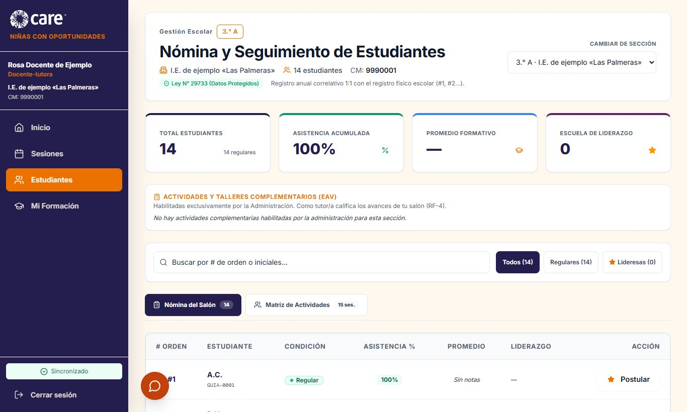

La pestaña **Matriz de Actividades** muestra, sesión por sesión, la asistencia y las notas de
cada estudiante, para ver de un vistazo quién necesita acompañamiento.

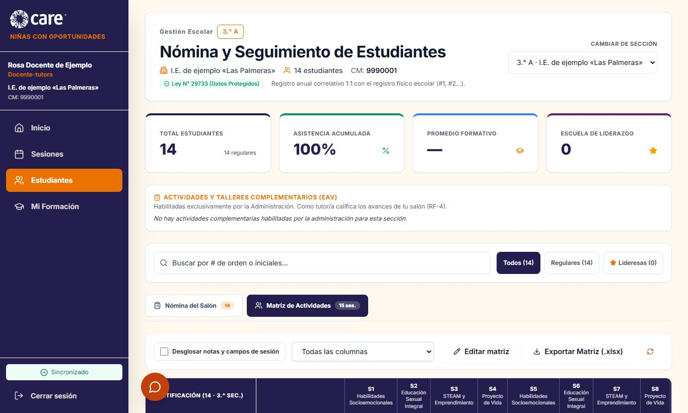

## Postular a una estudiante a la Escuela de Liderazgo
pagina: 14
claves: lideresa, escuela de liderazgo, postular, postulación, liderazgo, justificación, seguimiento de aula

Si una estudiante destaca por su liderazgo, puedes postularla a la Escuela de Liderazgo.

1. En **Estudiantes**, busca a la estudiante y toca **Postular** en su fila.

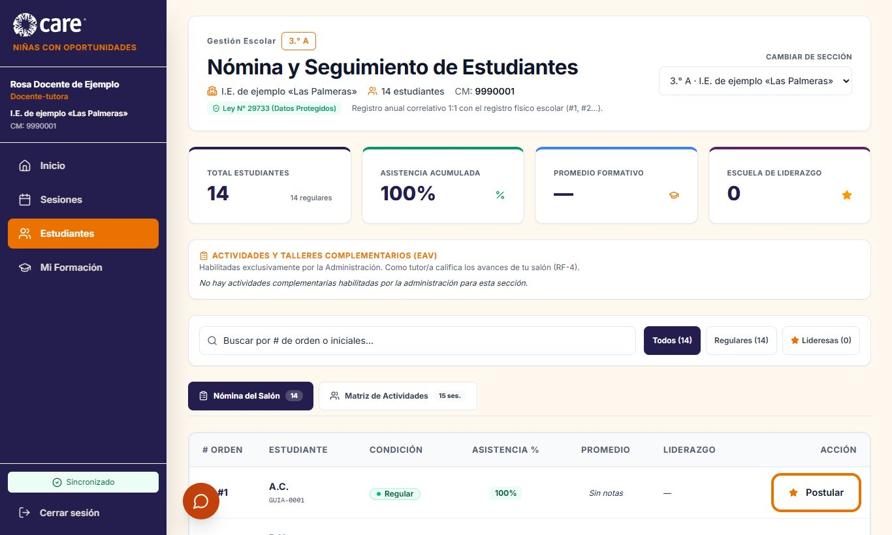

2. En la ventana **Postular a Escuela de Liderazgo**, escribe la justificación pedagógica: las
   actitudes de liderazgo, compromiso, empatía y participación que observaste. Es obligatoria.
3. Toca **Confirmar Postulación**. Tu gestor territorial revisará la postulación.

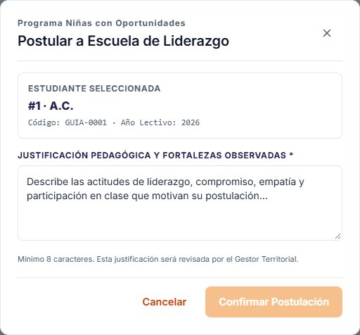

El filtro **Lideresas** de la nómina muestra a las estudiantes que ya forman parte de la Escuela
de Liderazgo.

## Revisar tu avance en Mi Formación
pagina: 15
claves: mi formación, plan formativo, horas, horas acreditadas, avance formativo, criterios, semáforo, moodle, constancia, ficha de avance

En **Mi Formación** ves tu avance en el plan de formación docente del programa.

- El círculo muestra tu porcentaje de avance y las horas acreditadas frente a las horas del plan.
- El semáforo indica tu estado: **rojo** (rezagada), **ámbar** o **verde**. La barra de avance
  tiene marcas que indican desde qué porcentaje cambia cada color. Cuando alcanzas el verde se
  habilita **Imprimir constancia oficial (PDF)**; mientras tanto el botón aparece apagado.
- **Imprimir ficha de avance** genera un resumen de tu avance para imprimir o guardar.
- **Último corte Moodle** indica cuándo se trajeron por última vez tus actividades del aula
  virtual (Moodle).

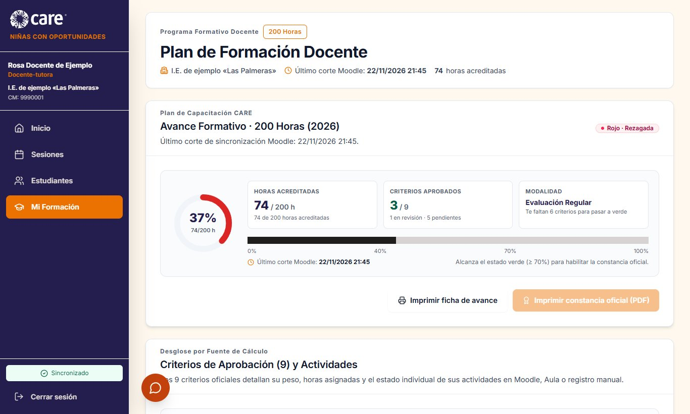

Más abajo, **Criterios de Aprobación y Actividades** detalla cada criterio del plan: las horas
asignadas, su peso, cuántas actividades completaste y su estado (Aprobado, En revisión o
Pendiente). Ahí ves qué te falta: los criterios en **Pendiente** son los que aún no empiezas.

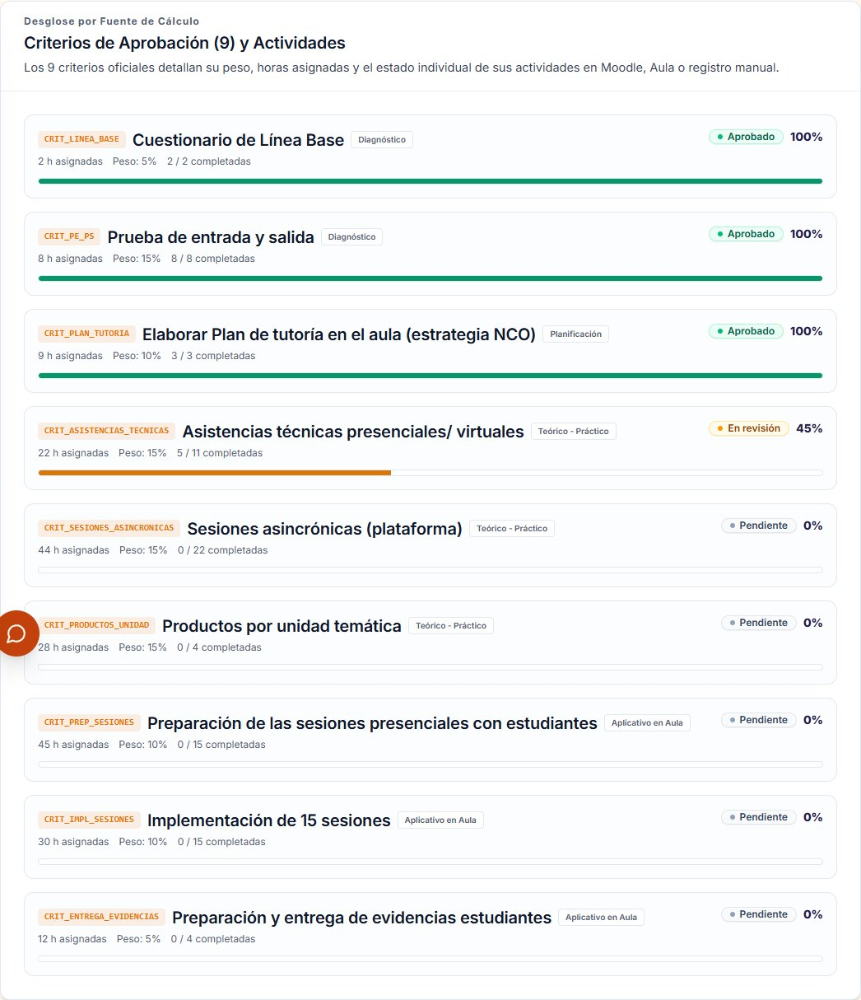

Las horas del plan, los criterios y sus pesos los define la coordinación del programa para cada
cohorte; la plataforma siempre muestra los vigentes.

## Consultar al asistente curricular
pagina: 16
claves: asistente, asistente curricular, inteligencia artificial, IA, chatbot, preguntar, dinámicas, guías pedagógicas, botón del asistente, fuentes

El asistente curricular responde preguntas sobre cómo preparar tus sesiones y sobre cómo usar la
plataforma. Responde solo con las guías del programa y te muestra de dónde sale cada respuesta.

1. Toca el **botón naranja** de la esquina inferior izquierda de la pantalla. Está en todas las
   pantallas, salvo en el registro de aula.
2. Escribe tu pregunta y toca el botón de enviar. Si no sabes qué preguntar, toca una de las
   preguntas sugeridas, por ejemplo: «¿Cómo calmo al grupo después del recreo?».

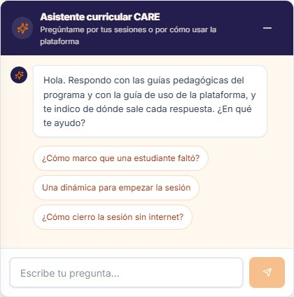

3. Lee la respuesta. Los números pequeños, como **1**, indican de qué fuente sale cada parte.
   Debajo, en **Fuente**, ves la sección y la guía. Si la fuente es esta guía de uso, toca
   **Abrir en la guía** para ver el tema completo con sus imágenes.

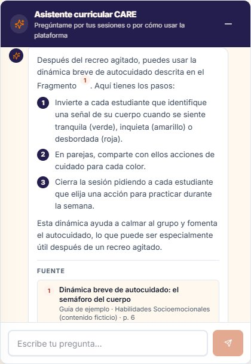

Si preguntas algo que no está en las guías, el asistente te lo dirá en lugar de inventar una
respuesta. Si un aviso indica que se quitaron citas, revisa la fuente antes de aplicar la
sugerencia. Para cerrar el asistente, toca la raya de arriba a la derecha.

El asistente también conoce esta guía de uso: puedes preguntarle, por ejemplo, «¿Cómo marco que
una estudiante faltó?», y te responde con el paso a paso y el botón **Abrir en la guía**.

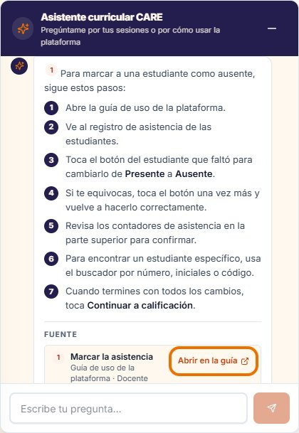
