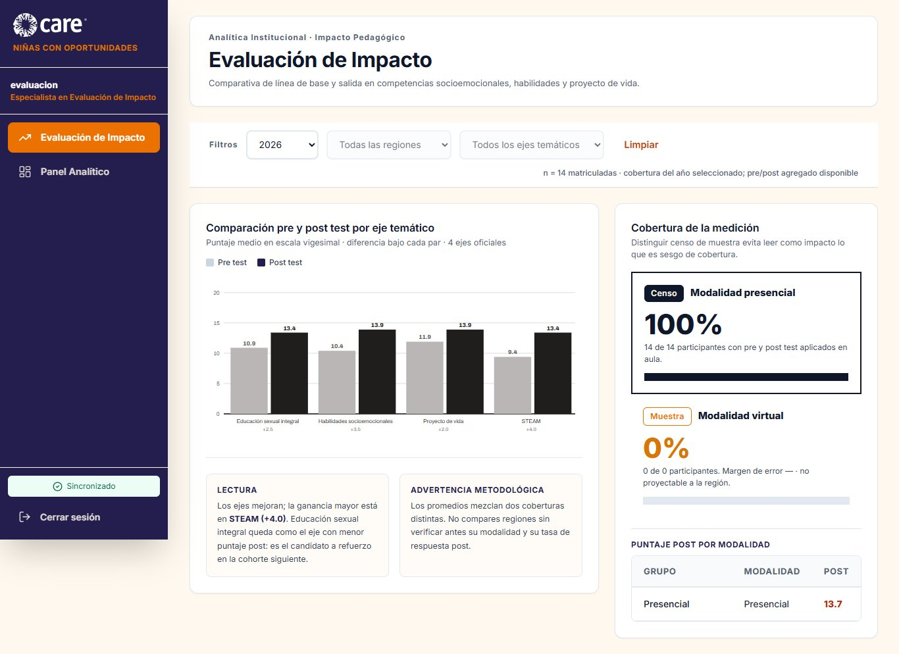
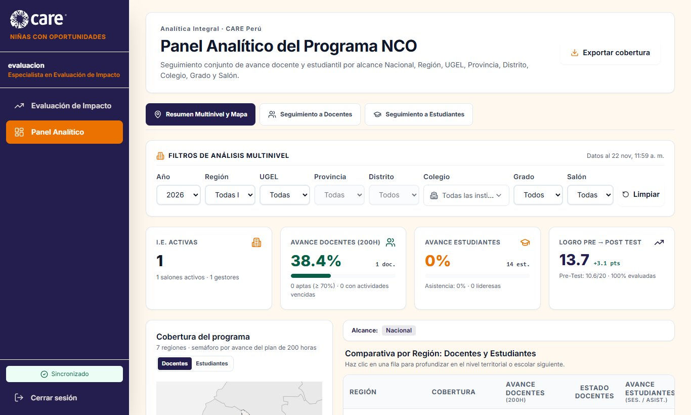
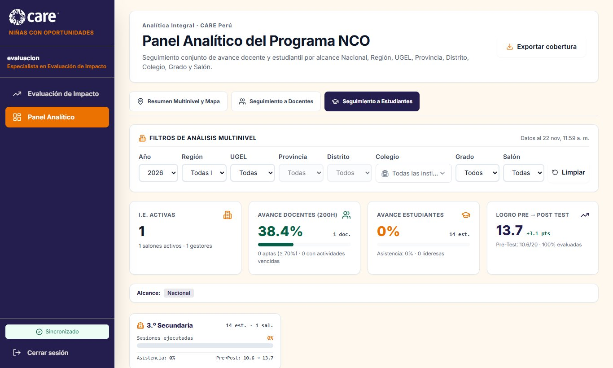
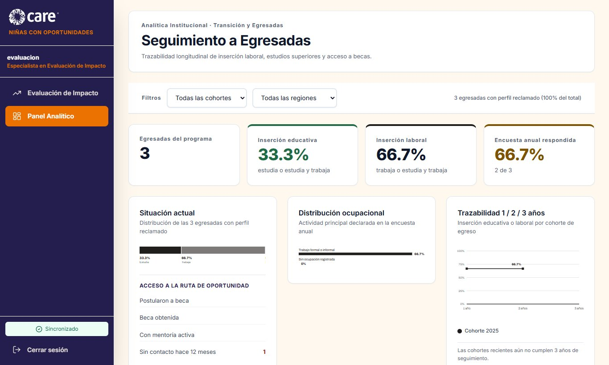

# Guía de uso para evaluación de impacto

Esta guía explica cómo usar la plataforma para medir el impacto del programa: comparar las pruebas
de entrada y salida de las estudiantes, revisar la cobertura de la medición y seguir la trayectoria
de las egresadas. Tus pantallas son de consulta: no modifican registros. Las imágenes usan datos de
ejemplo.

## Ingresar y conocer tu menú
pagina: 1
claves: ingresar, iniciar sesión, menú de evaluación, evaluación de impacto, panel analítico

1. Ingresa con tu correo institucional o DNI y tu contraseña.
2. La plataforma abre **Evaluación de Impacto**.
3. El menú tiene **Evaluación de Impacto** y **Panel Analítico**. El tablero de egresadas todavía
   no tiene botón en el menú: el tema «Seguir la trayectoria de las egresadas» explica cómo abrirlo.

## Comparar las pruebas de entrada y salida
pagina: 2
claves: evaluación de impacto, pre test, post test, prueba de entrada, prueba de salida, ejes temáticos, ganancia, puntaje vigesimal

El gráfico **Comparación pre y post test por eje temático** muestra el puntaje promedio (escala de
0 a 20) de la prueba de entrada (gris) y de salida (negro) en cada eje. Debajo de cada par está la
diferencia.

1. Elige el año, la región y, si quieres, un eje temático en los filtros.
2. Lee el recuadro **Lectura**: resume qué eje mejoró más y cuál quedó más bajo.
3. Antes de comparar regiones, revisa la **Advertencia metodológica**.

## Revisar la cobertura de la medición
pagina: 3
claves: cobertura de la medición, censo, muestra, modalidad presencial, modalidad virtual, margen de error, sesgo

**Cobertura de la medición** separa las dos formas de medir:

- **Censo · Modalidad presencial**: porcentaje de participantes con pre y post test aplicados en aula.
- **Muestra · Modalidad virtual**: participantes de la muestra virtual y su margen de error.

No leas como impacto lo que es diferencia de cobertura: si una modalidad tiene poca respuesta, sus
promedios no son comparables. **Puntaje post por modalidad** muestra el promedio de salida de cada grupo.

## Consultar el panel analítico
pagina: 4
claves: panel analítico, cobertura, avance docente, avance estudiantes, logro pre post, región

El **Panel Analítico** muestra la cobertura del programa por región, el avance de las docentes en su
plan formativo y el de las estudiantes, con los mismos filtros territoriales.

La pestaña **Seguimiento a Estudiantes** resume, por grado, las sesiones ejecutadas, la asistencia y
el cambio entre pre y post test:

## Seguir la trayectoria de las egresadas
pagina: 5
claves: egresadas, seguimiento a egresadas, inserción educativa, inserción laboral, trazabilidad, cohorte, encuesta anual

En **Seguimiento a Egresadas** ves qué pasa con las estudiantes después del colegio.

Esta pantalla todavía no tiene botón en el menú. Para abrirla, en la barra de direcciones del
navegador cambia lo que va después del nombre de la plataforma por **/analitica/egresadas** y presiona Enter.
Por ejemplo, `plataforma.ejemplo.pe/analitica/impacto` pasa a ser `plataforma.ejemplo.pe/analitica/egresadas`. Guárdala
en tus favoritos para volver con un clic.

El tablero muestra:

- **Inserción educativa** e **inserción laboral**: porcentaje que estudia o trabaja.
- **Encuesta anual respondida**: cuántas respondieron el seguimiento del año.
- **Situación actual**, **Distribución ocupacional** y **Trazabilidad 1 / 2 / 3 años** por cohorte.

Filtra por cohorte y región para comparar.

