# Guía de uso para gestores territoriales

Esta guía explica cómo usar la plataforma para acompañar a las docentes tutoras de los colegios a
tu cargo: revisar su avance, registrar tus contactos y visitas, y revisar las evidencias de aula.
Todo lo que ves está limitado a tu región y a los colegios que te asignó la coordinación. Las
imágenes usan datos de ejemplo.

**¿Dudas mientras usas la plataforma?** Toca el botón naranja de la esquina inferior izquierda
para preguntarle al asistente curricular: conoce esta guía, te responde con el paso a paso y te
lleva al tema. Más detalles en [Consultar al asistente curricular](docente.md#consultar-al-asistente-curricular).

## Ingresar y conocer tu menú
pagina: 1
claves: ingresar, iniciar sesión, menú del gestor, panel analítico, gestor territorial, cerrar sesión

1. Abre la dirección de la plataforma en el navegador e ingresa con tu correo institucional o
   DNI y tu contraseña. Si la coordinación acaba de crear tu cuenta, tu usuario y tu clave
   temporal son tu DNI, y en el primer ingreso la plataforma te pide cambiarla. El paso a paso
   está en [Ingresar a la plataforma](docente.md#ingresar-a-la-plataforma) de la guía docente:
   la pantalla de ingreso es la misma para todos.
2. La plataforma abre el **Panel Analítico** de tu ámbito.
3. El menú tiene **Panel Analítico**, **Estudiantes**, **Docentes** y **Territorio**.
4. Tu **cartera de docentes** y la **cola de evidencias** todavía no tienen botón en el menú: en
   los temas siguientes se explica cómo abrirlas.

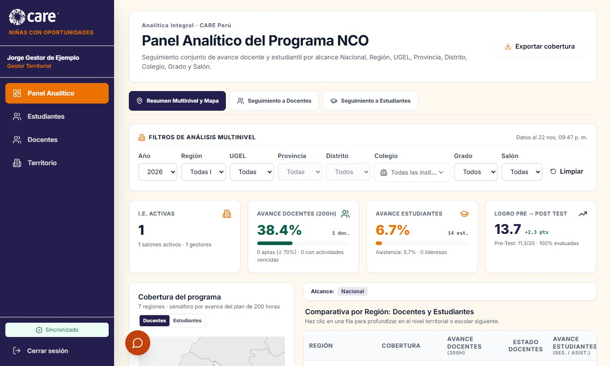

El panel muestra los indicadores y el mapa de cobertura solo de tus colegios, aunque la etiqueta
**Alcance** diga «Nacional». Usa los filtros para ver una UGEL, un colegio o un salón. El panel se
explica en detalle en [Revisar el panel analítico](coordinacion.md#revisar-el-panel-analitico).

## Revisar tu cartera de docentes
pagina: 2
claves: cartera, mi cartera, docentes a cargo, docentes en riesgo, atrasos, sin contacto, seguimiento docente

En **Mi Cartera de Docentes Tutoras** ves a las docentes de tus colegios.

Esta pantalla todavía no tiene botón en el menú. Para abrirla, en la barra de direcciones del
navegador cambia lo que va después del nombre de la plataforma por **/cartera** y presiona Enter.
Por ejemplo, `plataforma.ejemplo.pe/analitica/cobertura` pasa a ser `plataforma.ejemplo.pe/cartera`. Guárdala
en tus favoritos para volver con un clic.

En la cartera encontrarás:

- Los indicadores de arriba cuentan las docentes **en riesgo** (avance bajo en el plan
  formativo), con **tareas atrasadas** y **sin contacto** en las últimas dos semanas.
- Los filtros **Con atrasos** y **Sin contacto** muestran a quién priorizar.
- La tabla indica el avance de cada docente en el plan formativo y su último contacto.

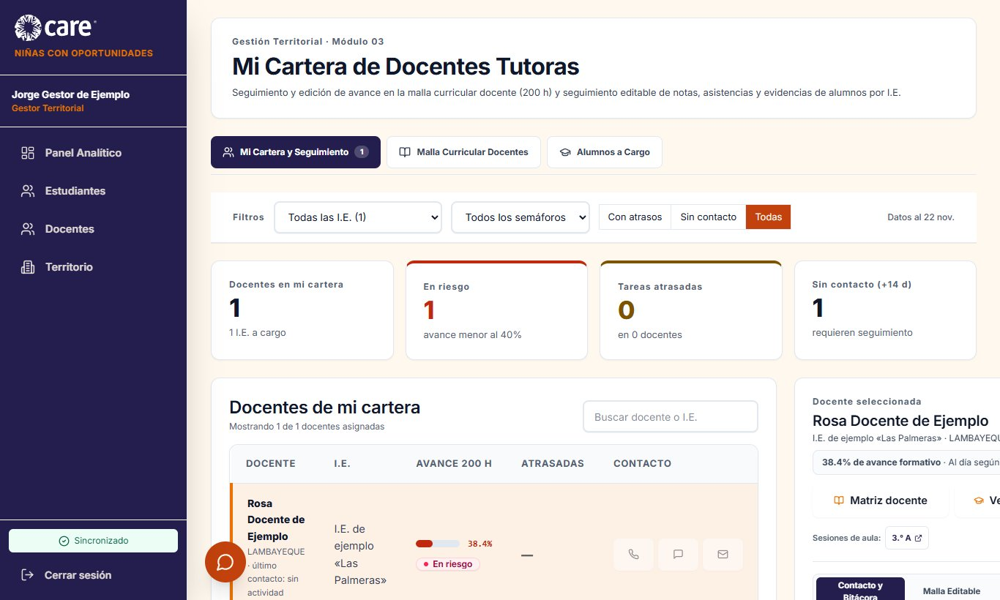

Toca a una docente para ver su resumen a la derecha: avance formativo, sus salones y los botones
**Matriz docente** y **Ver alumnos I.E.** Debajo hay tres pestañas: **Contacto y Bitácora**,
**Malla Editable** (para corregir el avance de la docente en cada actividad) y **Criterios**.

## Registrar un contacto con una docente
pagina: 3
claves: registrar contacto, bitácora de contacto, llamada, whatsapp, correo, acompañamiento, seguimiento a la docente

Cada llamada, mensaje o visita a una docente se registra en su **bitácora de contacto**:

1. En tu cartera, toca la fila de la docente.
2. En la pestaña **Contacto y Bitácora** del panel de la derecha, elige el **Canal de contacto**
   (visita, llamada o WhatsApp).
3. En **Registrar nuevo contacto**, escribe el resultado de la gestión y el compromiso acordado.
4. Toca **Guardar en bitácora**.

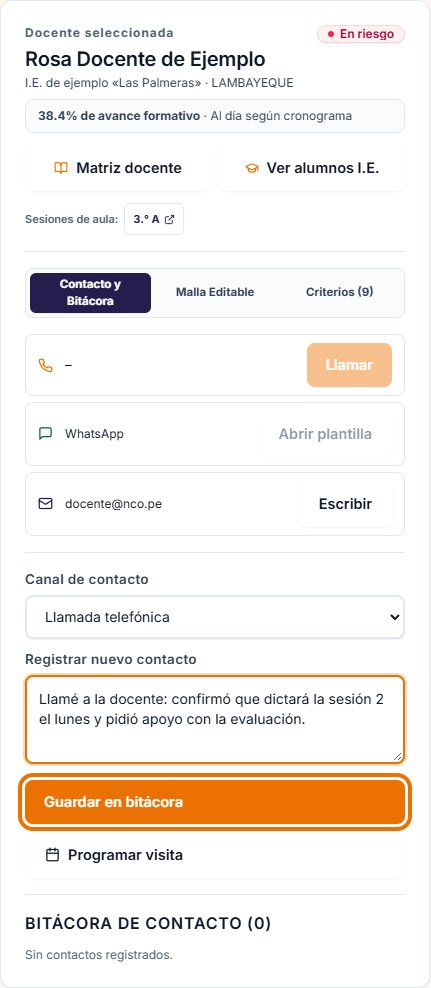

El contacto aparece al final, en **Bitácora de contacto**, con su canal y fecha. Los botones
**Llamar**, **Abrir plantilla** (WhatsApp) y **Escribir** (correo) abren el canal directamente
si la docente tiene esos datos registrados.

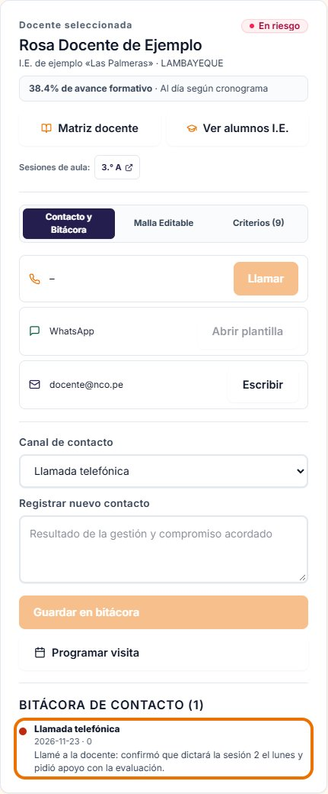

## Programar una visita al colegio
pagina: 4
claves: programar visita, agenda, visita al colegio, visita presencial, calendario, ics

1. En la pestaña **Contacto y Bitácora** de la docente, toca **Programar visita** (debajo de
   **Guardar en bitácora**).
2. Elige la fecha, la hora y el objetivo principal del acompañamiento.
3. Si quieres tenerla en el calendario de tu celular o tu correo, toca **Exportar evento (.ics)**
   antes de confirmar: descarga un archivo que tu calendario abre y guarda.
4. Toca **Confirmar y agendar**. La visita queda registrada en la bitácora de la docente.

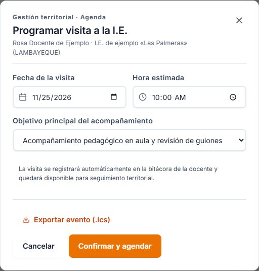

## Revisar el avance formativo de tus docentes
pagina: 5
claves: criterios, avance formativo, plan formativo, malla curricular docentes, horas, criterios de aprobación

La pestaña **Criterios** del resumen de la docente muestra su avance en cada criterio del plan
formativo, con las horas de la malla y si está en plazo.

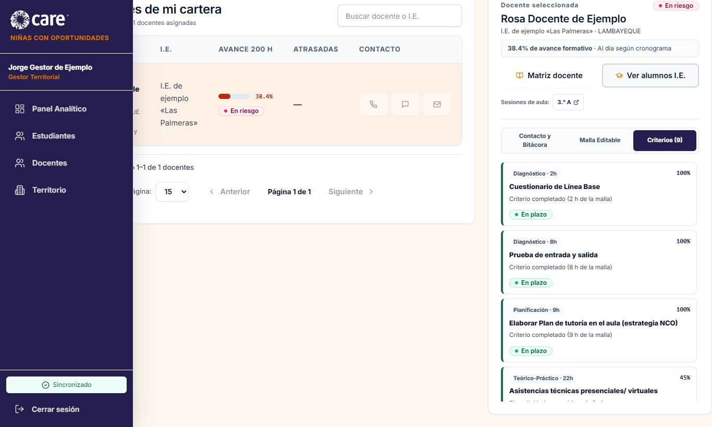

La pestaña **Malla Curricular Docentes** muestra a todas tus docentes juntas, con el avance de cada
criterio en columnas. Puedes filtrar por colegio, tipo de tutor, estado y criterio, y **Exportar
Excel**.

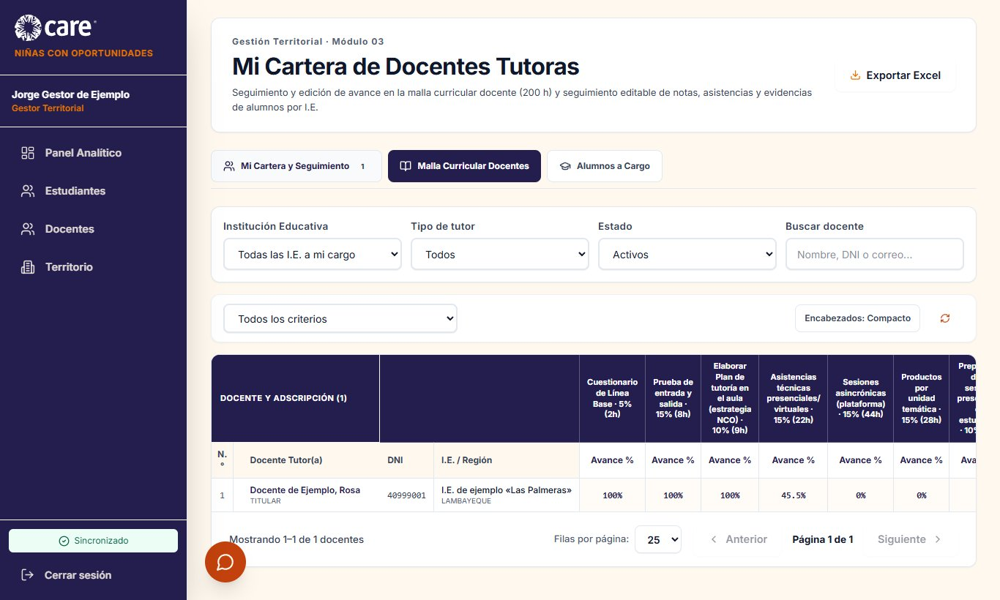

## Revisar a las estudiantes de tus colegios
pagina: 6
claves: alumnos a cargo, matriz de sesiones, editar matriz

La pestaña **Alumnos a Cargo** muestra, por grado, la asistencia de cada estudiante en cada sesión
(**P** presente, **F** falta). Marca **Desglosar notas y campos de sesión** para ver también las
notas.

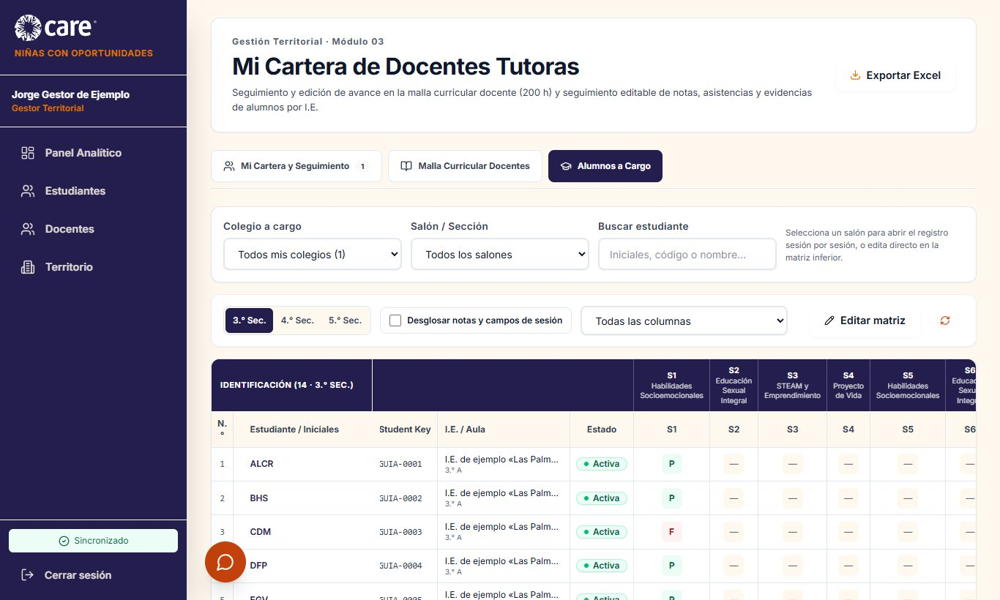

Si necesitas corregir un registro, toca **Editar matriz**. Para abrir el registro de una sesión,
elige un salón en el filtro **Salón / Sección**.

## Revisar evidencias de aula
pagina: 7
claves: cola de evidencias, revisar evidencia, dictamen, aprobar evidencia, fotos del aula

En **Cola de Evidencias Pedagógicas** llegan las fotos y archivos que las docentes de tu región
suben al cerrar sus sesiones.

Esta pantalla todavía no tiene botón en el menú. Para abrirla, en la barra de direcciones del
navegador cambia lo que va después del nombre de la plataforma por **/evidencias** y presiona Enter.
Por ejemplo, `plataforma.ejemplo.pe/analitica/cobertura` pasa a ser `plataforma.ejemplo.pe/evidencias`. Guárdala
en tus favoritos para volver con un clic.

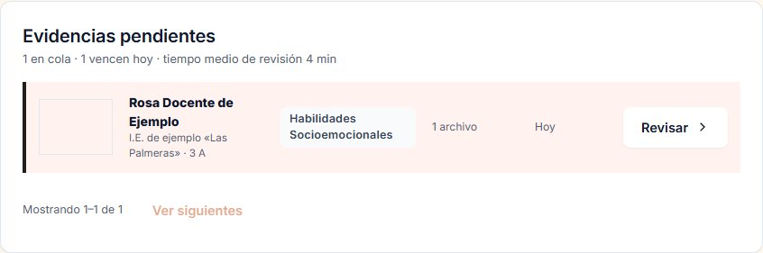

1. Toca **Revisar** en una evidencia.
2. Elige el dictamen: **Aprobada**, **Requiere corrección** o **No cumple el estándar**.
3. Escribe la retroalimentación para la docente; ella la verá en su panel.
4. Toca **Registrar dictamen y pasar a la siguiente**.

El paso a paso con imágenes está en la guía de la voluntaria, que hace la misma revisión:
[Revisar una evidencia](voluntaria.md#revisar-una-evidencia) y
[Registrar el dictamen](voluntaria.md#registrar-el-dictamen).

## Consultar docentes, estudiantes y colegios
pagina: 8
claves: territorio, padrón, colegios a cargo, nuevo estudiante, nuevo docente

Los módulos del menú muestran solo los registros de tu ámbito:

- **Docentes**: el padrón de docentes de tus colegios. Puedes registrar una docente con **Nuevo
  Docente** y abrir su ficha tocando su nombre.
- **Estudiantes**: la nómina de tus colegios. Puedes registrar una estudiante con **Nuevo
  Estudiante**.
- **Territorio**: tus colegios, con su código modular, UGEL y ubicación.

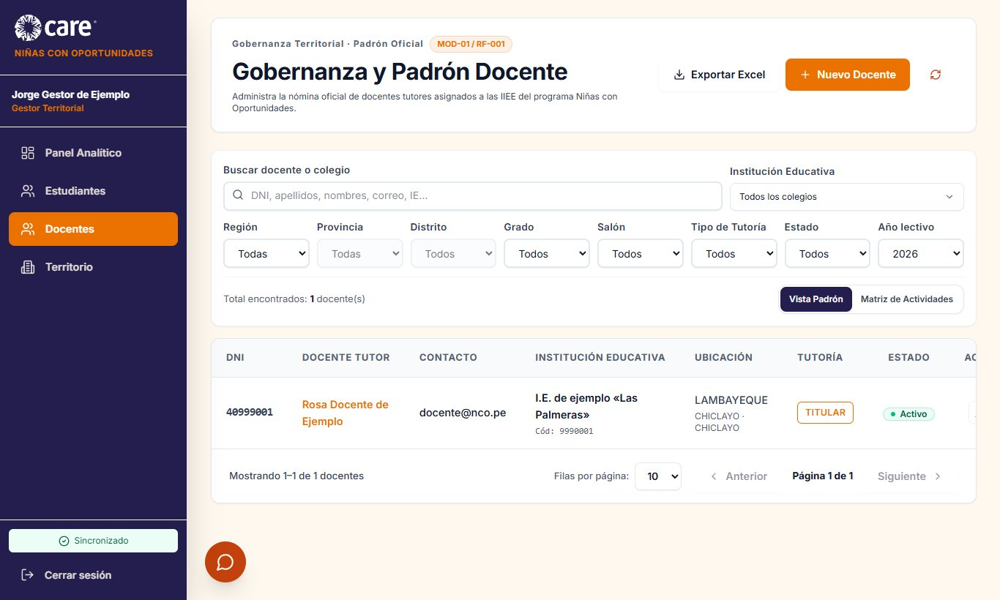

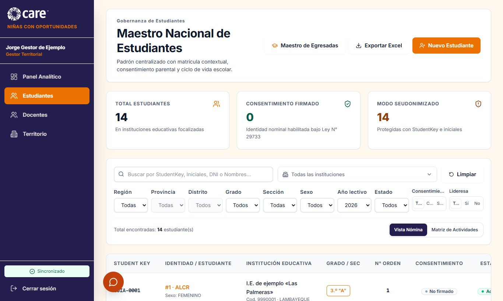

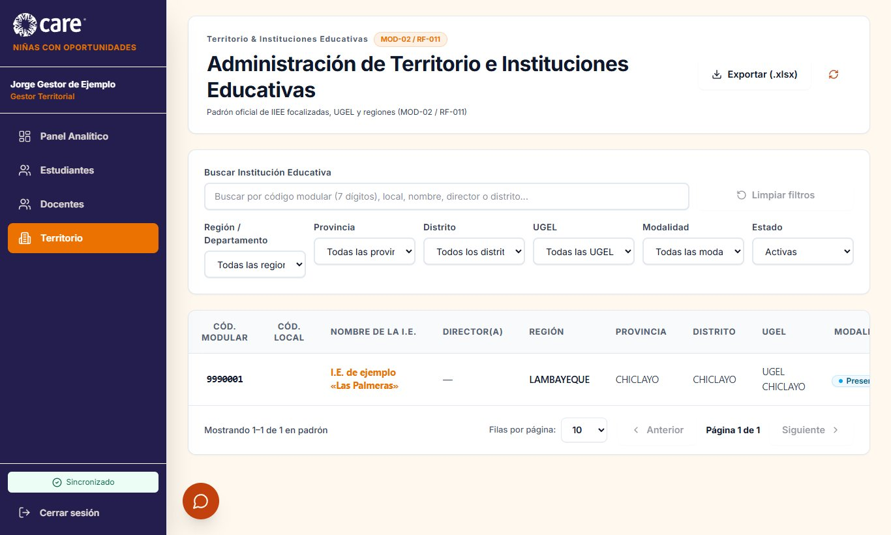

Los pasos para registrar docentes y estudiantes son los mismos que en la guía de coordinación:
[Gestionar el padrón docente](coordinacion.md#gestionar-el-padron-docente) y
[Registrar o importar estudiantes](coordinacion.md#registrar-o-importar-estudiantes).
