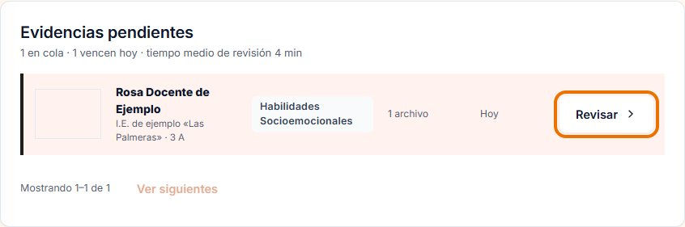
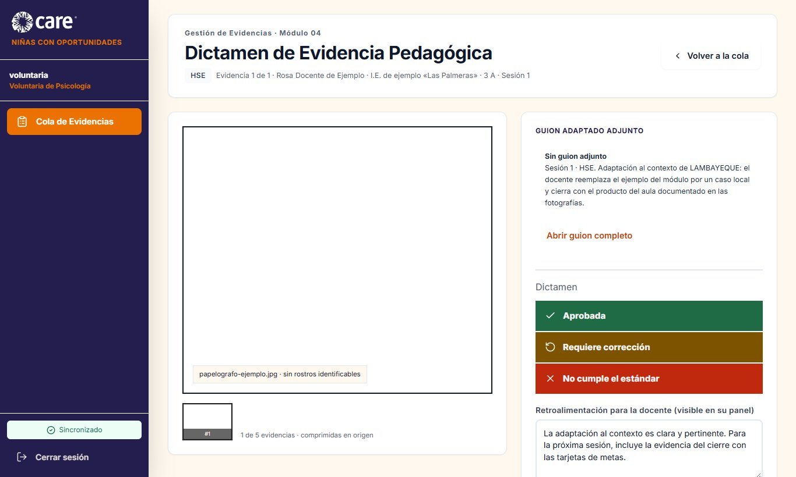
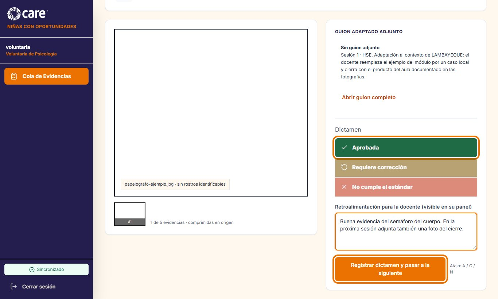

# Guía de uso para voluntarias de revisión de evidencias

Esta guía explica cómo revisar las evidencias que las docentes suben al cerrar sus sesiones de aula
y cómo registrar tu dictamen. Las imágenes usan datos de ejemplo.

## Ingresar y abrir la cola de evidencias
pagina: 1
claves: ingresar, iniciar sesión, voluntaria, cola de evidencias, evidencias pendientes

1. Ingresa con tu correo o DNI y tu contraseña.
2. La plataforma abre la **Cola de Evidencias Pedagógicas**. Es tu única opción del menú.
3. Cada fila es una evidencia: la docente, su colegio y sección, el eje temático, la cantidad de
   archivos y cuándo se subió.
4. Toca **Revisar** en la evidencia que vas a dictaminar.

## Revisar una evidencia
pagina: 2
claves: revisar evidencia, dictamen de evidencia, foto del aula, guion adaptado

La pantalla **Dictamen de Evidencia Pedagógica** muestra arriba la sesión, el eje, la docente y el
colegio. A la izquierda están los archivos de la evidencia; a la derecha, el guion adaptado que
adjuntó la docente (si lo hay) y el formulario del dictamen.

## Registrar el dictamen
pagina: 3
claves: dictamen, aprobar evidencia, apruebo, evidencia de aula, requiere corrección, no cumple el estándar, retroalimentación, registrar dictamen

Hay tres dictámenes posibles:

- **Aprobada**: la evidencia cumple lo que pide la sesión.
- **Requiere corrección**: la docente debe completar o rehacer algo.
- **No cumple el estándar**: la evidencia no corresponde a la sesión.

1. Elige el dictamen.
2. Escribe la **retroalimentación para la docente**. Ella la verá en su panel: sé concreta y
   propón una mejora. El cuadro trae un texto de ejemplo: reemplázalo por el tuyo.
3. Toca **Registrar dictamen y pasar a la siguiente**. La plataforma guarda el dictamen y abre la
   siguiente evidencia de la cola.

En la computadora puedes usar el teclado: **A** (aprobada), **C** (corrección) y **N** (no cumple).
