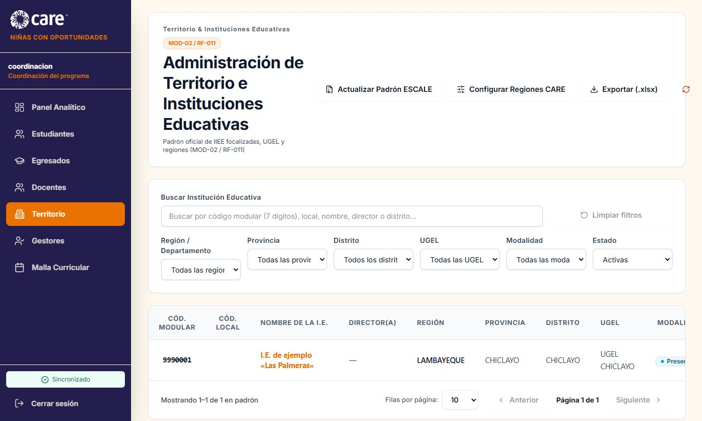
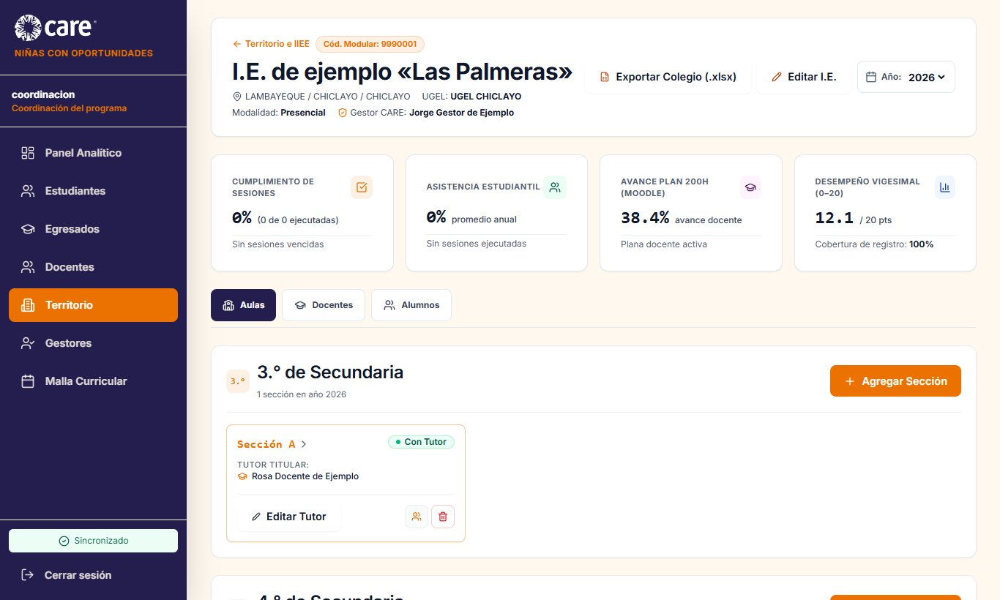
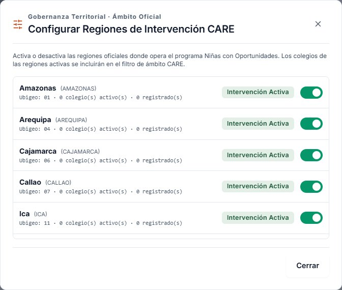

# Administrar colegios y regiones

Tema 10 de la guía de [Coordinación, administración y monitoreo](./index.md).

En **Territorio** está el padrón de instituciones educativas focalizadas, con su código modular,
región, provincia, distrito, UGEL y modalidad. Toca el nombre de un colegio para ver su ficha.

*Padrón de instituciones educativas*

*Ficha de un colegio*

En la ficha del colegio ves el cumplimiento de sesiones, la asistencia, el avance de sus docentes
y su desempeño, con sus aulas, docentes y alumnos en pestañas. Desde la pestaña **Aulas** puedes:

- Crear una sección con **Agregar Sección** (hay un botón por grado).
- Asignar o cambiar la docente tutora de una sección con **Editar Tutor**.

Arriba, **Exportar Colegio (.xlsx)** descarga los datos del colegio y **Editar I.E.** corrige sus
datos.

En **Territorio**, el botón **Configurar Regiones CARE** abre la lista de regiones de
intervención del programa: actívalas o desactívalas con el interruptor de cada una y toca
**Cerrar**. Los colegios de las regiones activas entran en los filtros de toda la plataforma.

*Regiones de intervención de CARE*

**Actualizar Padrón ESCALE** (coordinación y administración) trae los datos oficiales de colegios
del Ministerio de Educación.
