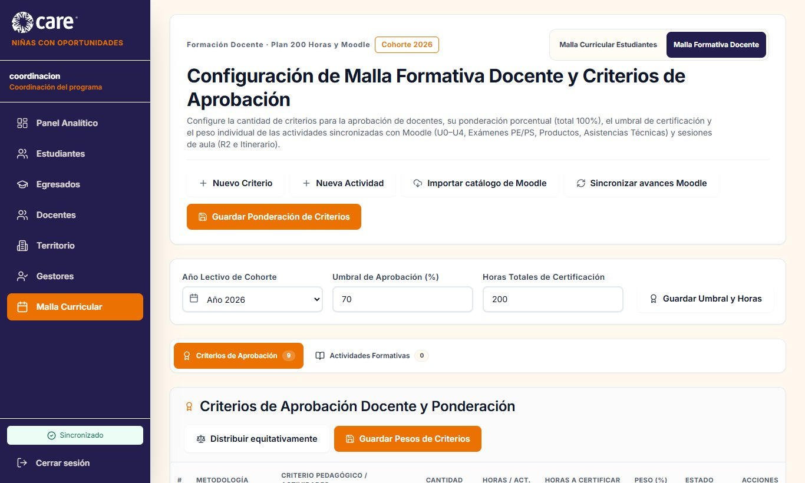

# Configurar el plan formativo docente

Tema 13 de la guía de [Coordinación, administración y monitoreo](./index.md).

En **Malla Curricular** → **Malla Formativa Docente** defines cómo se aprueba el plan formativo de
las docentes de cada cohorte:

- El **umbral de aprobación** y las **horas totales de certificación** (toca **Guardar Umbral y
  Horas**).
- Los **criterios de aprobación**, con su peso porcentual (deben sumar 100 %) y sus actividades.
  **Nuevo Criterio** y **Nueva Actividad** los crean. **Distribuir equitativamente** reparte los
  pesos por igual. Después de cambiar los pesos, toca **Guardar Pesos de Criterios**: si no, los
  cambios se pierden.
- **Importar catálogo de Moodle** y **Sincronizar avances Moodle** traen las actividades y el
  avance de las docentes desde el aula virtual.

*Configuración del plan formativo docente*

Lo que configures aquí es lo que ven las docentes en **Mi Formación**.
