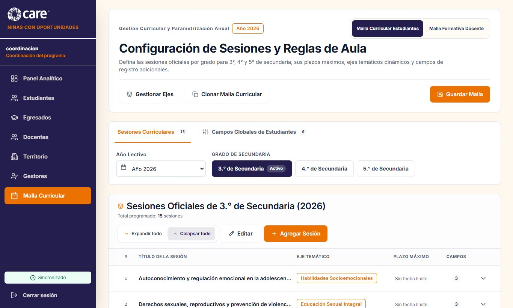
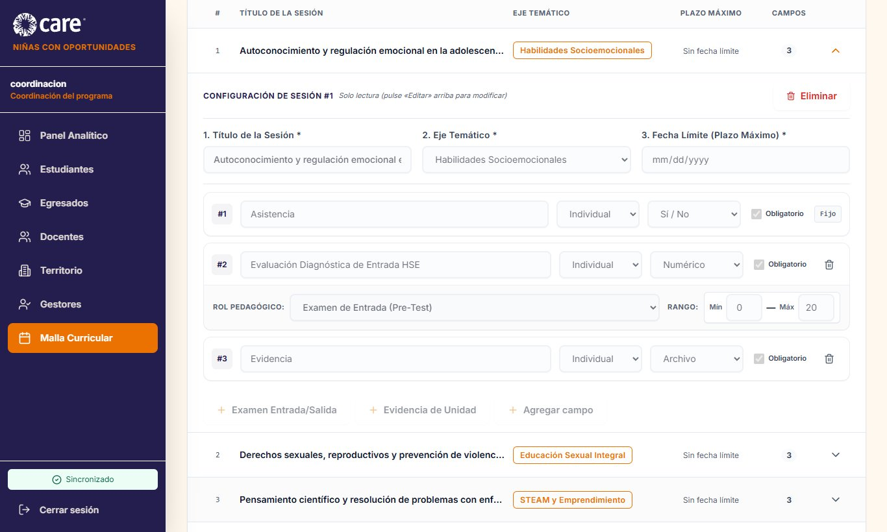
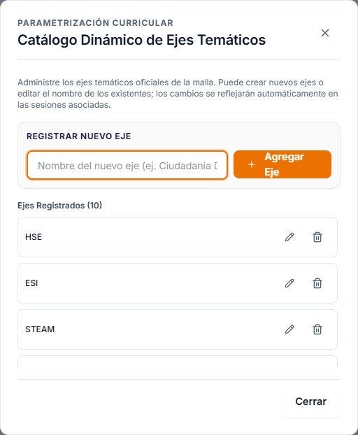

# Configurar las sesiones de la malla curricular

Tema 12 de la guía de [Coordinación, administración y monitoreo](./index.md).

En **Malla Curricular**, el selector de arriba a la derecha tiene dos opciones: **Malla Curricular
Estudiantes** (las sesiones de aula) y **Malla Formativa Docente** (el plan de formación, que se
explica en el tema siguiente). En **Malla Curricular Estudiantes** defines las sesiones oficiales
de cada grado para el año: su título, eje temático, plazo máximo y los campos que la docente debe
registrar.

*Sesiones oficiales de la malla curricular*

1. Elige el año lectivo y el grado.
2. Toca la flecha de una sesión para ver su configuración (evaluación, evidencias y campos).
3. Para cambiar algo, toca **Editar**; para crear una sesión, **Agregar Sesión**.
4. Toca **Guardar Malla**. Los cambios se aplican a todas las secciones activas de ese grado y año.

*Configuración de una sesión*

Cada sesión tiene sus campos de registro: el nombre, si es individual o general, el tipo de dato y si
es obligatorio. En una evaluación también defines su **rol pedagógico** (por ejemplo, examen de
entrada o de salida) y su rango de notas: así la plataforma sabe qué notas usar en la evaluación de
impacto. **Examen Entrada/Salida**, **Evidencia de Unidad** y **Agregar campo** añaden campos.

**Gestionar Ejes** crea o renombra los ejes temáticos; los cambios se reflejan en las sesiones
asociadas. **Clonar Malla Curricular** copia la malla de un grado a otro, o de un año lectivo a otro.

*Catálogo de ejes temáticos*
