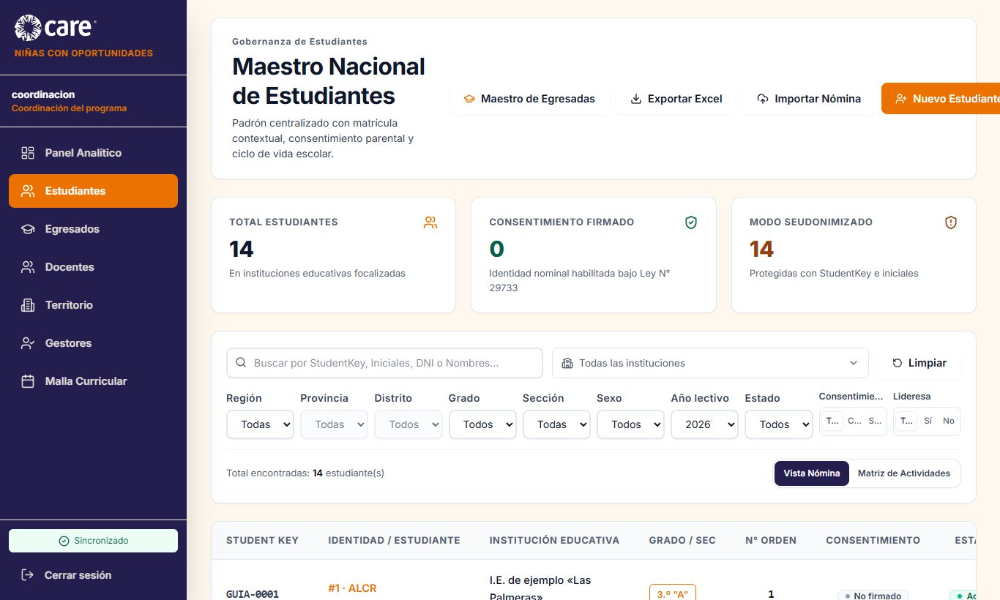

# Consultar el padrón de estudiantes

Tema 4 de la guía de [Coordinación, administración y monitoreo](./index.md).

En **Estudiantes** está el padrón nacional. Cada estudiante tiene un **StudentKey**: su código
único en el programa (por ejemplo, GUIA-0001), que no cambia aunque cambie de sección o de año.
Puedes buscar por StudentKey, iniciales, DNI o nombres, y filtrar por región, grado, sección, sexo,
año, estado, consentimiento y lideresa.

Por protección de datos personales (Ley N.° 29733), las estudiantes sin consentimiento firmado de
sus padres aparecen **seudonimizadas**: solo con su StudentKey e iniciales, sin nombre ni DNI.

*Padrón nacional de estudiantes*

La pestaña **Matriz de Actividades** muestra la asistencia y las notas por sesión. **Exportar
Excel** descarga el listado filtrado.
