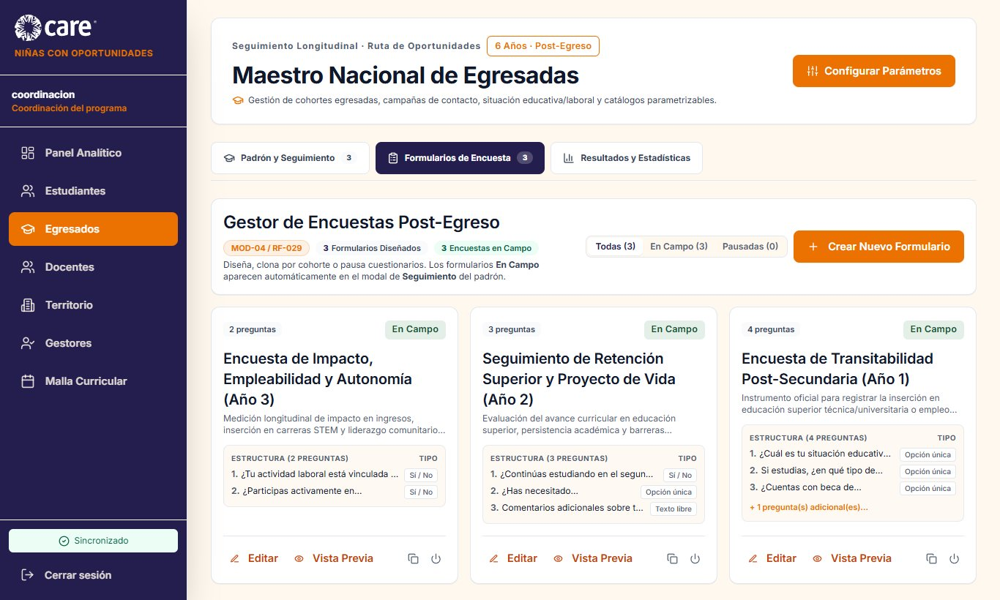
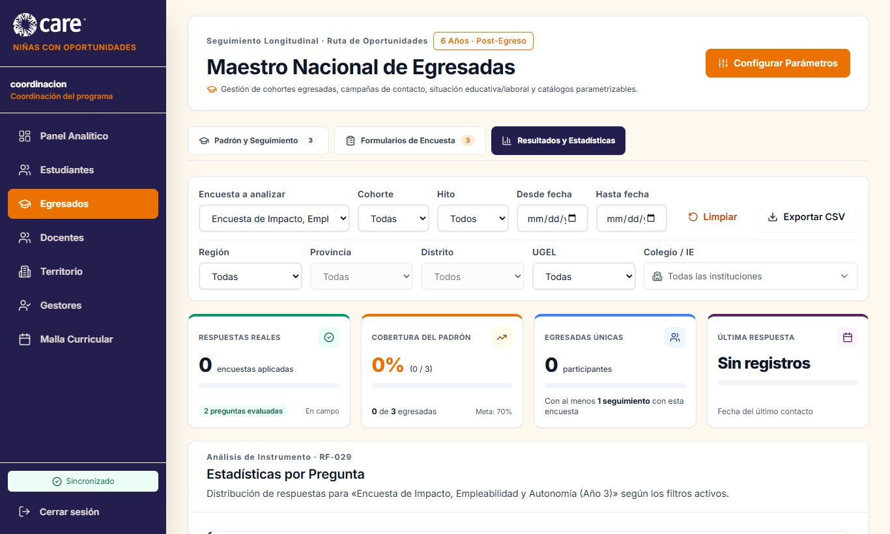

# Diseñar encuestas y ver resultados de egresadas

Tema 7 de la guía de [Coordinación, administración y monitoreo](./index.md).

En la pestaña **Formularios de Encuesta** están los cuestionarios de seguimiento. Para crear uno,
toca **Crear Nuevo Formulario**. En cada tarjeta, **Editar** cambia sus preguntas, **Vista Previa**
lo muestra como lo verá quien responde, y los íconos de abajo a la derecha lo clonan o lo pausan.
Los formularios **En Campo** aparecen automáticamente en la ventana de **Seguimiento** de cada
egresada.

*Formularios de encuesta post-egreso*

En **Resultados y Estadísticas** eliges una encuesta en **Encuesta a analizar** y ves las
respuestas por pregunta, la cobertura del padrón y la fecha de la última respuesta. **Exportar
CSV** descarga las respuestas. Si la encuesta todavía no tiene respuestas, los indicadores
aparecen en cero y dicen «Sin registros», como en la imagen.

*Resultados de una encuesta*
