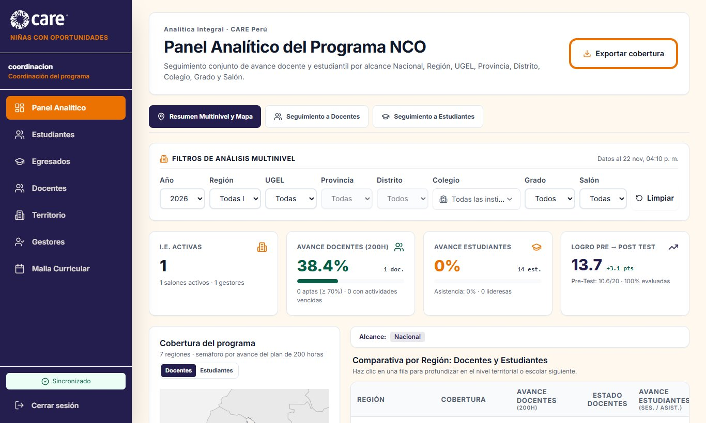

# Exportar la cobertura

Tema 3 de la guía de [Coordinación, administración y monitoreo](./index.md).

Para llevarte los datos del panel a una hoja de cálculo, aplica los filtros que necesites y toca
**Exportar cobertura**.

*Botón Exportar cobertura*
