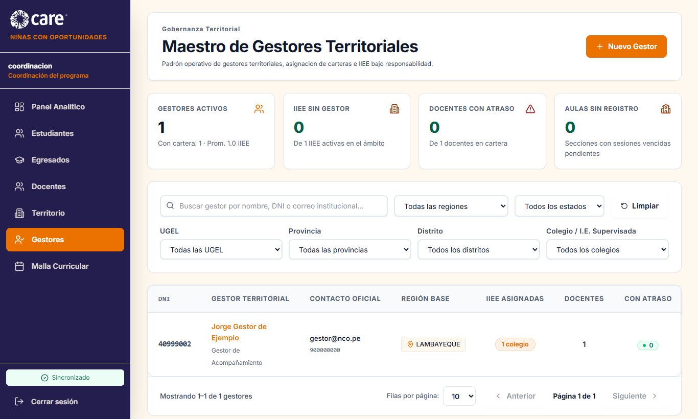
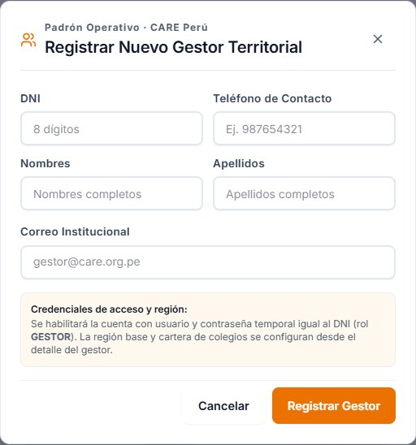
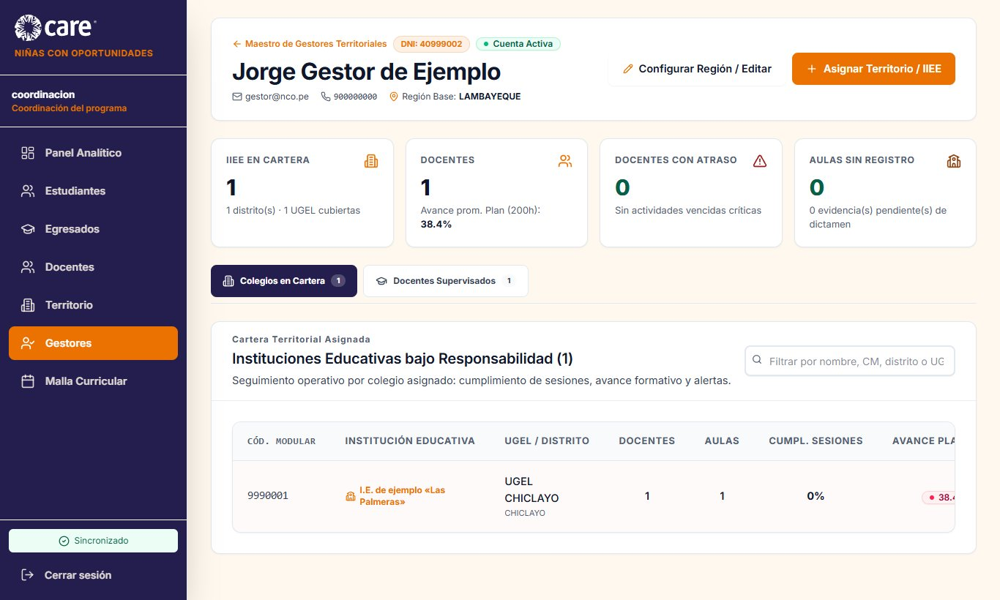

# Gestionar a los gestores territoriales

Tema 11 de la guía de [Coordinación, administración y monitoreo](./index.md).

**Gestores** (solo coordinación y administración) lista a los gestores territoriales con los
colegios y docentes a su cargo, y las alertas de atraso.

*Maestro de gestores territoriales*

Para registrar a un gestor, toca **Nuevo Gestor**, completa su DNI, teléfono, nombres y correo
institucional, y toca **Registrar Gestor**. Su cuenta se crea con usuario y clave temporal igual a
su DNI; en su primer ingreso la plataforma le pide cambiarla.

*Formulario para registrar un gestor*

Para asignarle colegios, abre su ficha tocando su nombre y usa **Asignar Territorio / IIEE**.
**Configurar Región / Editar** cambia su región base.

*Ficha de un gestor con su cartera de colegios*
