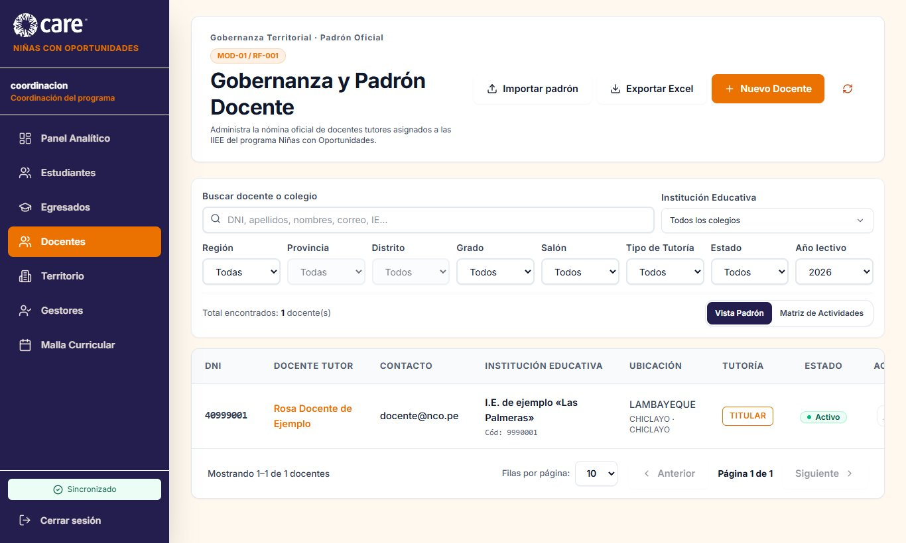
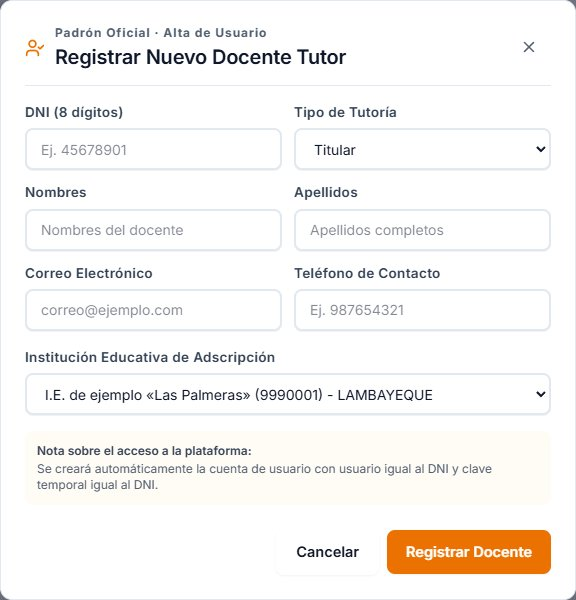
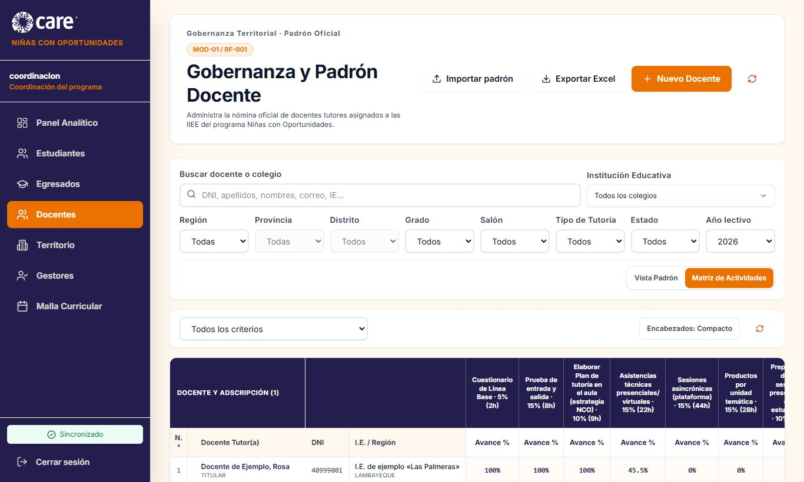

# Gestionar el padrón docente

Tema 8 de la guía de [Coordinación, administración y monitoreo](./index.md).

En **Docentes** está el padrón de docentes tutoras, con su colegio, ubicación, tipo de tutoría y
estado.

*Padrón docente*

Para registrar a una docente:

1. Toca **Nuevo Docente**.
2. Escribe su DNI, nombres, apellidos, correo y teléfono, y elige el tipo de tutoría y su colegio.
3. Toca **Registrar Docente**. La plataforma crea su cuenta: el usuario y la clave temporal son su
   DNI. En su primer ingreso, la plataforma le pedirá cambiar esa clave por una propia.
4. Envíale a la docente la dirección de la plataforma, su usuario (su DNI) y el enlace a la
   [guía docente](../docente/index.md).

*Formulario para registrar una docente*

**Importar padrón** carga varias docentes desde un archivo, y el lápiz al final de cada fila edita
sus datos (desplaza la tabla hacia la derecha si no lo ves). Ambas acciones son de coordinación y
administración. La pestaña **Matriz de Actividades**
muestra el avance de cada docente en las actividades del plan formativo:

*Matriz de actividades de las docentes*
