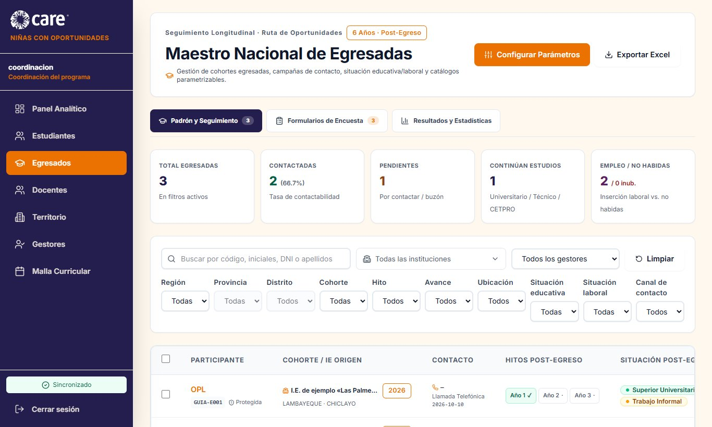
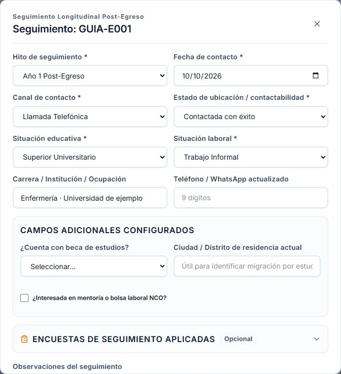

# Hacer seguimiento a las egresadas

Tema 6 de la guía de [Coordinación, administración y monitoreo](./index.md).

En **Egresados** se hace el seguimiento de las estudiantes después de terminar el colegio. Los
indicadores muestran cuántas fueron contactadas, cuántas siguen estudiando y cuántas trabajan.

*Padrón y seguimiento de egresadas*

Para registrar un contacto:

1. En la fila de la egresada, toca **Seguimiento** (al final de la fila; desplaza la tabla hacia
   la derecha si no lo ves).
2. Elige el hito (cuántos años pasaron desde que egresó), la fecha, el canal de contacto y si
   fue ubicada.
3. Registra su situación educativa y laboral, y la carrera, institución u ocupación.
4. Completa los campos adicionales y, si aplicaste una encuesta, abre **Encuestas de seguimiento
   aplicadas** y registra sus respuestas.
5. Toca **Registrar Seguimiento**, al final de la ventana.

*Registro de seguimiento de una egresada*

**Configurar Parámetros** (solo coordinación y administración) define los catálogos y campos del
seguimiento.
