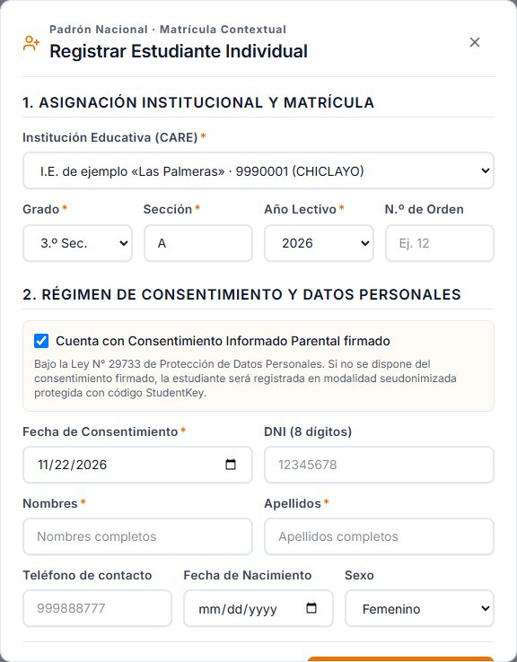
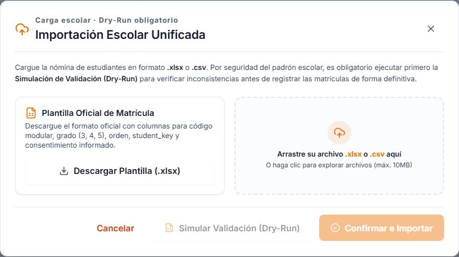

# Registrar o importar estudiantes

Tema 5 de la guía de [Coordinación, administración y monitoreo](./index.md).

Para registrar a una estudiante:

1. Toca **Nuevo Estudiante**.
2. Elige la institución educativa, el grado, la sección, el año lectivo y el número de orden.
3. Marca si cuenta con consentimiento informado firmado. Sin consentimiento, la estudiante se
   registra seudonimizada. Con consentimiento, indica también la fecha en que se firmó.
4. Completa sus datos (los campos con asterisco son obligatorios) y toca **Registrar Estudiante**,
   al final de la ventana.

*Formulario para registrar una estudiante*

Para cargar una nómina completa:

1. Toca **Importar Nómina**. En la ventana, toca **Descargar Plantilla (.xlsx)**: es el formato
   oficial, con las columnas que la plataforma espera.
2. Llena la plantilla y arrástrala al recuadro punteado de la derecha (o haz clic en él para
   elegirla). Acepta .xlsx o .csv de hasta 10 MB.
3. Toca **Simular Validación (Dry-Run)**. La simulación revisa el archivo **sin grabar nada** y te
   muestra las filas con problemas. Es obligatoria: corrige el archivo y vuelve a simular si hace
   falta.
4. Cuando la simulación no muestre errores, toca **Confirmar e Importar**.

*Importación de la nómina escolar*
