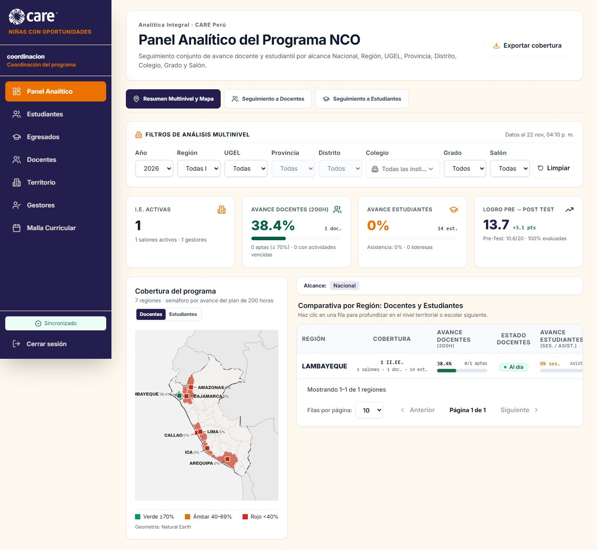
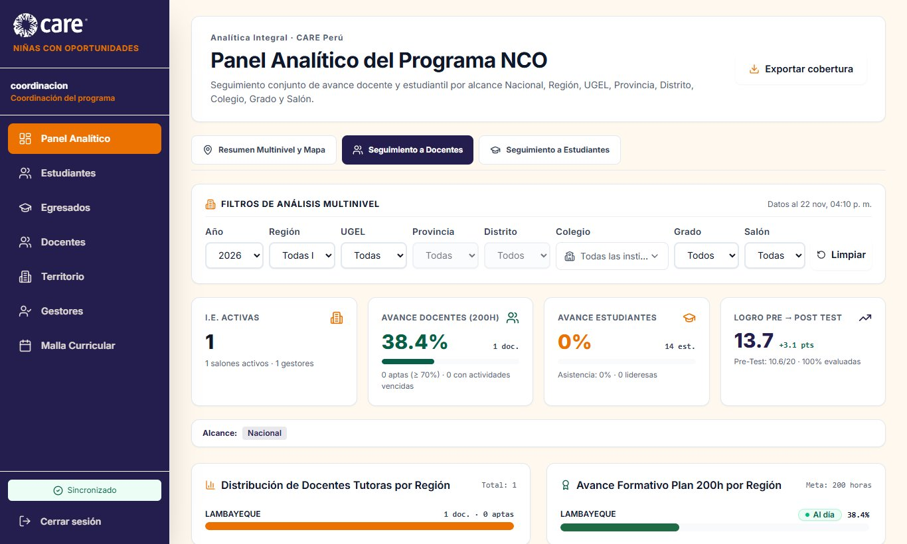
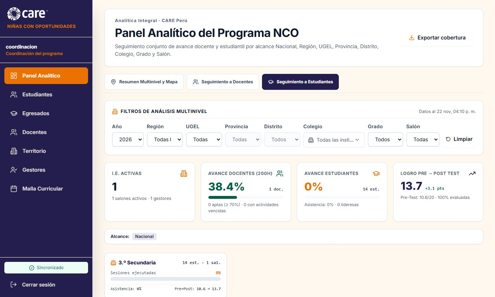

# Revisar el panel analítico

Tema 2 de la guía de [Coordinación, administración y monitoreo](./index.md).

El **Panel Analítico** resume el avance del programa. Arriba están los filtros (año, región, UGEL,
provincia, distrito, colegio, grado y salón) y debajo cuatro indicadores:

- **I.E. activas**: colegios, salones y gestores en el filtro.
- **Avance docentes**: avance promedio del plan formativo y cuántas docentes están aptas.
- **Avance estudiantes**: sesiones ejecutadas y asistencia.
- **Logro pre → post test**: puntaje promedio de salida y diferencia con el de entrada.

La pestaña **Resumen Multinivel y Mapa** muestra la cobertura por región con un semáforo. Haz clic
en una fila de la tabla para bajar al siguiente nivel (región → UGEL → colegio).

*Panel analítico con filtros, indicadores y mapa de cobertura*

Las pestañas **Seguimiento a Docentes** y **Seguimiento a Estudiantes** muestran el mismo filtro
con el detalle por región y por grado:

*Seguimiento a docentes por región*

*Seguimiento a estudiantes por grado*
