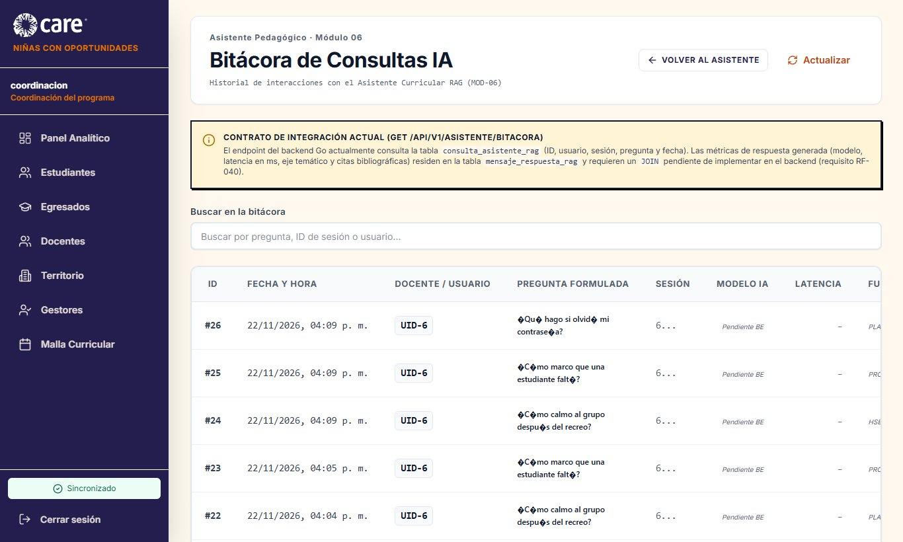

# Revisar la bitácora del asistente

Tema 14 de la guía de [Coordinación, administración y monitoreo](./index.md).

La **Bitácora de Consultas IA** registra las preguntas que las docentes hacen al asistente
curricular: la fecha, el usuario, la pregunta y el eje de la guía que respondió. Sirve para ver
qué temas consultan más. Puedes buscar por pregunta, sesión o usuario. Coordinación y monitoreo la
pueden abrir. Cada usuario aparece con su código interno (por ejemplo, UID-6), no con su nombre.

Esta pantalla todavía no tiene botón en el menú. Para abrirla, en la barra de direcciones del
navegador cambia lo que va después del nombre de la plataforma por **/asistente/bitacora** y presiona Enter.
Por ejemplo, `plataforma.ejemplo.pe/analitica/cobertura` pasa a ser `plataforma.ejemplo.pe/asistente/bitacora`. Guárdala
en tus favoritos para volver con un clic.

Por ahora las columnas de modelo y latencia aparecen como «Pendiente BE», y arriba hay un recuadro
con una nota técnica para el equipo de desarrollo: puedes ignorarlo. Esos datos se guardan, pero
la pantalla todavía no los muestra.

*Bitácora de consultas al asistente*
