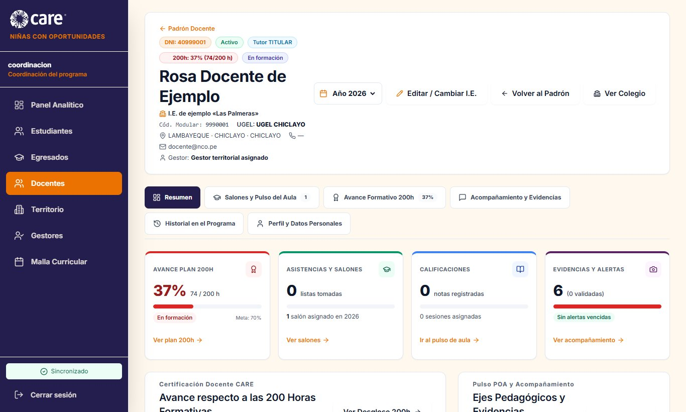

# Ver la ficha de una docente

Tema 9 de la guía de [Coordinación, administración y monitoreo](./index.md).

Toca el nombre de una docente para abrir su ficha. Ahí ves su avance en el plan formativo, sus
salones y asistencia, sus calificaciones registradas y sus evidencias, organizados en pestañas:
**Resumen**, **Salones y Pulso del Aula**, **Avance Formativo**, **Acompañamiento y Evidencias**,
**Historial en el Programa** y **Perfil y Datos Personales**.

*Ficha de una docente*

Desde la ficha puedes cambiar el año, editar sus datos o su colegio, y abrir la ficha del colegio.
