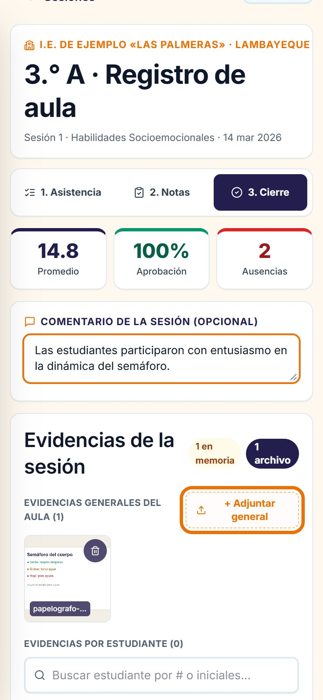

# Adjuntar evidencias y comentar la sesión

Tema 9 de la guía de [Docente y cotutor](./index.md).

En el paso **3. Cierre** ves el resumen de la sesión (promedio, porcentaje de aprobación y
ausencias) y puedes dejar constancia de lo que hiciste.

1. En **Comentario de la sesión (opcional)**, escribe observaciones generales sobre cómo se
   desarrolló la clase.
2. Para subir fotos del aula (por ejemplo, un papelógrafo), toca **+ Adjuntar general**. En
   el celular puedes tomar la foto en ese momento o elegirla de tu galería. Puedes elegir
   varias a la vez.
3. Si la evidencia es de una estudiante en particular, toca **Adjuntar** en su fila. Las
   estudiantes ausentes no pueden tener evidencia: su botón aparece apagado.

*Comentario de la sesión y evidencia adjunta*

Las fotos se comprimen automáticamente para que pesen poco y se suban rápido aunque tengas
poca señal. También puedes adjuntar documentos en PDF o Word. Si te equivocaste de archivo,
toca el ícono del tacho sobre la miniatura para quitarlo.

Si la sesión dice **Requiere evidencia fotográfica**, sube al menos una foto antes de cerrar. La
plataforma te deja cerrar sin fotos, pero la evidencia es parte de tu registro de la sesión.

Al final del paso aparece **Guardar cambios**: guarda lo que llevas sin cerrar la sesión, por si
necesitas terminar más tarde. No es necesario tocarlo antes de cerrar.
