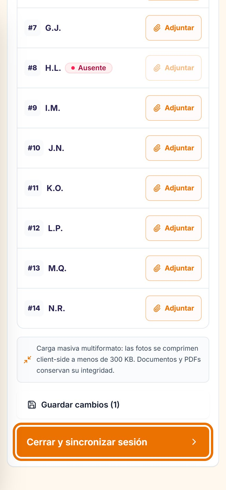
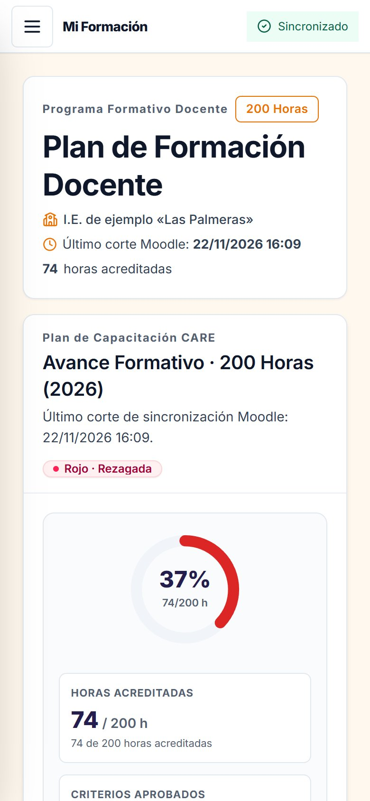
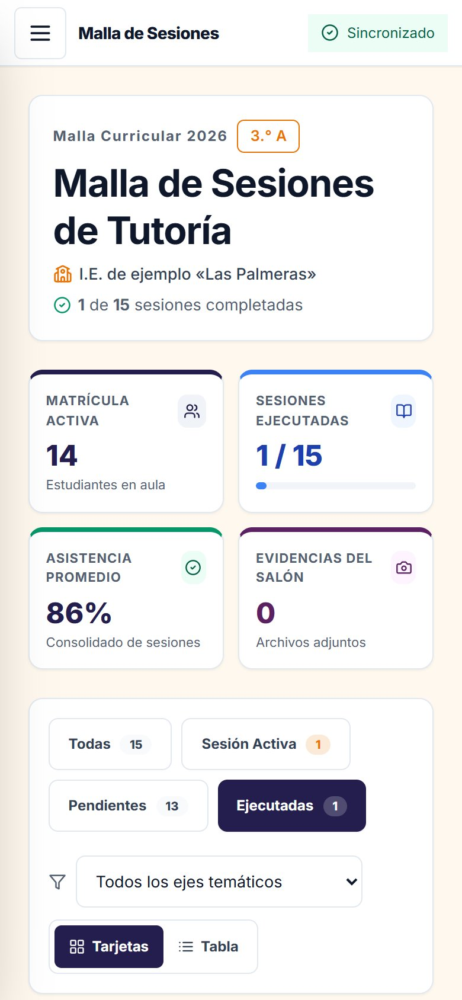

# Cerrar y sincronizar la sesión

Tema 10 de la guía de [Docente y cotutor](./index.md).

Al final del paso **3. Cierre**, toca **Cerrar y sincronizar sesión**.

*Botón Cerrar y sincronizar sesión*

**Cuidado con los nombres parecidos:** **Cerrar y sincronizar sesión** termina la sesión de clase
que registraste. **Cerrar sesión**, al final del menú, te saca de la plataforma y no guarda el
registro como terminado.

Si el botón está desactivado, lee el aviso **Pendiente para cerrar** que aparece encima: te
dice qué falta, por ejemplo «Faltan notas obligatorias por registrar en 2 estudiante(s)
presente(s)». Vuelve al paso **2. Notas**, complétalas y regresa al cierre.

Al cerrar, la plataforma guarda la sesión, la marca como ejecutada y te lleva a
**Mi Formación**, donde ves tu avance en el plan formativo.

*Mi Formación después de cerrar la sesión*

En **Sesiones**, la pestaña **Ejecutadas** muestra la sesión cerrada, y la siguiente sesión
pasa a estar activa.

*Malla de sesiones con una sesión ejecutada*
