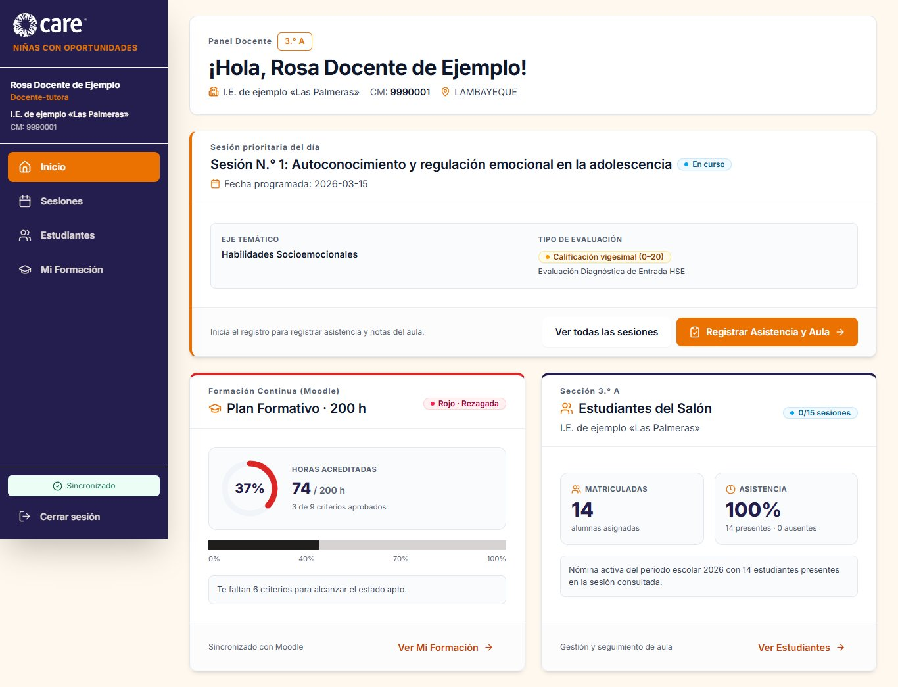

# Conocer tu panel de inicio

Tema 3 de la guía de [Docente y cotutor](./index.md).

El **Panel de inicio** es lo primero que ves al ingresar. Reúne lo más importante del día:

- **Encabezado**: tu nombre, tu colegio, el código modular y tu sección (por ejemplo, 3.° A).
- **Sesión prioritaria del día**: la sesión que te toca dictar, con su eje temático y el tipo
  de evaluación. Desde aquí entras al registro con **Registrar Asistencia y Aula**.
- **Plan Formativo**: cuántas horas de formación llevas acreditadas y tu semáforo de avance.
- **Estudiantes del Salón**: cuántas estudiantes tienes matriculadas y la asistencia de la última sesión.

*Panel de inicio de la docente*

El estado de sincronización aparece al final del menú en la computadora, y arriba a la derecha en
el celular. **Sincronizado** significa que todo lo que registraste ya está guardado en el servidor.

Las palabras **Rojo · Rezagada** y «Te faltan N criterios» se refieren a tu plan de formación: se
explican en [Revisar tu avance en Mi Formación](./revisar-tu-avance-en-mi-formacion.md).
