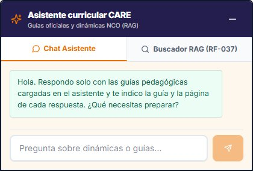
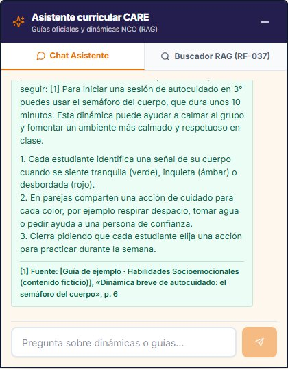
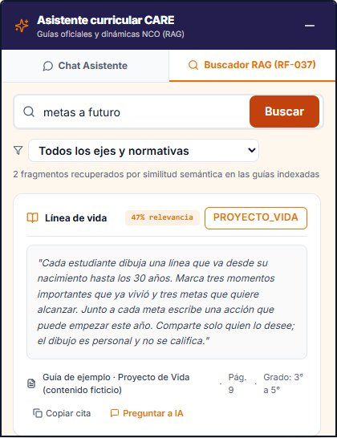
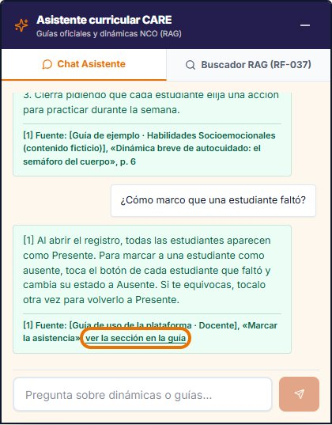

# Consultar al asistente curricular

Tema 16 de la guía de [Docente y cotutor](./index.md).

El asistente curricular responde preguntas sobre cómo preparar tus sesiones, usando solo las
guías pedagógicas del programa. Cada respuesta indica la guía y la sección de donde sale, para
que puedas revisarla.

1. Abre la página del asistente. La página todavía no tiene botón en el menú. Para abrirla, en la barra de direcciones del navegador cambia lo que va después del nombre de la plataforma por **/asistente** y presiona Enter. Por ejemplo, `plataforma.ejemplo.pe/inicio` pasa a ser `plataforma.ejemplo.pe/asistente`. Guárdala en tus favoritos para volver con un clic.
2. En **Chat Asistente**, escribe tu pregunta y toca el botón de enviar. Por ejemplo: «¿Cómo
   calmo al grupo después del recreo?».

*Página del asistente curricular*

3. Lee la respuesta. Los números entre corchetes, como **[1]**, indican de qué fuente sale cada
   parte. Debajo aparece cada **Fuente**: la guía, la sección y la página, para que la revises.

*Respuesta del asistente con sus fuentes*

Si preguntas algo que no está en las guías, el asistente te lo dirá en lugar de inventar una
respuesta. Si un aviso indica que se quitaron citas, revisa la
fuente antes de aplicar la sugerencia.

En la pestaña **Buscador RAG** puedes buscar fragmentos de las guías por tema: escribe una o dos
palabras (por ejemplo, «metas a futuro»), toca **Buscar** y, si quieres, filtra por eje temático:

*Buscador de fragmentos de las guías*

El asistente también conoce esta guía de uso: puedes preguntarle, por ejemplo, «¿Cómo marco que
una estudiante faltó?». En esos casos la fuente incluye el enlace **ver la sección en la guía**,
que abre el paso correspondiente de esta página.

*El asistente responde con la guía de uso y enlaza a la sección*
