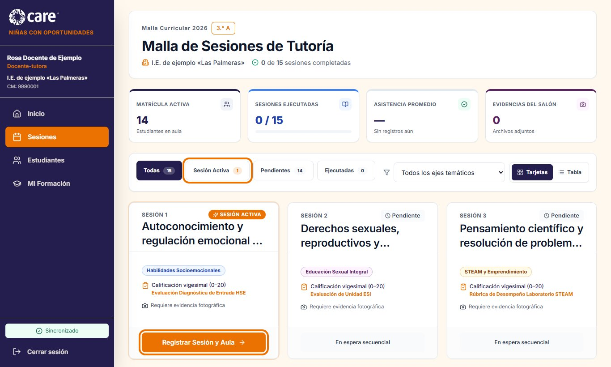
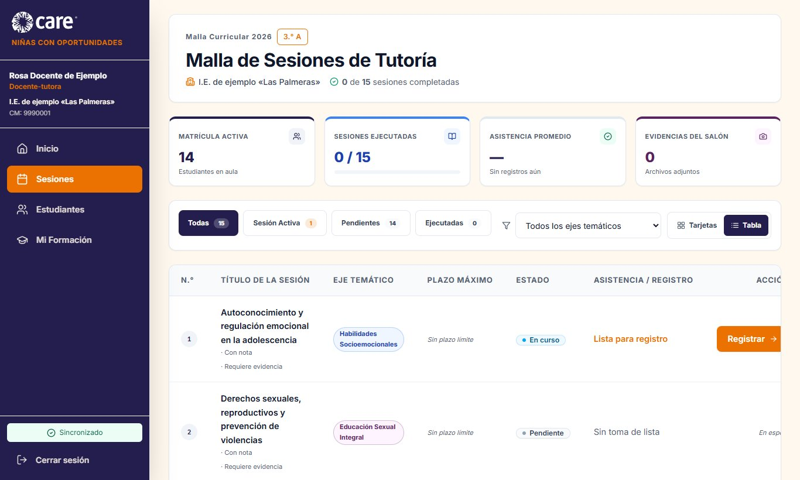

# Consultar la malla de sesiones

Tema 5 de la guía de [Docente y cotutor](./index.md).

En **Sesiones** ves todas las sesiones de tutoría del año para tu sección, en orden.

- Arriba tienes el resumen: estudiantes en aula, sesiones ejecutadas, asistencia promedio y
  evidencias del salón.
- Las pestañas **Todas**, **Sesión Activa**, **Pendientes** y **Ejecutadas** filtran la lista.
  También puedes filtrar por eje temático.
- La **sesión activa** es la que corresponde dictar ahora. Las demás aparecen «En espera
  secuencial»: se habilitan en orden, cuando cierras la anterior.
- Para empezar a registrar la sesión activa, toca **Registrar Sesión y Aula**.

*Malla de sesiones con la sesión activa resaltada*

Si prefieres una lista compacta, toca **Tabla** (junto a **Tarjetas**):

*Malla de sesiones en vista de tabla*
