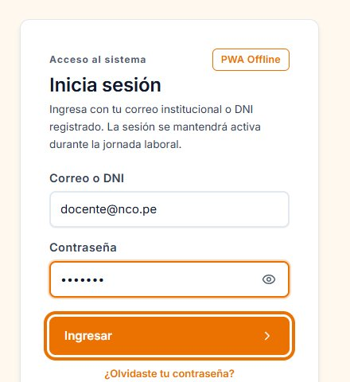

# Ingresar a la plataforma

Tema 1 de la guía de [Docente y cotutor](./index.md).

Para entrar a la plataforma necesitas tres datos que te entrega tu gestor territorial o la
coordinación del programa: la **dirección de la plataforma** (empieza con `https://`), tu
**usuario** (tu correo institucional o tu DNI) y tu **contraseña**. Si te acaban de crear la
cuenta, tu contraseña inicial es tu número de DNI.

1. Abre el navegador de tu celular o computadora (por ejemplo, Chrome), escribe la dirección de
   la plataforma en la barra de arriba y presiona Enter.
2. En **Correo o DNI**, escribe tu correo institucional o tu número de DNI.
3. En **Contraseña**, escribe tu clave. Puedes tocar el ícono del ojo para ver lo que escribiste.
4. Toca **Ingresar**. La plataforma te lleva a tu **Panel de inicio**.

*Formulario de ingreso con el botón Ingresar resaltado*

**La primera vez** que ingresas con la contraseña inicial, la plataforma te pide cambiarla: aparece
el aviso «Cambia la contraseña temporal para continuar». Escribe una contraseña nueva de al menos
8 caracteres en los dos campos y toca **Cambiar contraseña e ingresar**. Desde ese momento usa la
contraseña nueva.

Tu sesión se mantiene abierta durante la jornada. Si escribes mal la contraseña, verás el
mensaje «Credenciales incorrectas»: revisa que no tengas activadas las mayúsculas.

En el celular, puedes guardar la plataforma como una aplicación: en el menú del navegador (los
tres puntos de Chrome) toca **Agregar a la pantalla principal**. Así la abres con un toque, como
cualquier otra aplicación.
