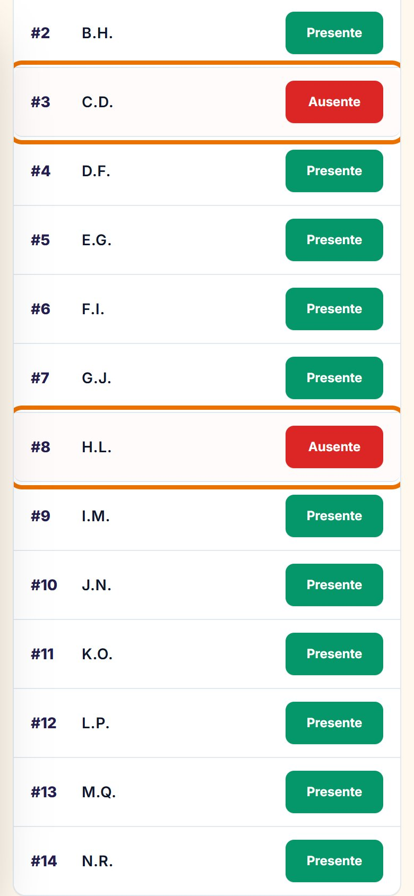

# Marcar la asistencia

Tema 7 de la guía de [Docente y cotutor](./index.md).

Al abrir el registro, todas las estudiantes aparecen como **Presente**.

1. Toca el botón de cada estudiante que faltó: cambia a **Ausente**. Si te equivocas, tócalo
   otra vez y vuelve a **Presente**.
2. Revisa los contadores de **Presentes** y **Ausentes** en la parte superior.
3. Si necesitas encontrar a una estudiante, usa el buscador por número, iniciales o código.
4. Cuando termines, toca **Continuar a calificación**.

*Dos estudiantes marcadas como ausentes*
