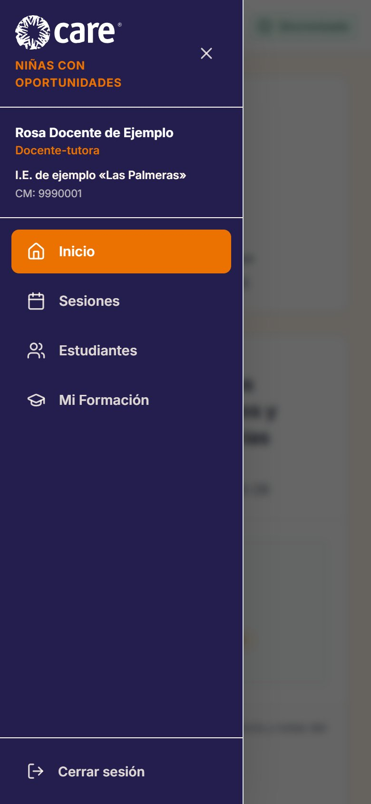

# Moverte por el menú desde el celular

Tema 4 de la guía de [Docente y cotutor](./index.md).

En la computadora, el menú está siempre a la izquierda. En el celular está oculto para dejar
más espacio:

1. Toca el botón de las tres rayas, arriba a la izquierda.
2. Elige **Inicio**, **Sesiones**, **Estudiantes** o **Mi Formación**.
3. Para salir de la plataforma, toca **Cerrar sesión** al final del menú.

*Menú abierto en el celular*

Si compartes el celular o la computadora, cierra sesión al terminar.
