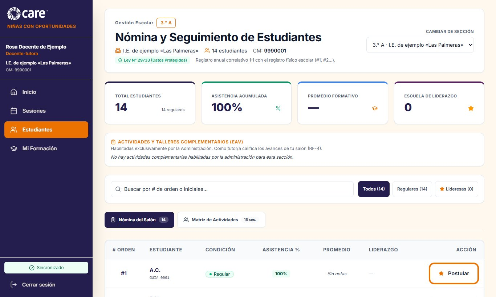
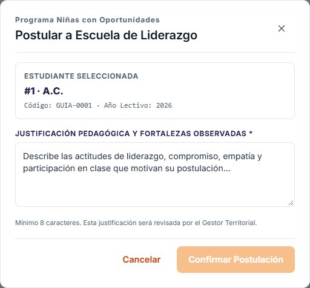

# Postular a una estudiante a la Escuela de Liderazgo

Tema 14 de la guía de [Docente y cotutor](./index.md).

Si una estudiante destaca por su liderazgo, puedes postularla a la Escuela de Liderazgo.

1. En **Estudiantes**, busca a la estudiante y toca **Postular** en su fila.

*Botón Postular en la nómina*

2. En la ventana **Postular a Escuela de Liderazgo**, escribe la justificación pedagógica: las
   actitudes de liderazgo, compromiso, empatía y participación que observaste. Es obligatoria.
3. Toca **Confirmar Postulación**. Tu gestor territorial revisará la postulación.

*Ventana para postular a la Escuela de Liderazgo*

El filtro **Lideresas** de la nómina muestra a las estudiantes que ya forman parte de la Escuela
de Liderazgo.
