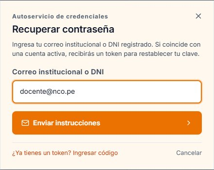

# Recuperar tu contraseña

Tema 2 de la guía de [Docente y cotutor](./index.md).

Si olvidaste tu contraseña, puedes crear una nueva sin pedir ayuda. Necesitas acceso a tu correo
institucional.

1. En la pantalla de ingreso, toca **¿Olvidaste tu contraseña?** (debajo del botón Ingresar).
2. En la ventana **Recuperar contraseña**, escribe tu correo institucional o tu DNI y toca
   **Enviar instrucciones**.
3. Abre tu correo. Te llegará un mensaje de la plataforma con el botón **Restablecer
   contraseña**. Tócalo: se abre la plataforma.
4. Escribe tu nueva contraseña dos veces y confírmala. Luego ingresa con ella.

*Ventana para recuperar la contraseña*

El enlace del correo **vence a los 15 minutos**. Si venció, vuelve a pedirlo desde el paso 1.
Si no te llega el correo en unos minutos, revisa la carpeta de correo no deseado o comunícate
con tu gestor territorial.

Si en lugar del botón recibiste un código (token), vuelve a abrir **¿Olvidaste tu contraseña?**,
toca **¿Ya tienes un token? Ingresar código**, pega el código y escribe tu nueva contraseña.
