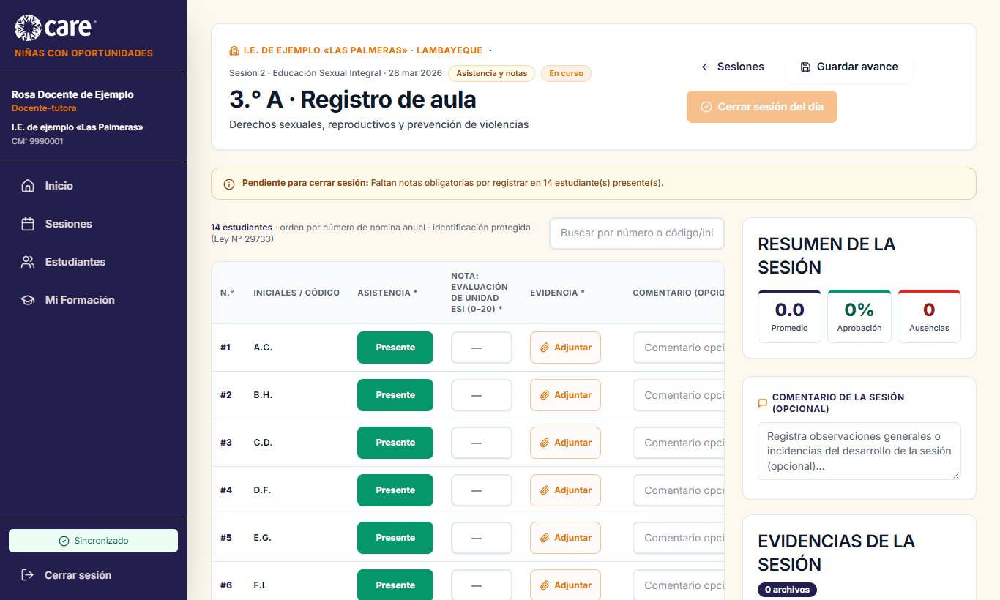

# Registrar la sesión desde la computadora

Tema 11 de la guía de [Docente y cotutor](./index.md).

En la computadora, el registro de aula muestra todo en una sola tabla: asistencia, nota,
evidencia y comentario de cada estudiante, con el resumen y las evidencias a la derecha.

1. Entra a **Sesiones** y toca **Registrar Sesión y Aula** en la sesión activa (en la vista
   **Tabla**, el botón se llama **Registrar**).
2. En cada fila, toca **Presente** para cambiarlo a **Ausente** si la estudiante faltó, escribe
   la nota en su casilla y, si corresponde, toca **Adjuntar** para subir su evidencia.
3. Toca **Guardar avance** (arriba a la derecha) para guardar sin cerrar; puedes terminar más tarde.
4. Cuando todo esté completo, toca **Cerrar sesión del día**. Mientras falte algo, el botón está
   apagado y el aviso **Pendiente para cerrar sesión** dice qué falta.

*Registro de aula en la computadora*

La tabla muestra diez estudiantes por página: usa **Siguiente** y **Anterior** para ver el resto.
Igual que en el celular, **Cerrar sesión del día** termina la sesión de clase, y **Cerrar sesión**
del menú te saca de la plataforma.
