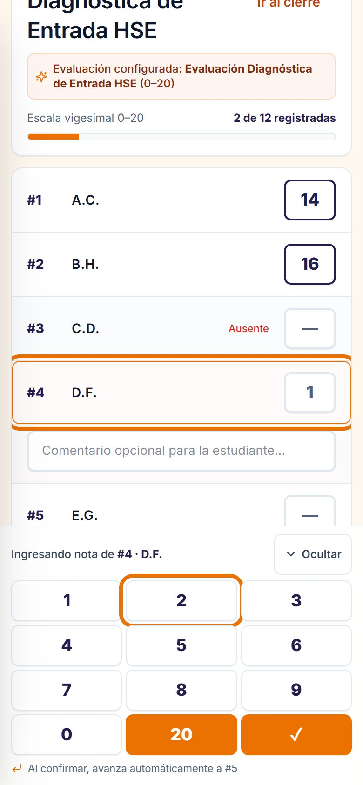

# Registrar las notas

Tema 8 de la guía de [Docente y cotutor](./index.md).

En el paso **2. Notas** registras la evaluación que corresponde a la sesión. El nombre de la
evaluación y su escala aparecen arriba (por ejemplo, «Evaluación Diagnóstica de Entrada HSE»,
escala de 0 a 20). Solo se califica a las estudiantes presentes; las ausentes aparecen con «—».

1. Toca la fila de la estudiante. Abajo aparece un teclado con números.
2. Toca los dígitos de la nota, uno por uno. Por ejemplo, para un 12 toca **1** y luego **2**.
   El botón **20** escribe la nota máxima de un solo toque.
3. Toca **✓** para confirmar. La plataforma pasa sola a la siguiente estudiante.
4. Si quieres, escribe un comentario opcional para esa estudiante en el cuadro que aparece
   debajo de su fila.
5. Cuando termines, toca **Continuar al cierre de sesión**, al final de la lista.

*Nota de la estudiante #4: se tocó 1 y falta tocar 2 para registrar un 12*

La barra de avance (por ejemplo, «2 de 12 registradas») te indica cuántas notas llevas. Para cerrar
la sesión, todas las estudiantes presentes deben tener nota. **Ocultar** esconde el teclado si
necesitas ver la lista completa; vuelve a tocar una fila para mostrarlo.
