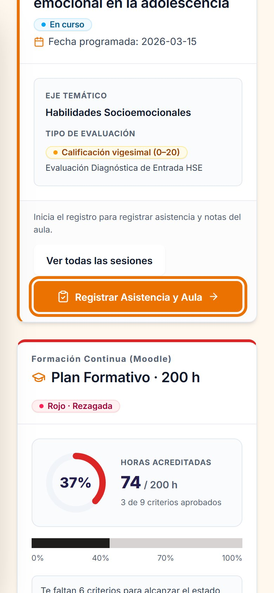
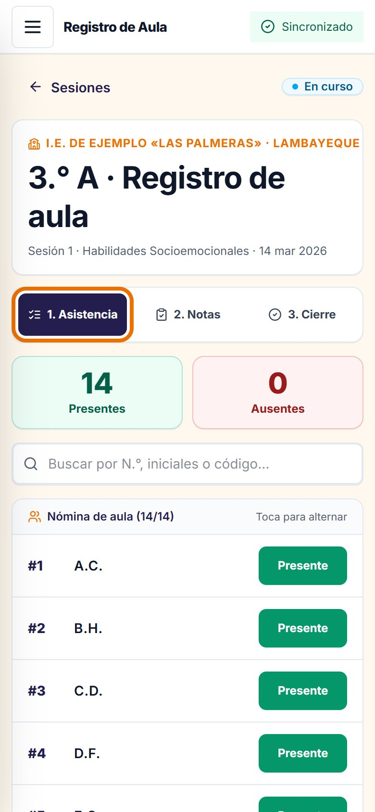

# Registrar una sesión en el aula desde el celular

Tema 6 de la guía de [Docente y cotutor](./index.md).

El registro de una sesión tiene tres pasos: **1. Asistencia**, **2. Notas** y **3. Cierre**.
Puedes hacerlo desde el celular mientras dictas la clase.

1. En el **Panel de inicio**, toca **Registrar Asistencia y Aula**.

*Botón Registrar Asistencia y Aula en el celular*

2. Se abre el **Registro de aula** de tu sección, con la sesión del día. Arriba verás los tres
   pasos (**1. Asistencia**, **2. Notas** y **3. Cierre**); empiezas en **1. Asistencia**.

*Paso 1: registro de aula con los tres pasos arriba*

Por protección de datos personales (Ley N.° 29733), las estudiantes aparecen con su número de
nómina y sus iniciales, no con su nombre completo. El número es el mismo de tu registro escolar.

Sigue con [Marcar la asistencia](./marcar-la-asistencia.md).
