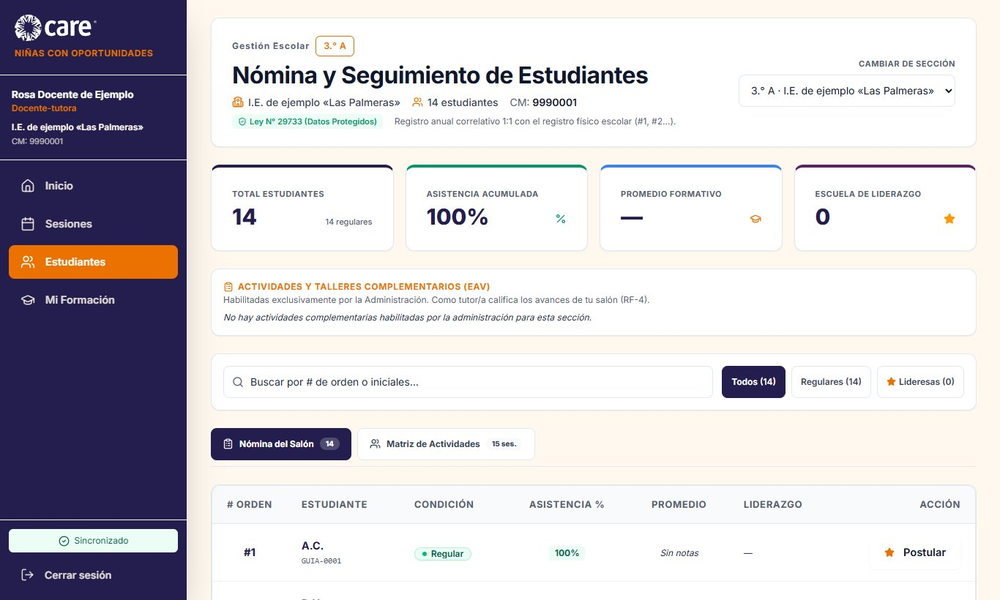
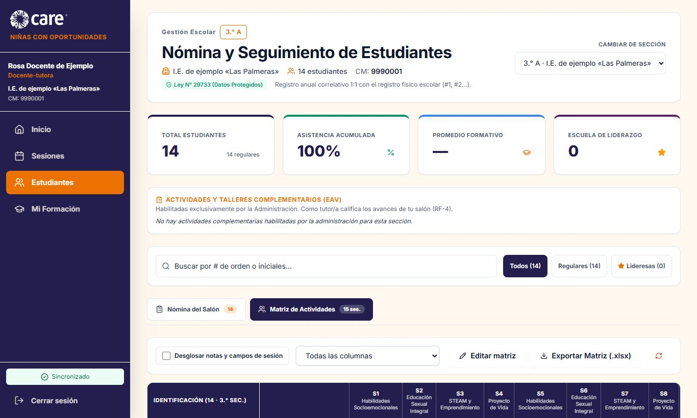

# Revisar la nómina de estudiantes

Tema 13 de la guía de [Docente y cotutor](./index.md).

En **Estudiantes** ves la nómina de tu sección con la condición, el porcentaje de asistencia y
el promedio de cada estudiante.

- Usa los filtros **Todos**, **Regulares** y **Lideresas**, o el buscador.
- En la parte superior puedes cambiar de sección si tienes más de una a cargo (**Cambiar de
  sección**).
- El recuadro **Actividades y talleres complementarios** muestra las actividades extra que la
  administración habilitó para tu sección, para que las califiques. Si no hay ninguna, lo dice.

*Nómina de estudiantes de la sección*

La pestaña **Matriz de Actividades** muestra, sesión por sesión, la asistencia y las notas de
cada estudiante, para ver de un vistazo quién necesita acompañamiento.

*Matriz de actividades por estudiante*
