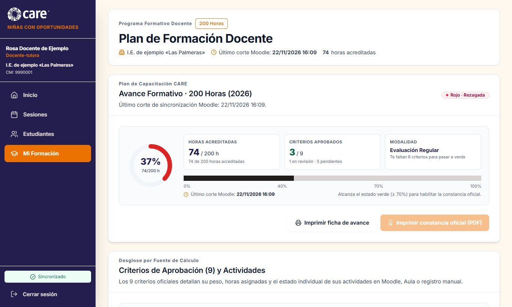
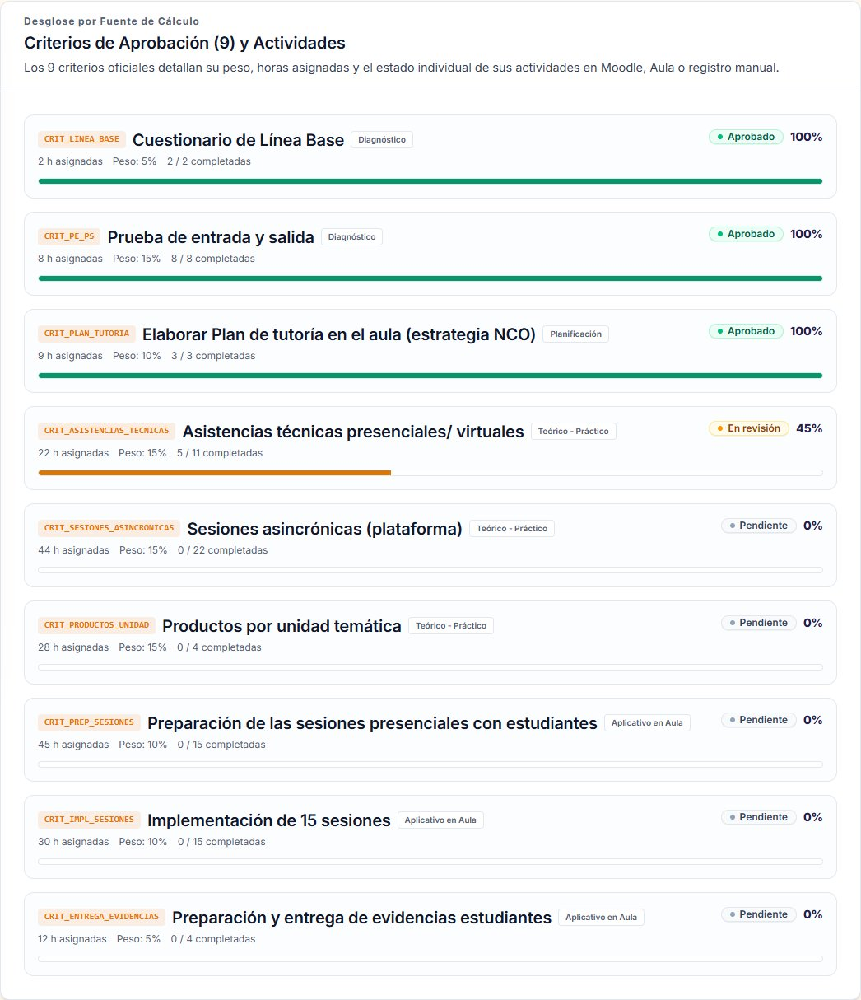

# Revisar tu avance en Mi Formación

Tema 15 de la guía de [Docente y cotutor](./index.md).

En **Mi Formación** ves tu avance en el plan de formación docente del programa.

- El círculo muestra tu porcentaje de avance y las horas acreditadas frente a las horas del plan.
- El semáforo indica tu estado: **rojo** (rezagada), **ámbar** o **verde**. La barra de avance
  tiene marcas que indican desde qué porcentaje cambia cada color. Cuando alcanzas el verde se
  habilita **Imprimir constancia oficial (PDF)**; mientras tanto el botón aparece apagado.
- **Imprimir ficha de avance** genera un resumen de tu avance para imprimir o guardar.
- **Último corte Moodle** indica cuándo se trajeron por última vez tus actividades del aula
  virtual (Moodle).

*Avance formativo de la docente*

Más abajo, **Criterios de Aprobación y Actividades** detalla cada criterio del plan: las horas
asignadas, su peso, cuántas actividades completaste y su estado (Aprobado, En revisión o
Pendiente). Ahí ves qué te falta: los criterios en **Pendiente** son los que aún no empiezas.

*Criterios de aprobación y su estado*

Las horas del plan, los criterios y sus pesos los define la coordinación del programa para cada
cohorte; la plataforma siempre muestra los vigentes.
