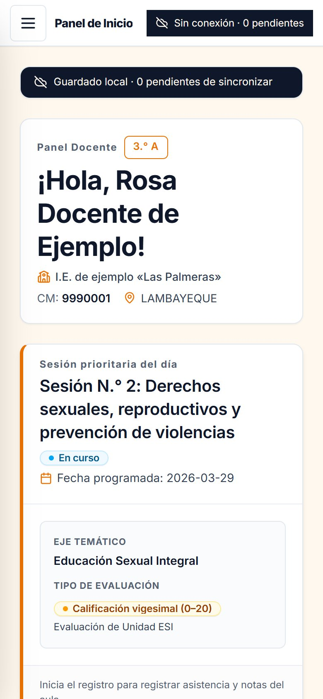

# Trabajar sin conexión a internet

Tema 12 de la guía de [Docente y cotutor](./index.md).

Puedes registrar la asistencia, las notas y las evidencias aunque te quedes sin internet en el
aula. La plataforma guarda todo en tu dispositivo y lo envía al servidor cuando vuelve la señal.

- Cuando no hay conexión, arriba aparece **Sin conexión** y el aviso **Guardado local**, con
  la cantidad de registros **pendientes de sincronizar**.
- Sigue trabajando normalmente. Al recuperar la conexión, la plataforma sincroniza sola y el
  estado vuelve a **Sincronizado**.
- Antes de cerrar sesión o borrar los datos del navegador, espera a que el estado vuelva a
  **Sincronizado**, para asegurarte de que nada quede solo en tu dispositivo.

*Aviso de trabajo sin conexión*

Para entrar a la plataforma por primera vez en un dispositivo sí necesitas conexión. El
asistente curricular también necesita internet para responder.
