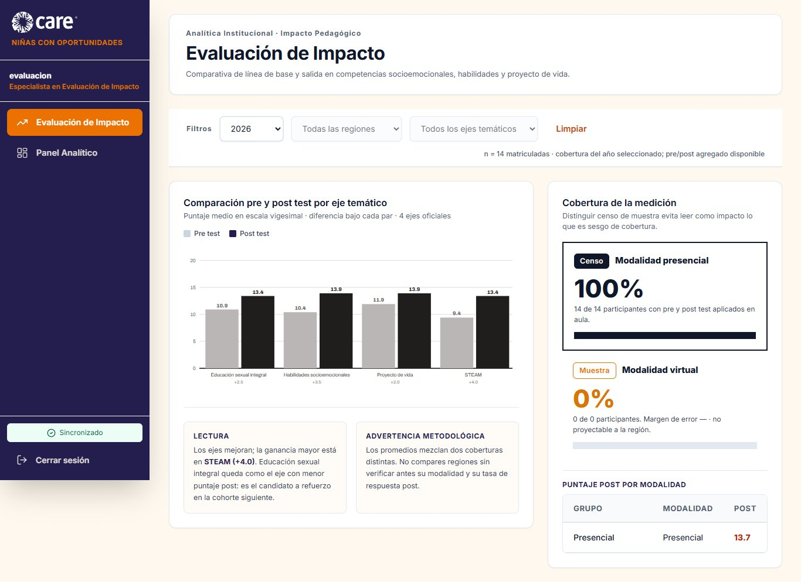

# Comparar las pruebas de entrada y salida

Tema 2 de la guía de [Evaluación de impacto](./index.md).

El gráfico **Comparación pre y post test por eje temático** muestra el puntaje promedio (escala de
0 a 20) de la prueba de entrada (gris) y de salida (negro) en cada eje. Debajo de cada par está la
diferencia.

1. Elige el año, la región y, si quieres, un eje temático en los filtros.
2. Lee el recuadro **Lectura**: resume qué eje mejoró más y cuál quedó más bajo.
3. Antes de comparar regiones, revisa la **Advertencia metodológica**.

*Evaluación de impacto con la comparación pre y post test*
