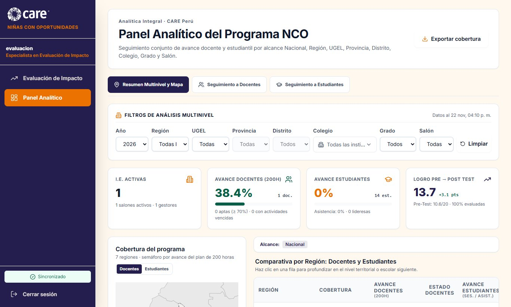
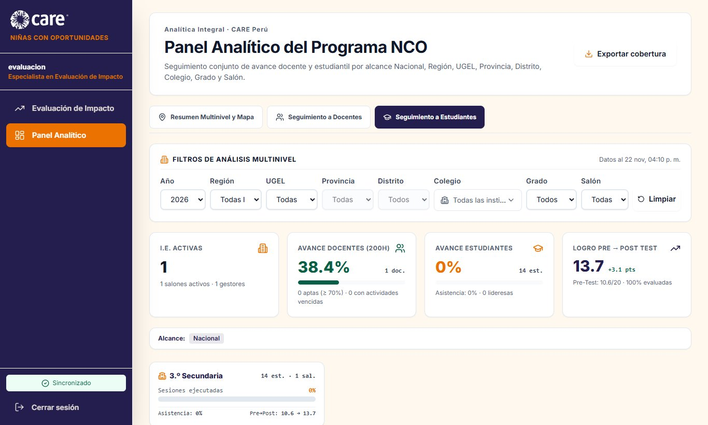

# Consultar el panel analítico

Tema 4 de la guía de [Evaluación de impacto](./index.md).

El **Panel Analítico** muestra la cobertura del programa por región, el avance de las docentes en su
plan formativo y el de las estudiantes, con los mismos filtros territoriales.

*Panel analítico*

La pestaña **Seguimiento a Estudiantes** resume, por grado, las sesiones ejecutadas, la asistencia y
el cambio entre pre y post test:

*Seguimiento a estudiantes por grado*
