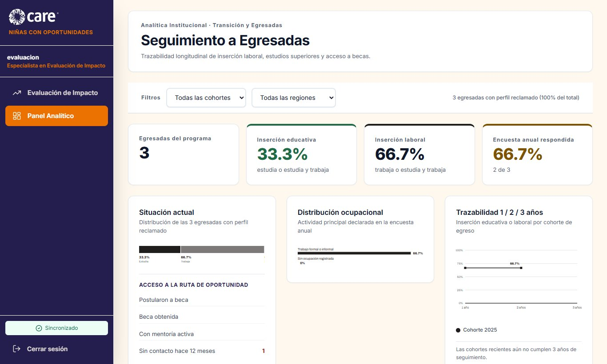

# Seguir la trayectoria de las egresadas

Tema 5 de la guía de [Evaluación de impacto](./index.md).

En **Seguimiento a Egresadas** ves qué pasa con las estudiantes después del colegio.

Esta pantalla todavía no tiene botón en el menú. Para abrirla, en la barra de direcciones del
navegador cambia lo que va después del nombre de la plataforma por **/analitica/egresadas** y presiona Enter.
Por ejemplo, `plataforma.ejemplo.pe/analitica/impacto` pasa a ser `plataforma.ejemplo.pe/analitica/egresadas`. Guárdala
en tus favoritos para volver con un clic.

El tablero muestra:

- **Inserción educativa** e **inserción laboral**: porcentaje que estudia o trabaja.
- **Encuesta anual respondida**: cuántas respondieron el seguimiento del año.
- **Situación actual**, **Distribución ocupacional** y **Trazabilidad 1 / 2 / 3 años** por cohorte.

Filtra por cohorte y región para comparar.

*Seguimiento a egresadas*
