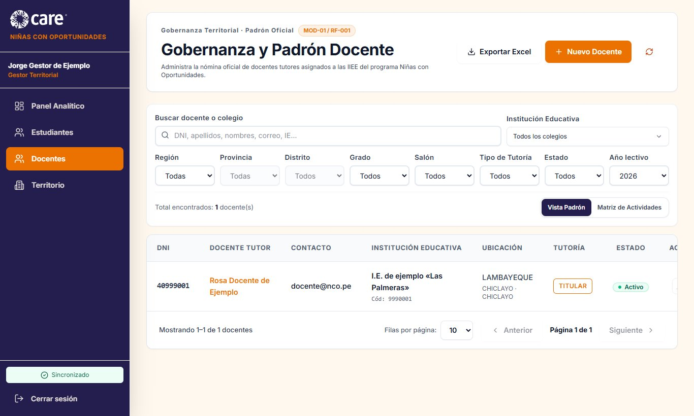
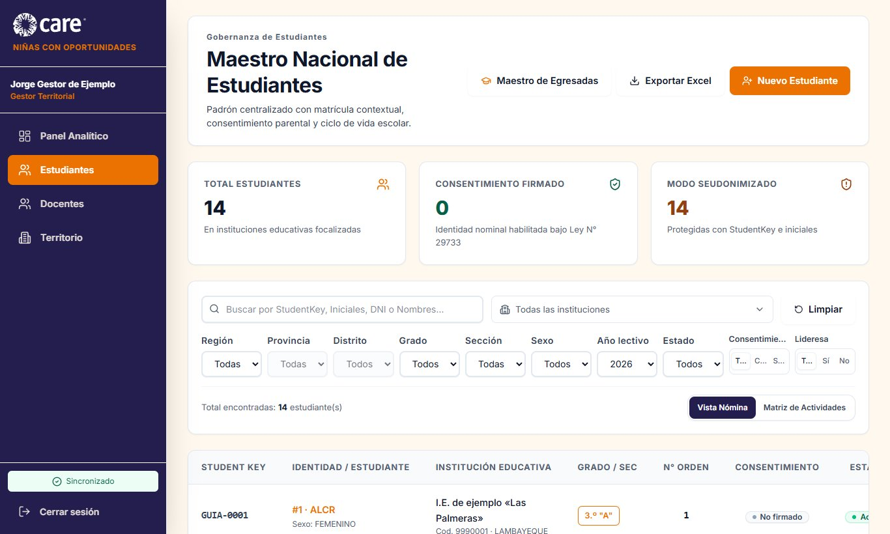
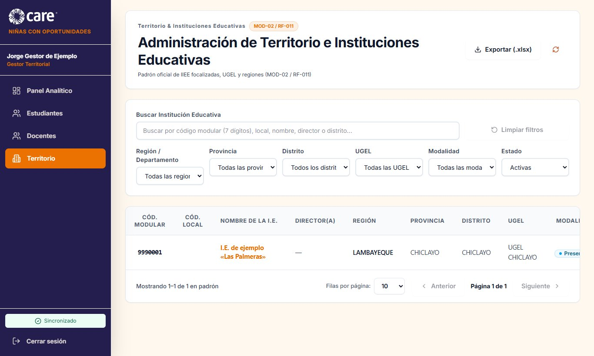

# Consultar docentes, estudiantes y colegios

Tema 8 de la guía de [Gestor territorial](./index.md).

Los módulos del menú muestran solo los registros de tu ámbito:

- **Docentes**: el padrón de docentes de tus colegios. Puedes registrar una docente con **Nuevo
  Docente** y abrir su ficha tocando su nombre.
- **Estudiantes**: la nómina de tus colegios. Puedes registrar una estudiante con **Nuevo
  Estudiante**.
- **Territorio**: tus colegios, con su código modular, UGEL y ubicación.

*Padrón docente del gestor*

*Nómina de estudiantes del gestor*

*Colegios del gestor*

Los pasos para registrar docentes y estudiantes son los mismos que en la guía de coordinación:
[Gestionar el padrón docente](../coordinacion/gestionar-el-padron-docente.md) y
[Registrar o importar estudiantes](../coordinacion/registrar-o-importar-estudiantes.md).
