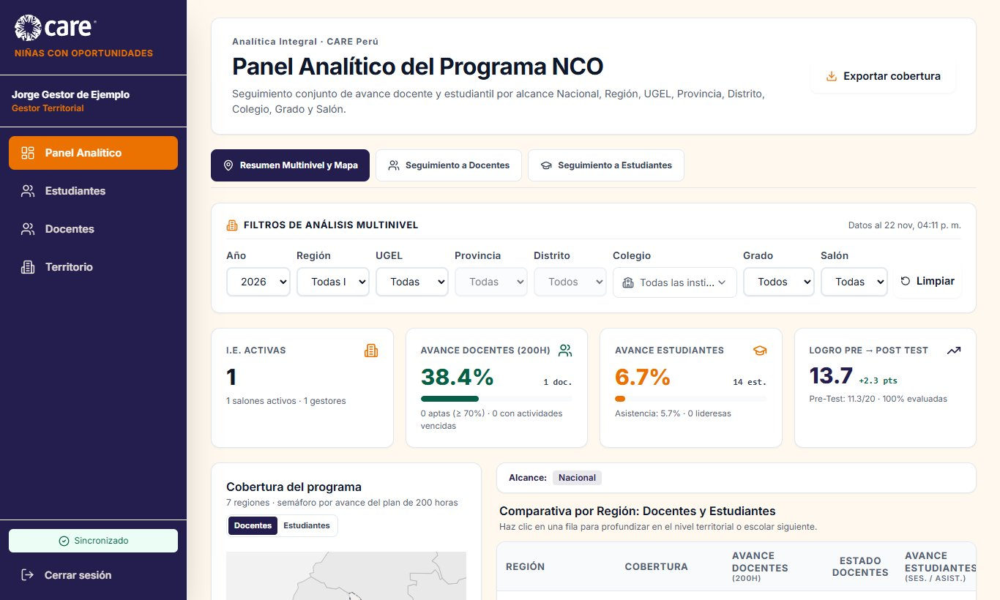

# Ingresar y conocer tu menú

Tema 1 de la guía de [Gestor territorial](./index.md).

1. Abre la dirección de la plataforma en el navegador e ingresa con tu correo institucional o
   DNI y tu contraseña. Si la coordinación acaba de crear tu cuenta, tu usuario y tu clave
   temporal son tu DNI, y en el primer ingreso la plataforma te pide cambiarla. El paso a paso
   está en [Ingresar a la plataforma](../docente/ingresar-a-la-plataforma.md) de la guía docente:
   la pantalla de ingreso es la misma para todos.
2. La plataforma abre el **Panel Analítico** de tu ámbito.
3. El menú tiene **Panel Analítico**, **Estudiantes**, **Docentes** y **Territorio**.
4. Tu **cartera de docentes** y la **cola de evidencias** todavía no tienen botón en el menú: en
   los temas siguientes se explica cómo abrirlas.

*Panel analítico del gestor*

El panel muestra los indicadores y el mapa de cobertura solo de tus colegios, aunque la etiqueta
**Alcance** diga «Nacional». Usa los filtros para ver una UGEL, un colegio o un salón. El panel se
explica en detalle en [Revisar el panel analítico](../coordinacion/revisar-el-panel-analitico.md).
