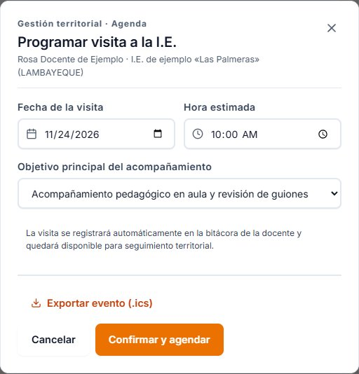

# Programar una visita al colegio

Tema 4 de la guía de [Gestor territorial](./index.md).

1. En la pestaña **Contacto y Bitácora** de la docente, toca **Programar visita** (debajo de
   **Guardar en bitácora**).
2. Elige la fecha, la hora y el objetivo principal del acompañamiento.
3. Si quieres tenerla en el calendario de tu celular o tu correo, toca **Exportar evento (.ics)**
   antes de confirmar: descarga un archivo que tu calendario abre y guarda.
4. Toca **Confirmar y agendar**. La visita queda registrada en la bitácora de la docente.

*Programar una visita a la I.E.*
