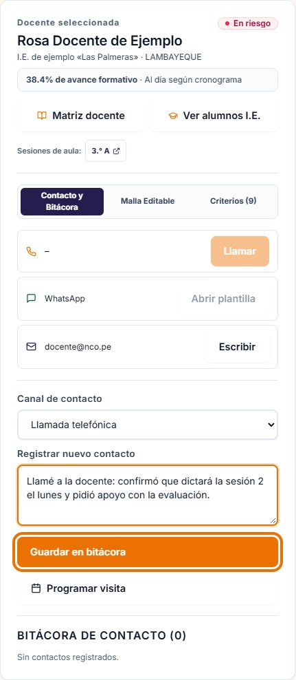
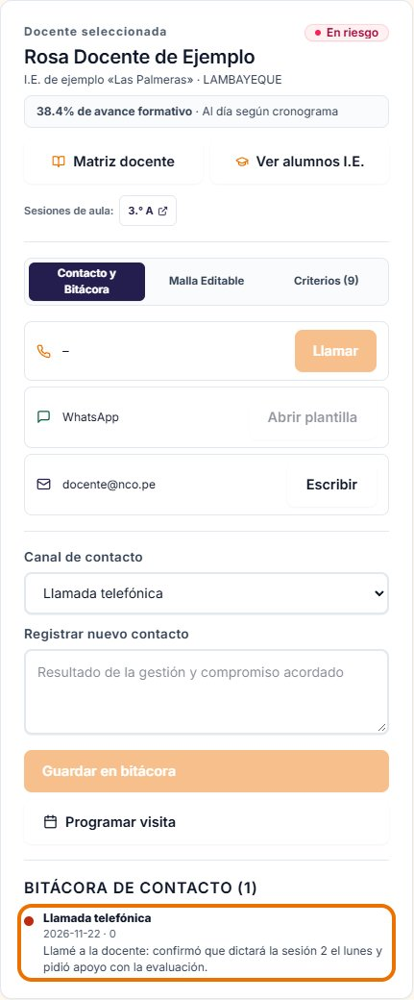

# Registrar un contacto con una docente

Tema 3 de la guía de [Gestor territorial](./index.md).

Cada llamada, mensaje o visita a una docente se registra en su **bitácora de contacto**:

1. En tu cartera, toca la fila de la docente.
2. En la pestaña **Contacto y Bitácora** del panel de la derecha, elige el **Canal de contacto**
   (visita, llamada o WhatsApp).
3. En **Registrar nuevo contacto**, escribe el resultado de la gestión y el compromiso acordado.
4. Toca **Guardar en bitácora**.

*Registrar un contacto en la bitácora*

El contacto aparece al final, en **Bitácora de contacto**, con su canal y fecha. Los botones
**Llamar**, **Abrir plantilla** (WhatsApp) y **Escribir** (correo) abren el canal directamente
si la docente tiene esos datos registrados.

*Contacto guardado en la bitácora*
