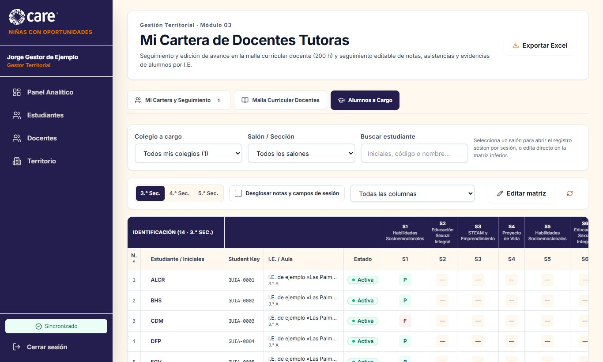

# Revisar a las estudiantes de tus colegios

Tema 6 de la guía de [Gestor territorial](./index.md).

La pestaña **Alumnos a Cargo** muestra, por grado, la asistencia de cada estudiante en cada sesión
(**P** presente, **F** falta). Marca **Desglosar notas y campos de sesión** para ver también las
notas.

*Asistencia de las estudiantes por sesión*

Si necesitas corregir un registro, toca **Editar matriz**. Para abrir el registro de una sesión,
elige un salón en el filtro **Salón / Sección**.
