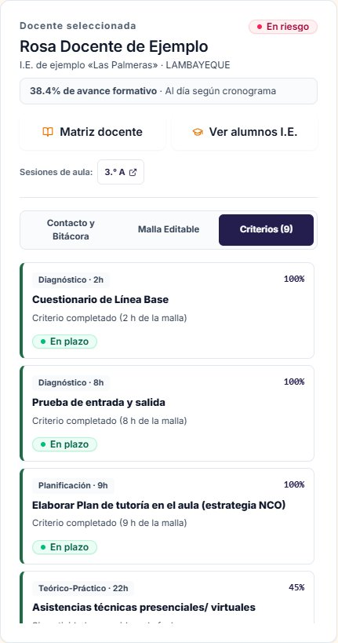
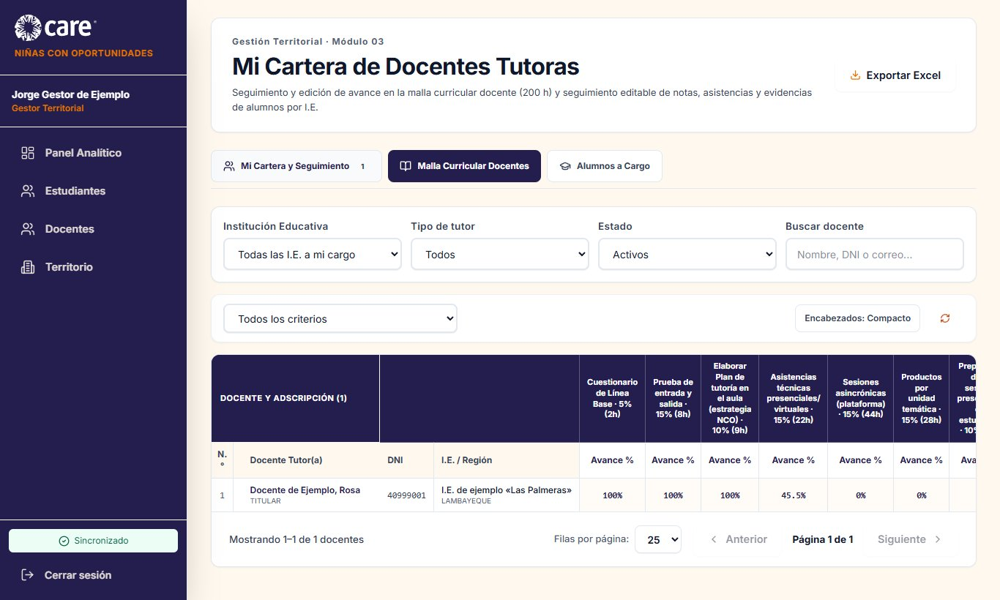

# Revisar el avance formativo de tus docentes

Tema 5 de la guía de [Gestor territorial](./index.md).

La pestaña **Criterios** del resumen de la docente muestra su avance en cada criterio del plan
formativo, con las horas de la malla y si está en plazo.

*Criterios del plan formativo de una docente*

La pestaña **Malla Curricular Docentes** muestra a todas tus docentes juntas, con el avance de cada
criterio en columnas. Puedes filtrar por colegio, tipo de tutor, estado y criterio, y **Exportar
Excel**.

*Malla curricular de las docentes de la cartera*
