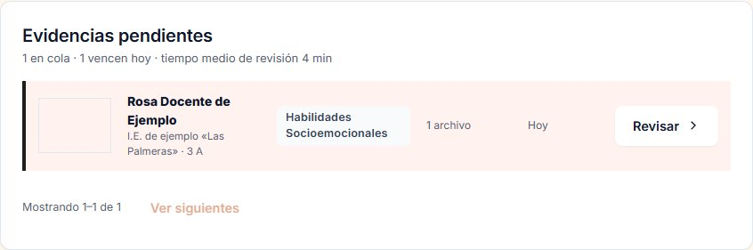

# Revisar evidencias de aula

Tema 7 de la guía de [Gestor territorial](./index.md).

En **Cola de Evidencias Pedagógicas** llegan las fotos y archivos que las docentes de tu región
suben al cerrar sus sesiones.

Esta pantalla todavía no tiene botón en el menú. Para abrirla, en la barra de direcciones del
navegador cambia lo que va después del nombre de la plataforma por **/evidencias** y presiona Enter.
Por ejemplo, `plataforma.ejemplo.pe/analitica/cobertura` pasa a ser `plataforma.ejemplo.pe/evidencias`. Guárdala
en tus favoritos para volver con un clic.

*Cola de evidencias pendientes*

1. Toca **Revisar** en una evidencia.
2. Elige el dictamen: **Aprobada**, **Requiere corrección** o **No cumple el estándar**.
3. Escribe la retroalimentación para la docente; ella la verá en su panel.
4. Toca **Registrar dictamen y pasar a la siguiente**.

El paso a paso con imágenes está en la guía de la voluntaria, que hace la misma revisión:
[Revisar una evidencia](../voluntaria/revisar-una-evidencia.md) y
[Registrar el dictamen](../voluntaria/registrar-el-dictamen.md).
