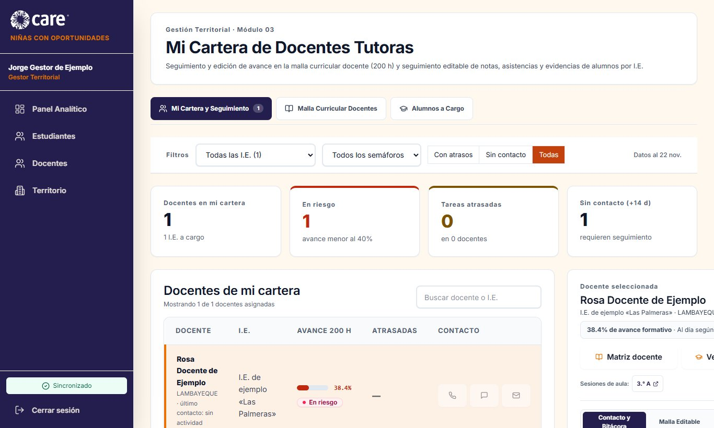

# Revisar tu cartera de docentes

Tema 2 de la guía de [Gestor territorial](./index.md).

En **Mi Cartera de Docentes Tutoras** ves a las docentes de tus colegios.

Esta pantalla todavía no tiene botón en el menú. Para abrirla, en la barra de direcciones del
navegador cambia lo que va después del nombre de la plataforma por **/cartera** y presiona Enter.
Por ejemplo, `plataforma.ejemplo.pe/analitica/cobertura` pasa a ser `plataforma.ejemplo.pe/cartera`. Guárdala
en tus favoritos para volver con un clic.

En la cartera encontrarás:

- Los indicadores de arriba cuentan las docentes **en riesgo** (avance bajo en el plan
  formativo), con **tareas atrasadas** y **sin contacto** en las últimas dos semanas.
- Los filtros **Con atrasos** y **Sin contacto** muestran a quién priorizar.
- La tabla indica el avance de cada docente en el plan formativo y su último contacto.

*Cartera de docentes del gestor*

Toca a una docente para ver su resumen a la derecha: avance formativo, sus salones y los botones
**Matriz docente** y **Ver alumnos I.E.** Debajo hay tres pestañas: **Contacto y Bitácora**,
**Malla Editable** (para corregir el avance de la docente en cada actividad) y **Criterios**.
