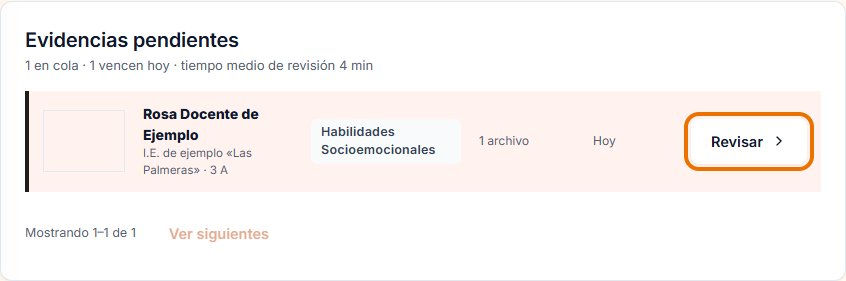

# Ingresar y abrir la cola de evidencias

Tema 1 de la guía de [Voluntaria de evidencias](./index.md).

1. Abre la dirección de la plataforma en el navegador e ingresa con tu correo o DNI y tu
   contraseña. El paso a paso está en
   [Ingresar a la plataforma](../docente/ingresar-a-la-plataforma.md) de la guía docente.
2. La plataforma abre la **Cola de Evidencias Pedagógicas**. Es tu única opción del menú.
3. Cada fila es una evidencia: la docente, su colegio y sección, el eje temático, la cantidad de
   archivos y cuándo se subió.
4. Toca **Revisar** en la evidencia que vas a dictaminar.

*Cola de evidencias con el botón Revisar*
