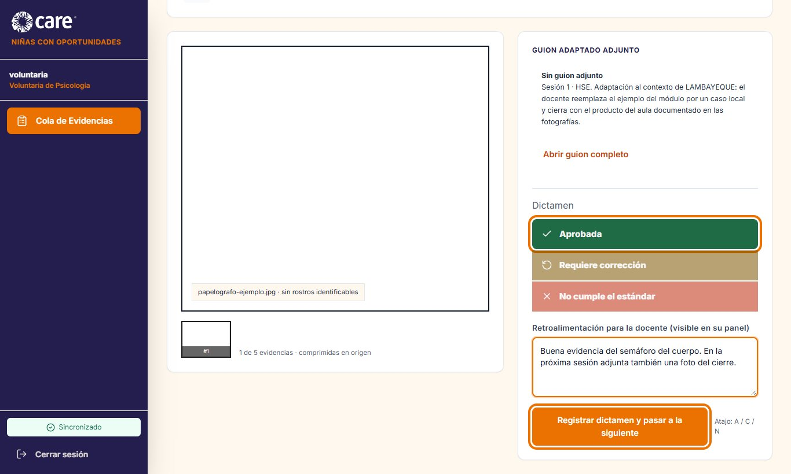

# Registrar el dictamen

Tema 3 de la guía de [Voluntaria de evidencias](./index.md).

Hay tres dictámenes posibles:

- **Aprobada**: la evidencia cumple lo que pide la sesión.
- **Requiere corrección**: la docente debe completar o rehacer algo.
- **No cumple el estándar**: la evidencia no corresponde a la sesión.

1. Elige el dictamen.
2. Escribe la **retroalimentación para la docente**. Ella la verá en su panel: sé concreta y
   propón una mejora. El cuadro trae un texto de ejemplo: reemplázalo por el tuyo.
3. Toca **Registrar dictamen y pasar a la siguiente**. La plataforma guarda el dictamen y abre la
   siguiente evidencia de la cola.

*Dictamen aprobado con retroalimentación*

En la computadora puedes usar el teclado: **A** (aprobada), **C** (corrección) y **N** (no cumple).
