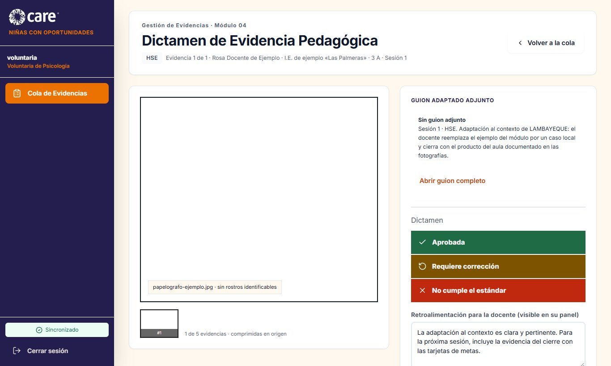

# Revisar una evidencia

Tema 2 de la guía de [Voluntaria de evidencias](./index.md).

La pantalla **Dictamen de Evidencia Pedagógica** muestra arriba la sesión, el eje, la docente y el
colegio. A la izquierda están los archivos de la evidencia; a la derecha, el guion adaptado que
adjuntó la docente y el formulario del dictamen.

1. Lee arriba el **eje** y el **número de sesión**: la evidencia debe mostrar el trabajo de esa
   sesión.
2. Mira la foto grande de la izquierda. Si la evidencia tiene varias fotos, toca las miniaturas de
   abajo para verlas una por una.
3. Lee el **guion adaptado**: explica cómo la docente adaptó la sesión. Si dice **Sin guion
   adjunto**, la docente no subió un guion propio y debajo aparece el resumen de la sesión.
4. **Volver a la cola** te regresa a la lista sin registrar nada.

*Pantalla de dictamen de una evidencia*
